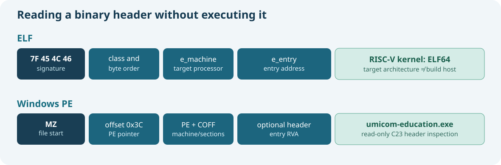

# 74. Inspect ELF, PE and COFF files with C23

A file does not need to be running for us to learn something about the machine code it contains. The first bytes of a compiled file often identify its format, target processor and internal structure. An inspection tool reads those bytes as **data**; it does not execute the programme.

Umicom Framework now contains a small C23 inspector that recognises three common binary containers: ELF, PE and ordinary COFF objects.



## 1. Understand three file formats

**ELF (Executable and Linkable Format)** is widely used for Linux executables, shared objects, compiler object files and freestanding kernel images. Umicom Kernel's RISC-V64 boot image is an ELF file.

**PE (Portable Executable)** is the usual container for Windows executable images and many Windows libraries. A Windows GCC build of `umicom-education.exe` will normally have a PE header.

**COFF (Common Object File Format)** is used by ordinary Windows `.obj` or `.o` object files before final linking. A Windows object file may be COFF even though the finished `.exe` is PE.

A library archive such as `.a` is a separate kind of container that may hold several object files. This lesson's native inspector does not yet parse archives. Use your toolchain's `ar` utility or `nm` to inspect their members.

## 2. Build the native inspector

First, merge this batch into the Umicom Framework repository. From `C:\umicom\Umicom-Applications`:

```powershell
$env:Path = "C:\msys64\ucrt64\bin;$env:Path"
cmake -S ".\framework\tools\umicom-education" `
    -B ".\build\umicom-education" -G Ninja `
    -DCMAKE_C_COMPILER="C:\msys64\ucrt64\bin\gcc.exe" `
    -DBUILD_TESTING=ON
cmake --build ".\build\umicom-education" --parallel 2
ctest --test-dir ".\build\umicom-education" --output-on-failure
```

Then inspect the compiled education tool itself:

```powershell
& ".\build\umicom-education\bin\umicom-education.exe" binary `
    --file ".\build\umicom-education\bin\umicom-education.exe"
```

You should see fields similar to these (exact counts and addresses depend on your compiler):

```text
Format: PE
Type: Portable Executable image
Architecture: x86-64
Address width: 64 bits
Endianness: little
Sections: ...
Entry point (RVA): 0x...
File size: ... bytes
```

The command works without Python, MkDocs or a Bits2Banking checkout path. It opens a file read-only and does not attempt to start or disassemble the inspected code.

## 3. Find the fields in an ELF header

An ELF file begins with four identifying bytes:

```text
7f 45 4c 46
```

The first byte is hexadecimal `7f`, and the last three are the ASCII letters `ELF`. The next bytes identify the address class and byte order. Common values are `2` for 64-bit ELF and `1` for little-endian storage.

The `e_machine` field identifies the target ISA. For example, the RISC-V value is **243**, and the x86-64 value is **62**. Those numbers describe the binary's intended processor; they do not say which processor is running the inspection tool.

The `e_entry` field contains an entry address. For Umicom Kernel's first-boot RISC-V example, the documented `_start` address is `0x80200000`. That is a linker-selected address for the target kernel image, not a Windows process address.

## 4. Find the fields in a PE header

A PE image typically begins with the letters `MZ`. A four-byte number at file offset `0x3c` points to a later `PE` signature. After that signature is a COFF-style header containing the machine identifier and section count.

For PE32+ images, the optional header's magic number is `0x20b`. It indicates the PE32+ format, commonly used by 64-bit Windows images. The inspector reports the **AddressOfEntryPoint** field as an RVA (relative virtual address), not as an absolute process address. The loader combines an image base and an RVA when it maps an image.

Why does this distinction matter? Printing `0x1200` as a complete virtual address would be misleading. It may identify an offset within a mapped image, not an address usable without loading that image.

## 5. Read bytes without unsafe structure casts

Open [Framework's binary inspector](https://github.com/umicom-foundation/umicom-framework/blob/main/src/education/binary_inspect.c). The implementation reads small unsigned integers from individual bytes instead of casting an untrusted file buffer to a packed C structure.

For example, a little-endian 16-bit value can be reconstructed as:

```c
uint16_t value = (uint16_t)((uint16_t)bytes[0] |
                            (uint16_t)((uint16_t)bytes[1] << 8U));
```

This is safe only after checking that **at least two bytes are present**. The real parser performs bounded-range checks before reading each header. It also checks the declared section count against the total file size without computing an overflowing `offset + count * size` expression.

A header that announces a section table beyond the end of the file is rejected. The output report is not overwritten when parsing fails.

## 6. Run the regression tests

The `framework.education.binary_inspect` test checks handcrafted ELF32, ELF64, PE32, PE32+ and COFF headers, malformed offsets and unchanged output on errors. It also opens the actual test executable and a fixture file in a path containing spaces. The `framework.education.binary.cli` test runs the public command against the real education executable.

```powershell
ctest --test-dir ".\build\umicom-education" `
    -R "^framework\.education\.binary" --output-on-failure
```

This confirms the limited inspection contract. It does **not** prove the entire binary file is trustworthy, safe to execute or correctly linked.

## 7. Inspect a C object and a kernel image

Build the [course catalogue library](https://github.com/umicom-foundation/Bits2Banking/tree/main/labs/native/course-catalogue-library) from Lesson 73. Then find the generated `catalogue.c.obj` or `.o` file inside the CMake build directory and pass its exact path to `umicom-education binary --file`.

On Windows UCRT64 you should normally see **COFF**. For an Umicom Kernel `umicom-kernel.elf` from the RISC-V QEMU build, you should see **ELF**, architecture **RISC-V**.

The inspector recognises a header; more advanced `readelf`, `objdump` and debuggers can examine symbols, section contents and disassembled instructions.

**Exercise:** Explain why an x86-64 Windows tool can inspect a RISC-V64 ELF file without being able to execute its instructions. What changes between a `.o` and an `.exe` after linking?

**Continue:** [Lesson 75 — processors and calling conventions](75-abi-stack-and-calling-conventions.md).
