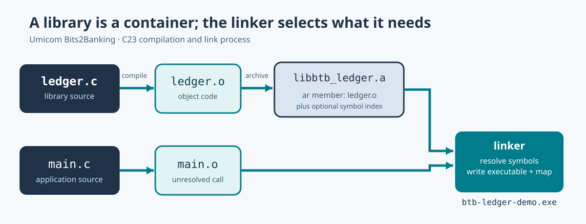

# 77. Understand static libraries and archive files

A large programme rarely consists of one source file. An application may need a ledger calculation, a document store, a database adapter and a user interface. Each component can be compiled separately. The **linker** combines the pieces needed to produce the final programme.

A **static library** is a container of compiled object files. With GCC and Clang, the container commonly ends in `.a`. Microsoft toolchains often use `.lib`. The container is not itself an executable programme.



## 1. Begin with two source files

In the [static-library-map laboratory](https://github.com/umicom-foundation/Bits2Banking/tree/main/labs/native/static-library-map), the public header declares functions for adding amounts expressed in whole pence:

```c
BtbLedgerStatus BtbLedgerTotalPence(
    const uint64_t *entries,
    size_t count,
    uint64_t *outTotal);
```

The declaration tells another source file how to call the function. Its implementation lives in `src/ledger.c`. The application in `src/main.c` includes the header, but it does not copy the library's source code into the application.

Compilation therefore proceeds in stages:

1. Compile `ledger.c` into an object file.
2. Place that object into a static archive.
3. Compile `main.c` into another object file.
4. Ask the linker to resolve the application's references using the library.
5. Run the resulting application.

If `main.c` calls `BtbLedgerTotalPence` and the library is missing from the link operation, compilation may succeed but the link fails with an unresolved external symbol.

## 2. Build the practical example

Open PowerShell:

```powershell
Set-Location "C:\umicom\Umicom-Bits2Banking"
$env:Path = "C:\msys64\ucrt64\bin;$env:Path"

cmake -S ".\labs\native\static-library-map" `
    -B ".\output\learning-build\static-library-map" `
    -G Ninja `
    -DCMAKE_C_COMPILER="C:\msys64\ucrt64\bin\gcc.exe"

cmake --build ".\output\learning-build\static-library-map" --parallel 2
ctest --test-dir ".\output\learning-build\static-library-map" --output-on-failure
```

Two tests should pass. Run the application:

```powershell
& ".\output\learning-build\static-library-map\btb-ledger-demo.exe"
```

It prints a fictional learning-fund total of **GBP 504.00**. The values use integers representing pence, not floating-point approximations.

## 3. What is inside an `.a` file?

An ordinary Unix `ar` archive begins with these eight bytes:

```text
!<arch>\n
```

Each archive member then has a fixed-width, 60-byte header followed by its data. A member header includes the name, modification time, owner, mode, data size and a two-byte marker. If the data size is odd, a padding byte aligns the next header.

This simple layout is part of the reason static archives have been useful for many decades. The format is independent of the programme's entry point and does not need an operating-system loader.

**Names need special care.** A short member name can fit inside the 16-byte name field. GNU archives can put long names in a separate `//` table and refer to them by numeric offsets. BSD archives can place a long name at the start of the member data with a `#1/length` header field. The stored name may include trailing NUL padding, which must not be treated as part of the displayed filename.

The parser must distinguish these name encodings from the actual object bytes. Treating a `//` name table as a programme object would be incorrect.

## 4. Inspect the archive with Umicom's C23 tool

Build `umicom-education` using the Framework instructions for this update. Then run:

```powershell
Set-Location "C:\umicom\Umicom-Applications"

& ".\build\umicom-education\bin\umicom-education.exe" archive `
    --file "C:\umicom\Umicom-Bits2Banking\output\learning-build\static-library-map\libbtb_ledger.a"
```

Typical output:

```text
Format: ar
Archive size: ... bytes
Members: 1
Object members: 1
Index/name-table members: ...
  ledger.c.obj : ... bytes (object)
```

The exact file size, object suffix and metadata count depend on the compiler and archive tool.

The implementation is in [Umicom Framework's archive inspector](https://github.com/umicom-foundation/umicom-framework/blob/main/src/education/archive_inspect.c). It is written in C23 and reads the archive as data. It never executes or extracts the members.

## 5. Learn why the parser checks sizes first

A malformed archive could claim that a member contains a billion bytes even when the file contains only a few hundred. A safe parser does not calculate `start + declaredSize` and assume the result is valid. Instead it checks that `start` is inside the file and that `declaredSize <= fileLength - start`.

The Framework parser also rejects malformed decimal lengths, invalid header endings, missing padding and long-name offsets outside their table. It preserves the caller's report when parsing fails. A thin archive (`!<thin>\n`) is intentionally not supported because its members reference external files rather than containing all object bytes.

This is a **read-only structural inspector**, not a signature verifier, antivirus scanner or complete ELF/COFF validator.

## 6. Connect the archive to the actual link

After examining the `.a` file, open the generated `btb-ledger-demo.map`. Find `libbtb_ledger.a` and look for the function that caused the linker to include the object.

A static archive provides available definitions; it does not automatically inject every object into the final executable. The linker usually extracts the members required to satisfy unresolved references, subject to linker and platform rules.

This is the key difference between **compiling** a library and **linking** an application against it.

## 7. Practical exercise

Modify the library's function so an empty list of amounts returns zero. Check that the existing test already expects this behaviour. Then inspect how the public header expresses the contract and how the test verifies it.

For the next lesson, read [Symbol visibility and link maps](78-symbol-visibility-and-linker-map.md).
