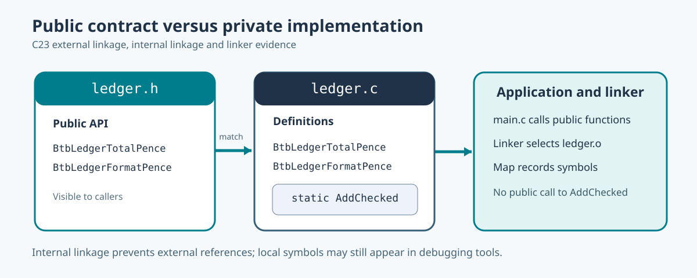

# 78. Understand public symbols, private functions and linker maps

When several object files become one programme, the linker has to answer an important question: **where is the implementation of every function used by this programme?**

A function declaration tells the compiler that a function exists. The object file records references to functions whose definitions may be in another object. The linker must connect those references to definitions.



## 1. Public functions can be called from other source files

Our laboratory contains a public header named `include/btb/ledger.h`. It declares:

```c
BtbLedgerStatus BtbLedgerTotalPence(
    const uint64_t *entries,
    size_t count,
    uint64_t *outTotal);
```

The implementation in `src/ledger.c` has the same function name and compatible parameter types. Because it is declared without `static`, it has external linkage in an ordinary C translation unit.

The application's `src/main.c` includes the public header and calls the function. At compile time, the compiler checks argument and return-value types. At link time, the linker locates the actual function definition.

## 2. Keep implementation helpers private

The same implementation contains:

```c
static BtbLedgerStatus AddChecked(
    uint64_t left, uint64_t right, uint64_t *out)
{
    if (right > UINT64_MAX - left)
        return BTB_LEDGER_OVERFLOW;

    *out = left + right;
    return BTB_LEDGER_OK;
}
```

The word `static` on a file-scope function gives it **internal linkage**. Other translation units cannot name that helper as an external function. That lets library authors change the helper without promising compatibility to unrelated applications.

Internal linkage is not encryption or complete information hiding. Debug information or a symbol table may still contain a *local* name for `AddChecked`. The distinction concerns which translation units can legally refer to the symbol.

## 3. Build and examine the library

From `C:\umicom\Umicom-Bits2Banking`, after building the [library laboratory](https://github.com/umicom-foundation/Bits2Banking/tree/main/labs/native/static-library-map):

```powershell
& "C:\msys64\ucrt64\bin\nm.exe" `
    ".\output\learning-build\static-library-map\libbtb_ledger.a"
```

For GNU-style `nm`, a capital `T` commonly marks a global function definition in an executable code section. A lowercase `t` commonly marks a local code symbol. These letters are tool-specific conventions, not C keywords.

Find `BtbLedgerTotalPence`, `BtbLedgerFormatPence` and, if present, `AddChecked`.

Next open the linker map:

```powershell
Select-String -Path `
    ".\output\learning-build\static-library-map\btb-ledger-demo.map" `
    -Pattern "btb_ledger"
```

The map shows which archive member was selected during the link and which symbols are associated with object files and sections. On GNU-style linkers the map often explains which unresolved reference caused an archive member to be included.

## 4. Why an undefined reference appears

Consider a source file with a declaration:

```c
uint64_t BtbLedgerTotalPenceExample(void);
```

A call can compile if the declaration is visible. But if no linked object defines the function, the linker cannot resolve the reference. The resulting error may say `undefined reference` on GCC or `unresolved external symbol` on Windows.

The correct response is not to duplicate the function in every caller. Check that the source defining it is compiled, that the library is part of the link, and that the name and calling convention match the declaration.

In CMake, a target expresses this dependency:

```cmake
target_link_libraries(btb-ledger-demo PRIVATE Bits2Banking::ledger)
```

`PRIVATE` means the dependency belongs to this executable's own link usage. When an exported library's public header requires another library's headers or symbols, its usage requirements may need `PUBLIC` or `INTERFACE` instead.

## 5. Object libraries, static libraries and shared libraries

An **object library** in CMake compiles source files into object files without creating a static archive. A **static library** packages compiled objects for later linking. A **shared library** is loaded or linked using a platform-specific dynamic-linking mechanism: DLL on Windows, `.so` on many Unix-like systems.

These are different build products and can carry different packaging and runtime requirements. A DLL requires more than a file extension change; exported interfaces, runtime discovery, binary compatibility and dependent DLLs must be considered.

For this exercise we deliberately use one static library. That makes the compile/link boundary observable without adding dynamic-loader complexity.

## 6. Practical exercise

Open `src/ledger.c` and find where `AddChecked` is called. Confirm that `ledger.h` does not expose it. Then locate the public symbols with `nm` and read the map. Explain why applications may depend on `BtbLedgerTotalPence` but should not depend on `AddChecked`.

Continue with [Relocations and position-independent code](79-relocations-and-position-independent-code.md).
