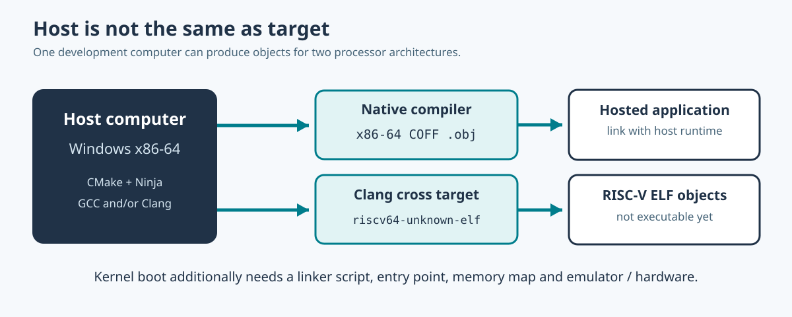

# 80. Cross-compile C23 and Assembly for RISC-V64

The processor that runs a compiler is not always the processor that will run the result. A developer working on Windows x86-64 can produce a RISC-V64 object file without owning a RISC-V computer.

This process is called **cross-compilation**.



## 1. Distinguish host and target

The **host** is the machine performing the build. The **target** is the architecture and system for which the machine instructions are generated.

For example, a Windows host may run a native GCC compiler targeting `x86_64-w64-mingw32`. Clang may also be able to generate object code for `riscv64-unknown-elf`.

The triple `riscv64-unknown-elf` describes a processor target and an ELF-oriented bare-metal environment. It does not mean that Windows suddenly understands RISC-V instructions. Nor does it provide a kernel, scheduler, C standard library or boot loader.

## 2. Compile for the host first

Start with the [cross-target-object laboratory](https://github.com/umicom-foundation/Bits2Banking/tree/main/labs/native/cross-target-object). It includes one small C23 source file that calculates a fingerprint from fictional boot arguments.

Open PowerShell:

```powershell
Set-Location "C:\umicom\Umicom-Bits2Banking"
$env:Path = "C:\msys64\ucrt64\bin;$env:Path"

cmake -S ".\labs\native\cross-target-object" `
    -B ".\output\learning-build\cross-target-host" `
    -G Ninja `
    -DCMAKE_C_COMPILER="C:\msys64\ucrt64\bin\gcc.exe"

cmake --build ".\output\learning-build\cross-target-host" --parallel 2
```

Find the resulting `.obj` file. Its header should describe the host toolchain's target, normally x86-64 COFF on UCRT64 Windows.

## 3. Prepare a RISC-V64 object build

The laboratory includes `toolchains/riscv64-clang.cmake`. This file tells CMake to select Clang and target `riscv64-unknown-elf`. CMake uses it during configuration, **before** deciding how to compile sources.

First check that Clang is installed:

```powershell
clang --version
```

Then configure using a *separate build directory*:

```powershell
$Toolchain = (Resolve-Path `
    ".\labs\native\cross-target-object\toolchains\riscv64-clang.cmake").Path

cmake -S ".\labs\native\cross-target-object" `
    -B ".\output\learning-build\cross-target-riscv64" `
    -G Ninja `
    "-DCMAKE_TOOLCHAIN_FILE=$Toolchain"

cmake --build ".\output\learning-build\cross-target-riscv64" --parallel 2
```

A successful build produces `probe.c.obj` and `riscv64_hart.S.obj`. It does not create an executable. The RISC-V object contains machine instructions that cannot be run directly by a Windows x86-64 process.

A Clang installation without the RISC-V target backend cannot complete this exercise. Use a cross-target-capable compiler, or continue with the host build and the architecture diagrams.

## 4. Examine the Assembly function

The file `riscv64_hart.S` contains:

```asm
BtbRiscvReadHartId:
    csrr a0, mhartid
    ret
```

`csrr` reads a processor control and status register. Here the register is `mhartid`, which identifies the running hardware thread, also known as a **hart**. The value is placed in `a0`, the RISC-V calling convention's first integer return register.

This code is not suitable for ordinary user-mode applications because `mhartid` is a privileged machine-mode register. We compile it for examination; **we do not execute it**.

The actual Umicom Kernel startup file also reads `mhartid`, but it performs additional essential work: selecting the boot hart, disabling interrupts before handlers exist, setting a stack pointer, clearing BSS and transferring control to `UmiKernelMain()`.

Read the original [Umicom Kernel Assembly source](https://github.com/umicom-foundation/umicom-kernel/blob/main/arch/riscv64/boot.S).

## 5. Inspect the generated object files

After the cross-target build, locate `probe.c.obj`:

```powershell
Get-ChildItem ".\output\learning-build\cross-target-riscv64" `
    -Recurse -File -Include "*.o", "*.obj"
```

Copy the complete path of a `.obj` file. From the Umicom Applications repository:

```powershell
Set-Location "C:\umicom\Umicom-Applications"
& ".\build\umicom-education\bin\umicom-education.exe" binary `
    --file "PASTE_RISCV64_OBJECT_PATH_HERE"
```

The inspector should report **ELF** and **RISC-V**, with a 64-bit address class. If a tool reports x86-64 or COFF instead, check whether you inadvertently inspected a host object.

## 6. What comes after object compilation?

Turning a relocatable object into a bootable kernel requires a linker script, entry symbol, initial memory layout, early platform I/O and a boot protocol. The Umicom Kernel project contains an actual RISC-V64 QEMU configuration with these features.

Do not copy a hosted application's startup files or link against the Windows C runtime when constructing a freestanding kernel. The boot environment does not provide them.

The next lesson explains how to stage a native learning application for delivery. For kernel development, continue with [Freestanding C23 and Umicom Kernel boot](../06-umicom/76-freestanding-c-and-umicom-kernel.md).
