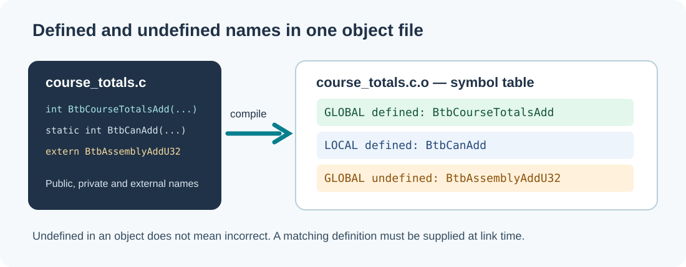

# 82. Read ELF symbols and find a missing function

You have compiled a C source file successfully, but the final application cannot link. The compiler says the declaration in the header is valid; the linker says it cannot find the function's implementation. To understand the difference, we will inspect the **symbol table** inside an object file without running it.

A *symbol* is a name associated with something the linker may need: a function, a variable, or another address-bearing entity. In a C program, a declaration tells the compiler a symbol exists. A definition supplies its implementation or storage. The linker needs to connect references to definitions.



## 1. Prepare a small C23 library

Open PowerShell and locate the previously introduced linker laboratory:

```powershell
Set-Location "C:\umicom\Umicom-Bits2Banking"
Get-ChildItem ".\labs\native\linker-relocations"
```

The files of interest are:

- `include/btb/course_totals.h`: public declarations.
- `src/course_totals.c`: checked C23 implementation.
- `asm/add_x86_64.S`: external Assembly function on Windows x64 or Linux x86-64.
- `src/main.c`: application calling the library.

In the header, this declaration does not yet create executable machine code:

```c
int BtbCourseTotalsAdd(uint32_t existing, uint32_t added,
                       uint32_t *outTotal);
```

In `course_totals.c` the function is **defined**. Its compiled object exports a symbol so another translation unit can call it. The source also contains a `static` helper named `BtbCanAdd`. Here, `static` gives the helper **internal linkage**: it cannot be resolved by name from a different object file.

The function `BtbAssemblyAddU32` is declared in the C file but implemented in Assembly. The C object therefore has an **undefined reference** until the Assembly object is linked with it. Undefined does not automatically mean erroneous; an undefined symbol in an intermediate object may be perfectly normal.

## 2. Compile without linking

Add the MSYS2 UCRT64 compiler to this PowerShell session, and build just the C source:

```powershell
$env:Path = "C:\msys64\ucrt64\bin;$env:Path"

New-Item -ItemType Directory -Force -Path ".\output" | Out-Null

& "C:\msys64\ucrt64\bin\gcc.exe" `
  -std=c23 -Wall -Wextra -Wpedantic -O0 -g `
  -I ".\labs\native\linker-relocations\include" `
  -c ".\labs\native\linker-relocations\src\course_totals.c" `
  -o ".\output\course_totals.o"
```

The `-c` option tells GCC to compile an **object**, not a finished executable. The `-o` option chooses its filename. The output object is normally **COFF** on Windows and **ELF** on Linux. The source-level relationships are the same, but the file-format layout is not.

On Windows, inspect the symbols with the toolchain's object inspector:

```powershell
& "C:\msys64\ucrt64\bin\nm.exe" ".\output\course_totals.o"
```

Look for a defined external `BtbCourseTotalsAdd`, a local `BtbCanAdd` when it was not optimised away, and the undefined `BtbAssemblyAddU32`. `nm` often uses `T` for global code and `U` for undefined symbols; letter conventions and decoration depend on the object format and compiler.

## 3. Inspect a real ELF object with Umicom Framework

The Framework-owned native tool from this update has a focused ELF reader:

```text
umicom-education symbols --file ELF_OBJECT_OR_IMAGE
```

**Windows GCC objects are COFF, not ELF.** Do not pass `course_totals.o` from Windows to this command and expect it to work. The command rejects non-ELF files rather than guessing the format.

You can use an ELF object from a Linux build or an existing RISC-V64 cross-compilation exercise. On Linux, after building the laboratory, locate an `.o` in the build directory and run:

```bash
# Run these on a Linux host, from a configured Umicom development checkout.
./build/umicom-education/bin/umicom-education symbols --file \
  ./output/learning-build/linker-relocations/CMakeFiles/btb_course_totals.dir/src/course_totals.c.o
```

The exact executable and object paths depend on the build directory you selected. You can also use the native ELF sample fixture produced by the `framework.education.elf_symbols` CTest test. Run the test first, then inspect that `.o` using its build-directory path.

The Framework output identifies the ELF width, endianness, symbol and relocation counts, followed by a bounded sample of symbol names. For example, a test fixture reports two global names: one defined function and one undefined reference. The counts are from the object you inspect, so real compiler output will differ.

## 4. How the ELF parser avoids trusting its input

Open the Framework source:

[`src/education/elf_symbols.c`](https://github.com/umicom-foundation/umicom-framework/blob/main/src/education/elf_symbols.c)

The parser does not cast untrusted file bytes to `Elf64_Ehdr *`. Such casts can depend on host alignment, byte order and compiler structure padding. Instead, it reads individual fields using explicit byte order and validates every table range before accessing it.

A section header identifies the symbol-table location and its linked string table. The symbol's `st_name` field is an offset into that string table. A valid offset alone is not enough: the name must also terminate before the end of the table. Invalid offsets are rejected before text is copied.

The reader reports at most 16 symbol names but counts all accepted entries. That is a display bound, **not** an assertion that the object contains only 16 symbols. Its current input size limit is 32 MiB. It does not disassemble, modify or execute files.

## 5. Try it yourself

Compile the Assembly object as well, then build the complete laboratory with the instructions in its README. Inspect the C and Assembly object files with `nm`. Which symbol moves from *undefined* in the C object to *defined* in the Assembly object?

Next, comment out the Assembly source in a **temporary copy** of the laboratory's `CMakeLists.txt`, reconfigure and attempt a build. It should fail during **linking**, not C parsing. Restore the original configuration afterwards.

### Check your understanding

1. What is the difference between a declaration and a definition?
2. Why can an object file contain unresolved references without being broken?
3. Why are symbol names stored in a separate string table?
4. Why is it incorrect to interpret a Windows COFF object as ELF?
5. What changes when a function is declared `static` in C?

**Next:** [83. Relocations and the linker's decisions](83-follow-relocations-and-linker-decisions.md).
