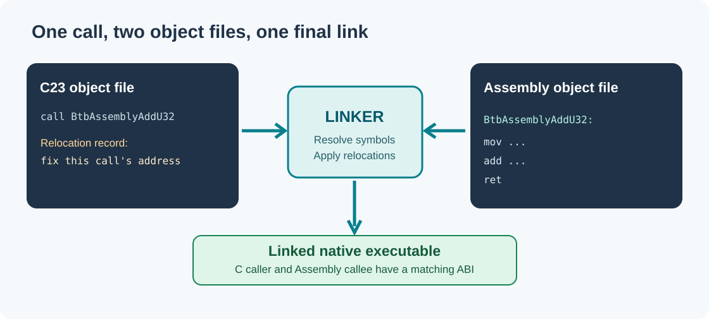

# 83. Follow relocations from an object file to a linked application

A compiler can generate an instruction that calls another function even when it does not yet know that function's final address. It records enough information for the linker to finish the job. This information is called a **relocation**.

Consider two source files: a C file that calls `BtbAssemblyAddU32()` and an Assembly file that defines it. Compiling the first source produces instructions and a relocation request. Compiling the second produces the function's machine code. Linking both lets the linker resolve the symbol and adapt the instruction encoding for the target.



## 1. Understand what the compiler knows

In the C23 source:

```c
extern uint32_t BtbAssemblyAddU32(uint32_t left, uint32_t right);
```

The compiler knows the function's name, parameter types and return type. It does **not** know whether the final implementation will be in an Assembly object, a C object or a library. Calling conventions are fixed by the ABI used to compile the caller; the implementation must follow the same ABI.

On Windows x64, the first two integer arguments normally arrive in `ECX` and `EDX`; on Linux System V x86-64 they arrive in `EDI` and `ESI`. A RISC-V64 function receives them in `a0` and `a1`. This is why the laboratory selects one Assembly source per target architecture.

## 2. Build the real C23/Assembly example

```powershell
Set-Location "C:\umicom\Umicom-Bits2Banking"
$env:Path = "C:\msys64\ucrt64\bin;$env:Path"

cmake -S ".\labs\native\linker-relocations" `
  -B ".\output\learning-build\linker-relocations" `
  -G Ninja `
  -DCMAKE_C_COMPILER="C:\msys64\ucrt64\bin\gcc.exe"

cmake --build ".\output\learning-build\linker-relocations" --parallel 2
ctest --test-dir ".\output\learning-build\linker-relocations" --output-on-failure
```

The laboratory builds a static library, an application and an independent test executable. It tests 16,384 combinations of small integer inputs and checks that a refused overflow does not change the previous output value.

The demonstration application prints:

```text
Bits2Banking learning path: 21 lessons
```

This count is an illustrative training value; it is not a claim about the number of chapters in the repository.

## 3. Inspect the relocations

On Windows, inspect a freshly compiled object using the native toolchain:

```powershell
& "C:\msys64\ucrt64\bin\objdump.exe" `
  -r ".\output\course_totals.o"
```

`-r` asks for relocation records in the object file. On Windows the machine format will be COFF. On Linux, the equivalent command can show ELF relocations:

```bash
objdump -r ./output/course_totals.o
readelf -r ./output/course_totals.o
```

`readelf` is an ELF-specific inspection utility; it is not suitable for COFF. A relocation contains a location in a section, a relocation type, and a reference to a symbol or section. Some formats store an **addend** explicitly; others keep it in the encoded instruction or data being relocated.

The initial Framework ELF inspector introduced here counts `SHT_REL` and `SHT_RELA` entries. It does not currently resolve each relocation to a destination or apply relocation patches. That distinction matters: *inspecting* a linker record is not the same as *implementing* a linker.

## 4. What changes after linking?

A relocatable object (`ET_REL` in ELF) may contain references to symbols it does not define. An executable or shared object has had those references processed according to the chosen linking model. Some references can remain for the dynamic loader to resolve later.

When a native application starts, the operating-system loader maps its executable sections and any required shared libraries into memory. The loader is not the same as the kernel's early boot entry: the **Umicom Kernel** begins before a normal user-space loader exists.

A successful link is not proof that a program is safe. The linker checks names and binary interfaces to the extent the toolchain and metadata allow; it cannot establish that every pointer has a valid lifetime or that a financial amount was validated correctly.

## 5. Make one change and predict the outcome

In a temporary copy of the laboratory, rename the Assembly label from `BtbAssemblyAddU32` to `BtbAssemblyAddU32Renamed` while leaving the C declaration unchanged. Compile again. The assembler should accept its source, but the linker should report an unresolved `BtbAssemblyAddU32` symbol.

Restore the original Assembly label. Now change the C function name in both its header and implementation, rebuild and run the test. This change should link successfully because its public declaration and definition agree.

### Questions

1. What can be known about a function before its address is assigned?
2. Which file usually contains a relocation: the object or the header?
3. What is a difference between `REL` and `RELA`?
4. Why does a native Windows object not work with an ELF-only inspector?
5. Where can dynamic linking delay address resolution until programme startup?

**Next:** [84. Sections and linker scripts](84-read-sections-and-linker-scripts.md).
