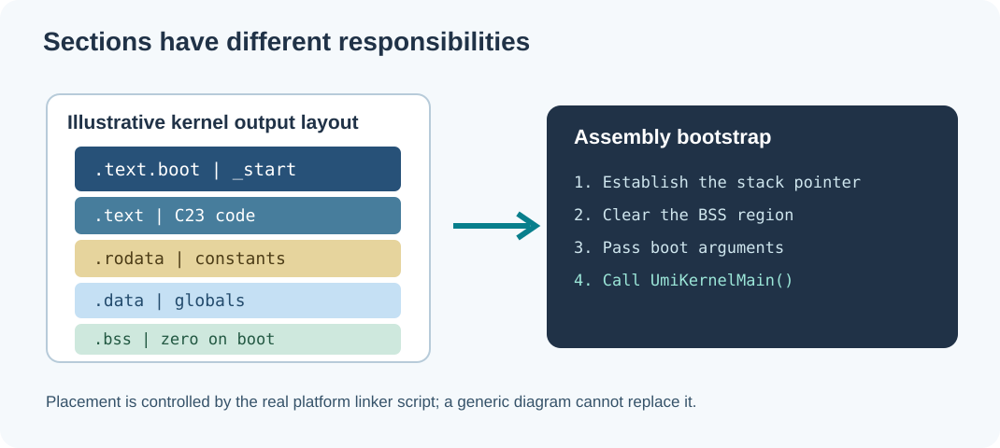

# 84. Give code and data their places with sections and linker scripts

A compiler does not normally put every byte of a program into one undifferentiated block. It arranges machine instructions, constants, variables and metadata into **sections**. The linker combines input sections and decides where the corresponding output sections belong.

In an ordinary application, the operating system and executable format determine much of this placement. In a freestanding kernel, the project may supply a **linker script** because it must choose the memory addresses used before an operating system is available.



## 1. Recognise four common sections

| Section | Typical contents | How to think about it |
| --- | --- | --- |
| `.text` | CPU instructions | Code that can be executed |
| `.rodata` | String literals and read-only constants | Data the program need not modify |
| `.data` | Globals with explicit nonzero initial values | Writable data stored in the image |
| `.bss` | Zero-initialised or uninitialised static-storage objects | Writable memory whose initial value is zero |

These are common conventions, not absolute rules. A linker script or compiler can create additional sections and change placement. `.bss` commonly occupies memory but does not require its full zero-filled contents to be stored in the executable file.

## 2. Inspect a compiled laboratory object

```powershell
Set-Location "C:\umicom\Umicom-Bits2Banking"
$env:Path = "C:\msys64\ucrt64\bin;$env:Path"

cmake -S ".\labs\native\linker-relocations" `
  -B ".\output\learning-build\linker-relocations" -G Ninja `
  -DCMAKE_C_COMPILER="C:\msys64\ucrt64\bin\gcc.exe"
cmake --build ".\output\learning-build\linker-relocations" --parallel 2
```

Find the object file produced from `course_totals.c` under `output/learning-build/linker-relocations/CMakeFiles/`. Then run:

```powershell
& "C:\msys64\ucrt64\bin\objdump.exe" -h "PATH_TO_OBJECT_FILE"
```

Replace `PATH_TO_OBJECT_FILE` with the actual object file found in your build tree. The `-h` option lists section headers. Compare the `.text` size with the object created from the short Assembly implementation. The Assembly file only contains a small leaf function, so its code should be brief.

## 3. Examine the Umicom Kernel bootstrap

Read the actual source:

- [Umicom Kernel `arch/riscv64/boot.S`](https://github.com/umicom-foundation/umicom-kernel/blob/main/arch/riscv64/boot.S)
- [Umicom Kernel first-boot explanation](https://github.com/umicom-foundation/umicom-kernel/blob/main/docs/FIRST_BOOT.md)
- [Umicom Kernel build and test commands](https://github.com/umicom-foundation/umicom-kernel/blob/main/docs/BUILD_AND_TEST.md)

At the start of the RISC-V Assembly file you will see a section declaration:

```asm
.section .text.boot, "ax", @progbits
```

This tells the assembler to place the following instructions in a named **executable** section. The linker can then arrange the boot entry before ordinary functions. The source later sets up the stack and clears the `.bss` region before calling C23 code.

Why clear `.bss`? In C, an object with static storage duration and no explicit initializer begins with zero-equivalent state. A normal application benefits from runtime and loader setup. A freestanding boot path must establish the required guarantees for itself.

## 4. Linker scripts express a target memory contract

A simple illustrative linker script can contain:

```ld
ENTRY(_start)
SECTIONS
{
    . = 0x80200000;
    .text : { *(.text.boot) *(.text*) }
    .rodata : { *(.rodata*) }
    .data : { *(.data*) }
    .bss : { *(.bss*) *(COMMON) }
}
```

This **illustration is not the Umicom Kernel's complete linker script**. It omits alignment constraints, stack reservation, physical-memory bounds and other necessities. Do not replace the working Kernel script with it. Instead, study the real [linker script in the Umicom Kernel repository](https://github.com/umicom-foundation/umicom-kernel/tree/main/arch/riscv64) and compare the decisions.

The address `0x80200000` is used by the project's documented QEMU RISC-V64 first-boot configuration. It is not a universally correct address for RISC-V devices.

## 5. Examine, do not overwrite, the running kernel experiment

After the toolchain is configured according to the Kernel's Windows setup documentation:

```powershell
Set-Location "C:\umicom\umicom-kernel"
cmake --preset riscv64-clang-debug
cmake --build --preset riscv64-clang-debug --parallel 2
ctest --preset riscv64-clang-debug --output-on-failure
```

Inspect the generated ELF file with a tool capable of reading RISC-V64 ELF headers. The education command `binary --file` shows the basic ELF header; `symbols --file` shows accepted symbol and relocation metadata within its documented size limit. Neither executes guest instructions.

### Questions

1. Why do instructions and mutable globals occupy different sections?
2. Why may `.bss` use memory without storing the same number of bytes in the file?
3. What does `ENTRY(_start)` tell a linker?
4. Why must a kernel linker script describe its chosen hardware memory map?
5. Why is placing machine-mode startup code different from linking a user-space application?

**Next:** [85. Cross-compilation and ABI checks](85-cross-compilation-and-abi-checks.md).
