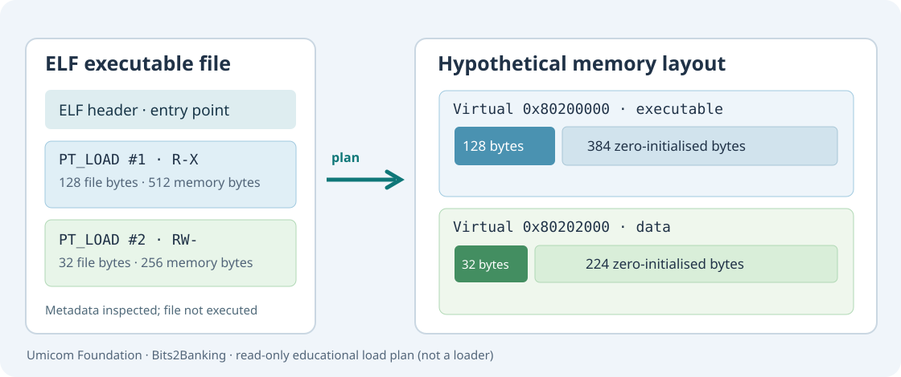

# 87. From an ELF file to a memory-loading plan

A compiler and linker create executable files. An operating system then needs to decide **where the programme belongs in memory** and which bytes it may read, change or execute. In this chapter, you will inspect that plan without running the programme.

Before starting, complete [Chapter 74: ELF, PE and COFF](74-read-elf-pe-coff-with-c23.md) and [Chapter 84: Sections and linker scripts](84-read-sections-and-linker-scripts.md). You will use the `umicom-education` C23 programme from Umicom Framework.



## 1. Separate three different jobs

The **linker** combines compiled object files and decides the layout of the linked image. Its output includes the ELF header and *programme headers*. The operating-system **loader** reads those programme headers and arranges memory. The **processor** executes instructions from an executable mapping after the loader has prepared the process and its entry point.

The distinction matters in Umicom Kernel too: `arch/riscv64/boot.S` performs the first low-level startup, and the linker script selects where the kernel image is placed. These are not the same operations as loading an ordinary Windows or Linux user programme.

An ELF file usually also contains *section headers*. Sections help linkers, disassemblers and debuggers identify `.text`, `.rodata`, `.data`, `.bss` and symbols. **Programme headers** describe the memory image used by loaders. Do not assume every section is a separate memory mapping.

## 2. Read a PT_LOAD entry

A *PT_LOAD* programme header identifies a region to make available in memory. The useful fields are:

| Field | Meaning | Example |
| --- | --- | --- |
| `p_offset` | First file byte that belongs to this segment | `0x200` |
| `p_vaddr` | Requested virtual address | `0x80200000` |
| `p_filesz` | Bytes copied from the file | `128` |
| `p_memsz` | Bytes occupied in memory | `512` |
| `p_flags` | Read, write and execute permissions | `R-X` |
| `p_align` | Alignment rule between file and memory offsets | `256` |

The loader must reject a segment whose `p_filesz` is greater than `p_memsz`. It must also ensure that the referenced file bytes actually exist. For our first synthetic segment, memory requires 512 bytes but the file contains only 128. The remaining **384 bytes must be zero-initialised**. This pattern is common for variables stored in a zero-initialised region such as `.bss`.

## 3. Inspect a real C23 load plan

From PowerShell, after building and testing Umicom Education:

```powershell
Set-Location "C:\umicom\Umicom-Applications"

$Education = ".\build\umicom-education\bin\umicom-education.exe"

ctest --test-dir ".\build\umicom-education" `
    -R "^framework\.education\.(elf_load_plan|load_plan\.cli)$" -V
```

The first test writes a small RISC-V64 ELF fixture into a folder whose name contains spaces. The second test calls the same native command as a learner:

```powershell
& $Education load-plan --file `
    ".\build\umicom-education\education-load-plan-test\fixture with spaces\umicom kernel.elf"
```

You should see the following important values; line spacing can vary:

```text
ELF load plan: ELF64 (little-endian)
Machine: 243 | ELF type: 2
Entry address: 0x80200010 | Inside executable segment: yes
Loadable segments: 2 | File-backed bytes: 160 | Zero-fill bytes: 608
Virtual memory extent: [0x80200000, 0x80202100)
```

The 608 zero-fill bytes are the total of 384 bytes from the code segment and 224 bytes from the data segment. `Machine: 243` identifies the RISC-V architecture in ELF. `ELF type: 2` denotes `ET_EXEC`. This fixture illustrates the format; **it is not a bootable kernel image**.

Once you have an actual compiled Umicom Kernel ELF file, inspect its header and programme-header plan using its real path. Expect different addresses and segment counts. The inspector does not run QEMU, activate an MMU, allocate a page or execute the target file.

## 4. Understand a virtual-memory interval

The report uses a half-open range:

```text
[0x80200000, 0x80202100)
```

The first address belongs to the extent; the final address does not. Keeping the upper boundary exclusive makes it easier to detect ranges that overlap and to calculate lengths.

A segment may occupy fewer bytes in the file than it occupies in memory. A 4 KiB page may also contain bytes from more than one logical section. A production loader must therefore work in page-sized mappings while honouring segment boundaries and platform security policies. The C23 command in this chapter **plans** segments only; it does not implement this page-merging and protection work.

## 5. Learn from the parser's refusal cases

Open these complete source files:

- [Public interface](https://github.com/umicom-foundation/umicom-framework/blob/main/include/umicom/education/elf_load_plan.h)
- [C23 parser](https://github.com/umicom-foundation/umicom-framework/blob/main/src/education/elf_load_plan.c)
- [Regression tests](https://github.com/umicom-foundation/umicom-framework/blob/main/tests/education/test_elf_load_plan.c)

Find the checks for `fileBytes > memoryBytes`, an offset that crosses the end of the file, incompatible alignment, and virtual ranges that overlap. Notice that parsing stores its results in a temporary `plan` first. The caller's report is updated only after the entire file passes inspection. A failure therefore cannot leave behind a partially accepted load plan.

## 6. Exercise

On paper, sketch a segment beginning at virtual address `0x10000` with `p_filesz = 64` and `p_memsz = 256`. Identify the first 64 bytes and the 192 zero-filled bytes. Then explain whether a second segment beginning at `0x10080` with 256 memory bytes would overlap. It would: the first interval ends at `0x10100` and the second starts at `0x10080`.

## 7. Continue

The ELF plan tells us what memory is needed. [Chapter 88](88-physical-pages-and-frame-ownership.md) explains where a kernel can obtain real physical pages to hold that memory.
