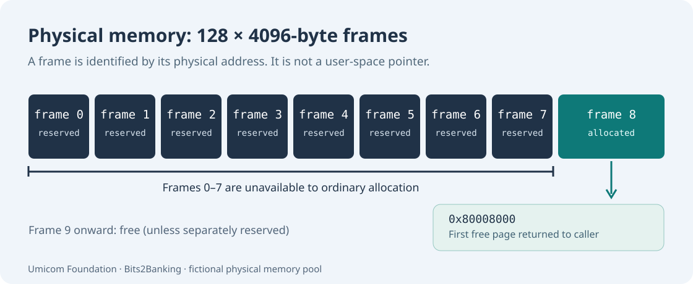

# 88. Allocate and protect physical memory pages

A programme needs memory for instructions, variables and stacks. That memory is a limited resource. An operating-system kernel has to know which pieces are free, which are reserved for the system and which have already been given to a caller.

In this lesson you will build a small physical-frame allocator in C23. The allocator works with **fictional physical addresses** and does not read or alter computer RAM.



## 1. From bytes to frames

Computer memory is byte-addressed. A byte can be identified by an address such as `0x80000000`. Kernels often divide RAM into fixed-size blocks called *page frames*. In the Umicom RISC-V teaching profile, a frame contains **4096 bytes (4 KiB)**.

To find the next frame, add 4096 (`0x1000`) to the current frame's base address. From `0x80000000` the next frame begins at `0x80001000`. Frame number eight therefore begins at `0x80008000`.

If your memory model has 128 frames, it represents 128 × 4096 = **524288 bytes, or 512 KiB**. This is a small classroom inventory, not the real amount of RAM in the Umicom Kernel QEMU profile.

## 2. Why some frames must be reserved

The kernel may be executing code stored in RAM. It may also have a bootstrap stack, a device tree supplied by firmware, or allocator metadata. Returning these pages for unrelated work would allow a new owner to overwrite vital system data.

A frame therefore has a state:

| State | Meaning | May Allocate return it? |
| --- | --- | --- |
| Free | No current owner | Yes |
| Reserved | Protected for boot, kernel or platform use | No |
| Owned | Already allocated to a caller | No |

A reserved frame is not automatically the same thing as a caller-owned frame. Real Umicom Kernel distinguishes reservations and allocations using separate bitmaps, as described in its [Physical Memory documentation](https://github.com/umicom-foundation/umicom-kernel/blob/main/docs/PHYSICAL_MEMORY.md).

## 3. Build the C23 frame inventory

Open PowerShell and enter:

```powershell
Set-Location "C:\umicom\Umicom-Bits2Banking"
$env:Path = "C:\msys64\ucrt64\bin;$env:Path"

cmake -S ".\labs\native\physical-frame-pool" `
    -B ".\output\learning-build\physical-frame-pool" `
    -G Ninja -DCMAKE_C_COMPILER="C:\msys64\ucrt64\bin\gcc.exe"

cmake --build ".\output\learning-build\physical-frame-pool" --parallel 2

ctest --test-dir ".\output\learning-build\physical-frame-pool" --output-on-failure
```

After two passing tests, run the demonstration programme from its build directory:

```powershell
& ".\output\learning-build\physical-frame-pool\btb-frame-pool-demo.exe"
```

Expected output:

```text
First available frame: 0x80008000
Reserved frames: 8
Owned frames: 1
```

The first eight frames were reserved. The allocator returns the lowest free frame, which is frame eight. Calling `Release` at the end returns it to the pool.

## 4. Understand the C23 ownership rules

Look at [`frame_pool.c`](https://github.com/umicom-foundation/Bits2Banking/blob/main/labs/native/physical-frame-pool/frame_pool.c). The model stores 128 state values in an array. The real Umicom Kernel uses bitmaps to represent larger physical-memory inventories compactly.

The demonstration has four public operations: initialise, reserve, allocate and release. These names describe actions rather than memory pointers. The returned `uint64_t` is a physical-address **number**; user-space C code must not cast it into a pointer and assume it can access that address.

An important contract is *failure atomicity*. Consider reserving frames 10–13 when frame 12 is already reserved. The operation checks the entire interval before changing any state. It refuses the request and leaves all frames as they were.

A second contract is *single ownership*. A frame may be allocated only if it is free. `Release` refuses a reserved frame and refuses releasing the same frame twice.

## 5. Make a controlled change

Open `labs/native/physical-frame-pool/frame_pool.c` and locate the loop in `BtbFramePoolInit` that reserves the first eight frames. As an exercise, change the number to ten and rebuild. Predict the new address **before running the program**.

The first available frame will become `0x8000A000`. The original demonstration program deliberately checks for `0x80008000`, so it will now return an error. That failure is expected until you adjust the example and its test to match the new reservation policy. Restore the original source after completing the exercise.

## 6. Follow Umicom Kernel source

Open the actual [`kernel/physical_memory.c`](https://github.com/umicom-foundation/umicom-kernel/blob/main/kernel/physical_memory.c). Identify the reserved and allocated bitmaps, frame-index calculations, reservation policy and counter updates. Read the corresponding [kernel documentation](https://github.com/umicom-foundation/umicom-kernel/blob/main/docs/PHYSICAL_MEMORY.md).

The real implementation also reserves its linked kernel image and relevant boot memory. The classroom exercise deliberately omits firmware memory discovery, concurrency, live hardware mappings and production security rules.

## 7. Continue

Owning a physical frame does not yet make it visible at a virtual address. [Chapter 89](89-sv39-virtual-address-translation.md) shows how a page table describes that translation.
