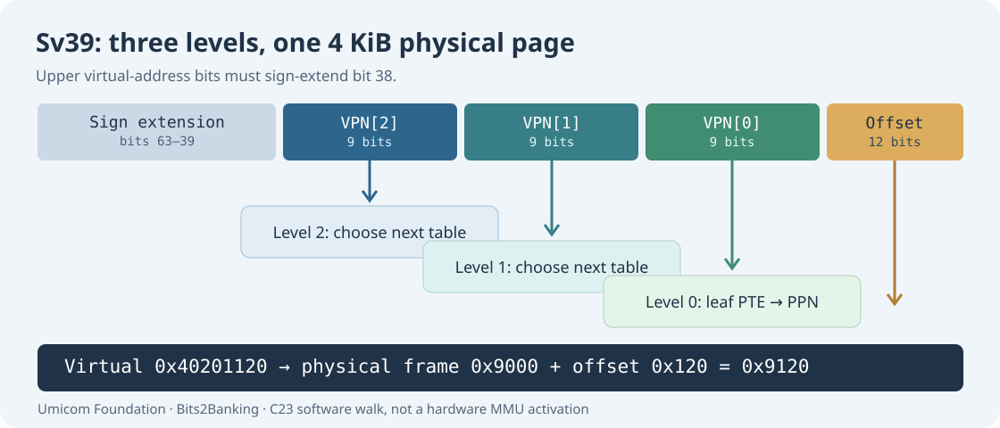

# 89. Translate a virtual address with RISC-V Sv39

When a programme uses a pointer, it normally refers to a *virtual address*. Virtual addresses let different processes have their own view of memory. A page table tells the processor which physical frame should satisfy a permitted access.

We will model the RISC-V **Sv39** address-translation format in C23. This is the same family of page tables used by the Umicom Kernel RISC-V research track. The exercise runs as an ordinary programme; it does not turn on the processor's memory-management unit (MMU).



## 1. Split a virtual address into four parts

Sv39 uses 39 meaningful low address bits, with the high bits required to be copies of bit 38. This is called a **canonical address**. Addresses with inconsistent upper bits are invalid.

| Virtual-address bits | Name | Meaning |
| --- | --- | --- |
| 38–30 | VPN[2] | Index into the top page table |
| 29–21 | VPN[1] | Index into the middle page table |
| 20–12 | VPN[0] | Index into the bottom page table |
| 11–0 | Offset | Byte position within the selected 4096-byte page |

Each page-table entry is 64 bits. One 4096-byte page therefore contains **512 entries**, and each index needs nine bits to select one of them.

The first two entries in our simplified walk point to the next table. The final (leaf) entry describes the physical frame and permissions.

## 2. Follow one address through the tables

Our laboratory maps virtual page `0x40201000` to physical page `0x9000`. A programme requests the byte at virtual address `0x40201120`.

The lower twelve bits are the offset `0x120` within the page. Translation replaces the page number but **preserves the offset**:

```text
Virtual page base:       0x40201000
Offset within page:           0x120
Physical page base:         0x9000
Translated physical byte:   0x9120
```

The MMU performs this sort of page-table walk in hardware when address translation is enabled. Our laboratory performs a deliberately limited software walk over three arrays so you can inspect every intermediate value.

## 3. Build the C23 Sv39 model

In PowerShell:

```powershell
Set-Location "C:\umicom\Umicom-Bits2Banking"
$env:Path = "C:\msys64\ucrt64\bin;$env:Path"

cmake -S ".\labs\native\sv39-address-translation" `
    -B ".\output\learning-build\sv39-address-translation" `
    -G Ninja -DCMAKE_C_COMPILER="C:\msys64\ucrt64\bin\gcc.exe"

cmake --build ".\output\learning-build\sv39-address-translation" --parallel 2

ctest --test-dir ".\output\learning-build\sv39-address-translation" --output-on-failure
```

Two tests should pass. Run the demonstration:

```powershell
& ".\output\learning-build\sv39-address-translation\btb-sv39-demo.exe"
```

Expected output:

```text
Virtual address: 0x40201120
Physical address: 0x9120
```

## 4. Read the C23 mapping code

The mapping code is in [`sv39.c`](https://github.com/umicom-foundation/Bits2Banking/blob/main/labs/native/sv39-address-translation/sv39.c). It creates three page-table arrays. A valid intermediate entry contains a physical page number (PPN) and the valid flag (`V`). It has no read, write or execute permissions because it points to another table rather than mapping data.

The leaf entry contains a PPN and permissions. Our example creates a readable and writable mapping. The translator accepts `READ` and `WRITE` requests but denies `EXEC` on that page. The tests also refuse a non-canonical address and a requested page with no mapping.

A write-only leaf with `W = 1` and `R = 0` is invalid in RISC-V. The map routine rejects it before changing any table, just as other C23 lessons reject malformed records before committing changes.

## 5. Why this is only part of the real system

A complete kernel also manages free physical frames, per-process address spaces, page-table ownership, translation caches (TLBs), privileged CPU registers, exceptions and address-space security. It may use 2 MiB or 1 GiB superpages when supported. Our model deliberately accepts only one 4 KiB leaf and has no TLB or hardware access.

The Umicom Kernel [software page-table guide](https://github.com/umicom-foundation/umicom-kernel/blob/main/docs/VIRTUAL_MEMORY.md) explains its own three-level representation and frame ownership. The [hardware-translation guide](https://github.com/umicom-foundation/umicom-kernel/blob/main/docs/HARDWARE_ADDRESS_TRANSLATION.md) describes separate tests that ask a RISC-V processor to perform translated loads and stores. Read both to see the difference between *simulating a walk* and *qualifying the hardware's translation*.

## 6. Exercise

Change the mapping permissions from readable/writable to readable/executable. Test a read, a write and an instruction-fetch request. Predict which should be permitted before rebuilding. Then explain how a page that stores executable instructions may need different permissions from a page that holds a mutable application balance.

## 7. Continue

[Chapter 90](90-memory-permissions-traps-and-privilege.md) introduces the security and exception-handling rules that govern these accesses.
