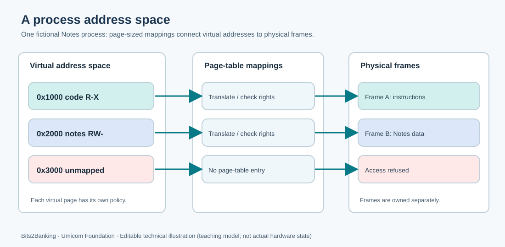

# 92. Understand a process address space

When you open a note-taking program, the operating system needs somewhere to place its machine instructions, variables and working data. It also needs to stop that program from reading or damaging memory that belongs to a different program. A **process** is one operating-system-managed instance of a running program. An **address space** is the set of virtual addresses that the process is allowed to use.

You have already seen how an ELF executable describes loadable code and data in [Lesson 87](87-read-elf-program-headers-and-load-plan.md), how physical page frames are owned in [Lesson 88](88-physical-pages-and-frame-ownership.md), and how Sv39 translates virtual addresses in [Lesson 89](89-sv39-virtual-address-translation.md). We can now connect those ideas.



## 1. Start with a program file

Imagine a fictional **Umicom Notes** program. Its executable file contains the machine instructions for adding, displaying and saving notes. Those bytes are on a storage device; they do not become a running process simply because the file exists.

A simplified loader performs several different jobs:

1. Read and validate the executable's file headers.
2. Decide which **virtual-memory regions** its code and data need.
3. Obtain physical frames or establish suitable backing for those regions.
4. Place file-backed bytes in memory and initialise the required extra bytes to zero.
5. Apply the correct **read, write and execute** permissions.
6. Prepare a stack and the initial CPU state.
7. Enter the program under the intended, less-privileged execution mode.

Each job depends on the one before it. Merely reading ELF metadata is **not** equivalent to creating a process.

## 2. Understand an address

An address is a number that identifies a location. A **physical address** selects a location in physical memory or a hardware address range. A **virtual address** is interpreted through an address-translation mechanism before the memory access completes.

For this classroom example, imagine:

| Virtual range | Purpose | Rights |
| --- | --- | --- |
| `0x00001000`–`0x00001fff` | Notes machine instructions | Read + execute |
| `0x00002000`–`0x00002fff` | Working note data | Read + write |
| `0x00003000`–`0x00003fff` | Reserved but not mapped | None |

A process might map virtual address `0x1018` to a physical frame starting at `0x80001000`. The virtual offset inside the page is `0x18`, so its physical counterpart is `0x80001018`. This is the calculation you will verify in the C23 exercise.

These are **illustrative addresses**, not an Umicom Kernel memory-map specification.

## 3. Understand ownership

A page table describes *how* a virtual address resolves. It does not, by itself, prove who owns the underlying physical frame. Umicom Kernel deliberately separates page-table-frame ownership from caller-owned data-frame ownership. When an address space is destroyed, the kernel must release its page-table structures and separately settle the lifetime of any mapped data frames.

You can examine the actual implementations in the [physical-memory allocator](https://github.com/umicom-foundation/umicom-kernel/blob/main/kernel/physical_memory.c) and the [Sv39 virtual-memory subsystem](https://github.com/umicom-foundation/umicom-kernel/blob/main/kernel/virtual_memory.c). These are the authoritative source files, not copied teaching implementations.

## 4. Run the page-access laboratory

Open PowerShell in the Bits2Banking repository:

```powershell
Set-Location "C:\umicom\Umicom-Bits2Banking"
$env:Path = "C:\msys64\ucrt64\bin;$env:Path"
cmake -S ".\labs\native\page-fault-model" -B ".\output\learning-build\page-fault-model" -G Ninja -DCMAKE_C_COMPILER="C:\msys64\ucrt64\bin\gcc.exe"
cmake --build ".\output\learning-build\page-fault-model" --parallel 2
ctest --test-dir ".\output\learning-build\page-fault-model" --output-on-failure
& ".\output\learning-build\page-fault-model\btb-page-fault-demo.exe"
```

The two tests should pass. The program then reports one permitted instruction fetch, one refused write to code, and one refused access to an unmapped address.

Read [`page_map.h`](https://github.com/umicom-foundation/Bits2Banking/blob/main/labs/native/page-fault-model/page_map.h) and [`page_map.c`](https://github.com/umicom-foundation/Bits2Banking/blob/main/labs/native/page-fault-model/page_map.c). The public interface records the mapping table and its rights. The implementation checks alignment, canonical Sv39 addresses and each requested access before changing an output address.

## 5. Change one mapping

Find this line in `main.c`:

```c
BTB_PAGE_READ | BTB_PAGE_WRITE
```

Temporarily replace it with `BTB_PAGE_READ`. Predict the result of a write to the data page. Rebuild the demonstration and modify the exercise to attempt that write. The result should be **protection fault**. Restore the original rights and rerun the tests.

## 6. Check your understanding

1. Why do two processes not necessarily use the same physical memory when they both access virtual address `0x2000`?
2. Why should a kernel treat a page-table frame differently from a mapped data frame?
3. Does a successful ELF load-plan inspection prove that a process has been created?
4. What remains unchanged when the laboratory refuses an access?

A virtual address is a request to access memory through a mapping. It is not a promise that a physical byte is available or accessible. Continue with [Lesson 93](93-understand-page-faults-in-c23.md) to see how a denied request becomes a fault.
