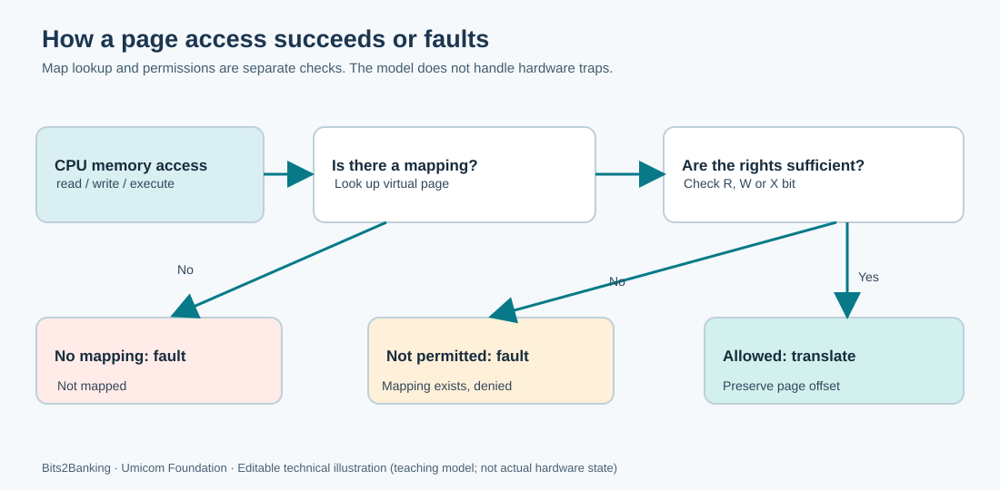

# 93. Understand page faults in C23

A page fault occurs when a processor cannot complete a virtual-memory access under the current page-table and privilege rules. A fault is not always a program defect. Some operating systems deliberately leave pages unmapped until a process first needs them. Other faults indicate an invalid address or a forbidden operation.

In this chapter, we work with **Umicom Notes**, a fictional note-taking process. We use a small hosted C23 model so you can investigate the outcomes without crashing a real program or changing the operating system.



## 1. Follow an access

Imagine that the CPU attempts to execute an instruction at virtual address `0x1018`.

1. The CPU checks whether the current address is valid for its active address-translation mode.
2. It finds the page-table entry that covers that address.
3. It checks whether that page is executable in the current privilege context.
4. If authorised, the CPU resolves the physical address and continues the instruction fetch.
5. If the mapping is missing or its rights are insufficient, the CPU raises the appropriate exception.

The **kernel's trap handler** receives the exception context. It examines the cause and address, then decides whether the situation can be repaired safely, requires another process action, or must terminate the faulty operation. Those decisions belong to a real kernel, not to the classroom model.

## 2. Separate three different failures

| Condition | Classroom result | What it teaches |
| --- | --- | --- |
| Read `0x1018`, mapped RX | Allowed | Read access is permitted |
| Write `0x1018`, mapped RX | Protection fault | The code page must not be modified |
| Read `0x3000`, unmapped | Unmapped page fault | No translation exists |

A *protection fault* means that a mapping exists but the requested operation is not allowed. An *unmapped fault* means that the requested page is absent from the model's mapping table. Real kernels have more detailed exceptions, including access faults and privilege violations.

## 3. Read the C23 contract

The exercise accepts an address and an action:

```c
BtbPageStatus BtbPageAccessAddress(
    const BtbAddressSpace *space,
    uint64_t virtualAddress,
    BtbPageAccess action,
    uint64_t *outPhysicalAddress);
```

The mapping state is borrowed for reading. The function may change `outPhysicalAddress` **only when access is permitted**. On failure, the previous output remains unchanged. This is a useful rule for safe APIs: callers can distinguish success from failure without inspecting a partially updated result.

The implementation aligns the address down to the containing 4 KiB page, looks up its mapping and checks the relevant permission bit. It adds the page offset to the physical-frame base only after permission succeeds.

## 4. Run two deterministic tests

```powershell
Set-Location "C:\umicom\Umicom-Bits2Banking"
cmake -S ".\labs\native\page-fault-model" -B ".\output\learning-build\page-fault-model" -G Ninja -DCMAKE_C_COMPILER="C:\msys64\ucrt64\bin\gcc.exe"
cmake --build ".\output\learning-build\page-fault-model" --parallel 2
ctest --test-dir ".\output\learning-build\page-fault-model" --output-on-failure
```

You should see **two passing tests**. The `basic` test confirms permissions, offsets and unmapped-page refusal. The `boundaries` test checks alignment, non-canonical Sv39 addresses, duplicate mappings and the capacity of the fixed mapping table.

Open `labs/native/page-fault-model/test_page_map.c`. Locate this check:

```c
CHECK(physical == UINT64_C(0x8000102a));
```

The test keeps the result of the previous permitted read. The next denied write must leave that value unchanged. This proves the refusal is not a partial success.

## 5. How does the real Umicom Kernel differ?

The simulator performs no hardware translation. The real Umicom Kernel maintains actual page-table data structures and has separate trap/exception handling, supervisor-mode work and hardware-translation qualification. Follow the source in [virtual_memory.c](https://github.com/umicom-foundation/umicom-kernel/blob/main/kernel/virtual_memory.c) and the [hardware translation guide](https://github.com/umicom-foundation/umicom-kernel/blob/main/docs/HARDWARE_ADDRESS_TRANSLATION.md).

A software page-table walk is useful for checking a model. It is not proof that the processor will interpret those entries identically. The hardware guide describes how the Kernel subsequently validates actual translated loads and stores.

## 6. Practise and review

Add one further test: map an address as read-only, then try to execute from it. Check that the caller's physical-address output does not change when execution is refused.

Can a fault be repaired? Sometimes, if a kernel has a valid page-in or demand-allocation policy. Must every fault be repaired? No: invalid and unauthorised accesses must be refused. Never equate a page fault with permission to grant broader access.

Next: [Lesson 94](94-review-executable-memory-protection.md) examines a subtle permission problem that appears when an executable's segments share the same physical page after address rounding.
