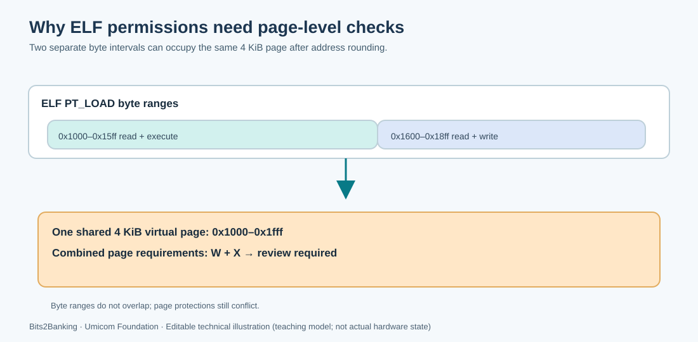

# 94. Review executable-memory protection in C23

Code must normally be executable but not writable, while application data may be writable but should not be executable. This convention is often called **W^X**, meaning *write exclusive of execute*. It is a valuable defence because changing data is different from changing instructions.

An ELF executable describes the preferred permissions for its loadable segments. A loader cannot simply copy those permission bits without considering the size of the processor's memory pages.



## 1. Start with two separate ranges

Imagine a fictional executable containing these two `PT_LOAD` ranges:

| Segment | Virtual bytes | Desired rights |
| --- | --- | --- |
| Machine instructions | `0x1000`–`0x15ff` | Read + execute |
| Note storage | `0x1600`–`0x18ff` | Read + write |

The ranges do not overlap as byte intervals. However, both are inside the single 4 KiB page from `0x1000` through `0x1fff`. The processor's page permission applies to the **whole page**, not independently to each byte.

If a loader combines the requested access rights, that page needs both W and X. If it refuses one permission, one of the segments cannot be used as declared. A good loader needs an explicit, carefully reviewed policy for such conflicts.

## 2. Understand the conservative test

The Umicom Education command adds a second report to the existing ELF load-plan reader:

```powershell
umicom-education memory-audit --file PATH
```

The command:

1. Uses Framework's existing ELF parser to validate file offsets and `PT_LOAD` byte ranges.
2. Rounds each non-empty virtual-memory segment to 4 KiB page boundaries.
3. Counts unique virtual pages without allocating memory for every page.
4. Checks whether more than one segment covers the same page.
5. Identifies pages that would require both write and execute permissions.
6. Reports unknown permission bits separately.

The check is **read-only**. It does not start the executable or apply any memory mapping. A clean report is not a security certification and does not prove that the operating system will load the image successfully.

## 3. Build the inspection command

The native C23 implementation belongs in Umicom Framework, not in the Bits2Banking lesson directory.

```powershell
Set-Location "C:\umicom\Umicom-Applications"
$env:Path = "C:\msys64\ucrt64\bin;$env:Path"
cmake -S ".\framework\tools\umicom-education" -B ".\build\umicom-education" -G Ninja -DCMAKE_C_COMPILER="C:\msys64\ucrt64\bin\gcc.exe" -DBUILD_TESTING=ON
cmake --build ".\build\umicom-education" --parallel 2
ctest --test-dir ".\build\umicom-education" --output-on-failure
```

Expected result after integrating this update: **18 passing tests**. The existing ELF load-plan test writes a synthetic RISC-V64 ELF fixture that does not execute on your Windows host.

```powershell
$Education = ".\build\umicom-education\bin\umicom-education.exe"
$Fixture = ".\build\umicom-education\education-load-plan-test\fixture with spaces\umicom kernel.elf"
& $Education memory-audit --file $Fixture
```

The safe fixture should report **two mapped virtual pages** and **zero writable-and-executable pages**.

## 4. Read the implementation

Inspect the public [memory-audit header](https://github.com/umicom-foundation/umicom-framework/blob/main/include/umicom/education/memory_audit.h) and its [C23 implementation](https://github.com/umicom-foundation/umicom-framework/blob/main/src/education/memory_audit.c).

The reader builds a small collection of page-range boundaries. It sorts those boundaries and checks each interval for the permissions of overlapping segments. This means it can check a file that declares an extremely large address range **without allocating a similarly large array**.

The test also constructs the overlapping `0x1000`/`0x1600` example directly. It expects a single shared page, one mixed-permission page and one W+X page. This is an important lesson in granularity: a byte-range check alone is insufficient.

## 5. Review the result carefully

`Policy: no W+X page conflict found` means only that this narrow check found no conflict in the inspected `PT_LOAD` metadata. A `REVIEW REQUIRED` result means that write/execute overlap or unknown permission bits were reported; the command returns a nonzero status so a build check can flag it.

Kernel and executable formats sometimes have special startup requirements, linker sections and transitional mappings. A warning is a reason to inspect those requirements, not permission to change the Kernel or remove protection flags blindly.

## 6. Try the related exercises

Run the page-fault model from [Lesson 93](93-understand-page-faults-in-c23.md). Attempt to map one page with `BTB_PAGE_READ | BTB_PAGE_WRITE | BTB_PAGE_EXECUTE`. The classroom mapper refuses the request. Then inspect [Umicom Kernel's virtual-memory implementation](https://github.com/umicom-foundation/umicom-kernel/blob/main/kernel/virtual_memory.c), which implements the actual Sv39 page-table model with a different ownership and privilege boundary.

Questions: Why do both ELF segments need the same page in our example? Does a successful load-plan check guarantee W^X? Why is an inspector safer when it operates only on metadata rather than executing the file?

Next: [Lesson 95](95-model-a-process-lifecycle-in-c23.md) models how a kernel records processes as they become ready, run, wait and finish.
