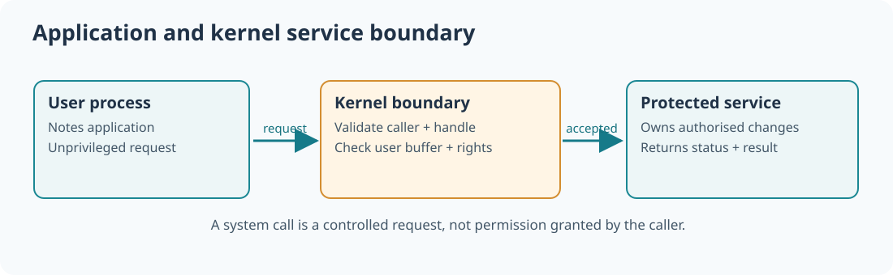

# 97. How a programme asks the operating system for a service

A note-taking application can keep a paragraph in its own memory. Saving that paragraph to a file is different: the application needs a service that can access files, and the operating system must decide whether the requested access is permitted. The boundary between an application and the kernel makes this possible without giving every programme complete control of the machine.

When you choose **Save**, the application prepares a request describing what it needs. A library may translate that request into an operating-system *system call*. The kernel identifies the calling process, checks the arguments and permissions, performs an allowed operation and returns a result.



## 1. Understand user mode and kernel mode

A modern processor can enforce different *privilege levels*. Ordinary application code normally runs with fewer privileges than the kernel. If an application could directly change page tables, drive hardware or read another process's private memory, a programming error in one application could endanger the entire system.

The kernel has privileged code and manages protected resources. It does not automatically accept every request. A file path, address or handle supplied by a user programme is **data to validate**, not proof of authority.

| Concept | Meaning in the Notes example |
| --- | --- |
| User process | The running Notes application and its private address space |
| System call | A controlled request to an operating-system service |
| Kernel | Privileged code that validates and performs allowed operations |
| Handle | A reference the operating system has issued to a managed object |
| Return status | Success, permission denied, bad argument, unavailable resource, etc. |

## 2. Follow the request

Consider saving a Notes document.

1. The application selects the document and opens or creates a permitted destination.
2. It passes a handle, an address of text bytes and a byte count to an operating-system interface.
3. The kernel identifies the caller from its own execution context.
4. The kernel checks the handle rights and verifies that it can safely read the requested source bytes.
5. An approved storage service writes the bytes or reports why the request could not complete.
6. The application checks the result. It must not report **Saved** merely because it issued the request.

The kernel's work depends on the requested service. Checking that user memory is accessible is separate from checking that a file handle authorises writing.

## 3. Recognise the RISC-V environment-call instruction

On RISC-V, `ecall` is the instruction that requests an environment service. Its meaning depends on the active privilege level and the configured software environment. A user-mode environment call transfers control to an appropriate trap handler; the handler examines the saved execution context and decides what service, if any, is permitted.

```asm
# RISC-V illustration — not an executable Umicom Kernel call wrapper.
# A real caller must follow its published ABI for numbers and arguments.
ecall
```

This instruction alone is **not** a complete operating-system interface. Correct usage also needs a defined calling convention, register assignments, return values, trap routing, permission checks and a supported runtime. Do not run the fragment as a standalone programme.

For the real Umicom implementation, inspect the assembly and trap code in the [Umicom Kernel repository](https://github.com/umicom-foundation/umicom-kernel), together with the [service dispatch](https://github.com/umicom-foundation/umicom-kernel/blob/main/kernel/message_service.c) and [user-memory checks](https://github.com/umicom-foundation/umicom-kernel/blob/main/kernel/user_memory.c).

## 4. Build a small service model without entering kernel mode

The [service-dispatch laboratory](https://github.com/umicom-foundation/Bits2Banking/tree/main/labs/native/syscall-dispatch) is a hosted C23 exercise that lets you inspect a request/response boundary. It returns a fictional service tick counter and records a bounded Notes event when the simulated request has the required right.

From PowerShell:

```powershell
Set-Location "C:\umicom\Umicom-Bits2Banking"
$env:Path = "C:\msys64\ucrt64\bin;$env:Path"
cmake -S ".\labs\native\syscall-dispatch" -B ".\output\learning-build\syscall-dispatch" -G Ninja -DCMAKE_C_COMPILER="C:\msys64\ucrt64\bin\gcc.exe"
cmake --build ".\output\learning-build\syscall-dispatch" --parallel 2
ctest --test-dir ".\output\learning-build\syscall-dispatch" --output-on-failure
```

The expected tests both pass. The demonstration prints `Training service ticks: 125` and `Training events: 1; revision: 2`.

## 5. Investigate one rejected call

Open `labs/native/syscall-dispatch/test_dispatch.c`. Find the request that tries to publish without `BTB_SERVICE_RIGHT_PUBLISH`. The dispatcher returns `BTB_SERVICE_DENIED` and leaves the stored events unchanged.

Change the request's `expectedRevision` to a stale value. Even with the required right, the dispatcher refuses the change. This is a simple example of *optimistic concurrency control*: a caller cannot unknowingly overwrite changes made since the version it examined.

In a real kernel, an application **cannot grant itself rights by filling in a field**. The kernel must derive those rights from a validated handle and the actual calling task. The teaching request includes a rights field only to make the rule visible in a hosted laboratory.

## 6. Check your understanding

Explain the difference between a function call to another function in the same application and a system call. Then answer: who establishes the caller's identity; why is an untrusted buffer address not sufficient; and what should the Notes application do if a save request is refused?

Next: [build a copied-message channel](98-build-a-copied-message-channel.md), where another process can receive a Notes event without borrowing the sender's memory.
