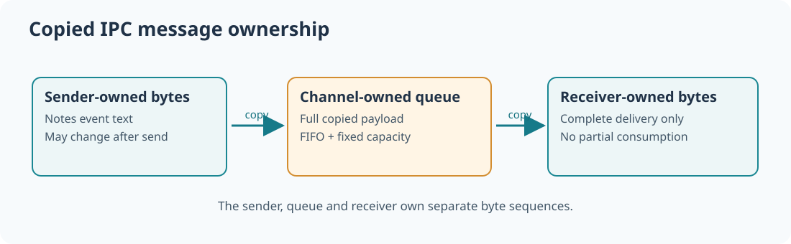

# 98. Build a copied-message channel in C23

Suppose one part of a banking workstation calculates a training report while another displays it. They need a way to exchange information without sharing uncontrolled pointers. An *inter-process communication channel* (IPC channel) is one approach: a sender places a message in a channel, and a receiver collects it later.

A message is not merely a pointer. A pointer identifies a location in the sender's address space; the receiver might not have permission to read that location, and the sender might overwrite or release it. A safer model copies the requested bytes into storage owned by the communication service.



## 1. Understand a bounded queue

A *queue* normally delivers items in first-in, first-out (FIFO) order. A bounded queue has room for only a specified number of messages.

Consider a four-slot channel:

```text
Before sending:
  [empty] [empty] [empty] [empty]

After two successful sends:
  [note #1] [note #2] [empty] [empty]

After the first successful receive:
  [empty] [note #2] [empty] [empty]
```

The first send must be the first receive. A fifth send to a full four-slot queue is refused. Rejecting a send is preferable to silently deleting an earlier message.

## 2. Build the channel

The [bounded-channel laboratory](https://github.com/umicom-foundation/Bits2Banking/tree/main/labs/native/bounded-channel) contains an ordinary C23 library. It owns four fixed-size message slots; each slot accepts at most 64 payload bytes. It uses a ring index so it can reuse a slot after the receiver consumes its message.

```powershell
Set-Location "C:\umicom\Umicom-Bits2Banking"
$env:Path = "C:\msys64\ucrt64\bin;$env:Path"
cmake -S ".\labs\native\bounded-channel" -B ".\output\learning-build\bounded-channel" -G Ninja -DCMAKE_C_COMPILER="C:\msys64\ucrt64\bin\gcc.exe"
cmake --build ".\output\learning-build\bounded-channel" --parallel 2
ctest --test-dir ".\output\learning-build\bounded-channel" --output-on-failure
& ".\output\learning-build\bounded-channel\btb-bounded-channel.exe"
```

The two CTest cases should pass. The demonstration prints a Notes message received from the training sender:

```text
Receiver 22 accepted message 1 from 11: Notes: save the weekly report
```

## 3. Inspect how copying changes ownership

In `channel.c`, find `BtbChannelSend`. The function validates the sender, recipient, payload length, available slot and sequence counter. It copies the complete payload into a local message record before changing the channel's queue metadata.

Now open `main.c`. It sends a string and immediately changes the sender's original array. The receiver nevertheless reads the original message because the channel holds its **own bytes**.

This proves a small but useful rule: once a send succeeds, the caller may reuse its source buffer without changing the accepted message. The receiver still has to collect the message through an authorised operation.

## 4. Refuse unsafe receives without consuming messages

`BtbChannelReceive` checks which recipient is allowed to receive the next message and how many bytes the destination can hold. If the destination buffer is too small, the function must return `BTB_CHANNEL_SMALL_BUFFER` **without** consuming the queued message or altering the output values.

Why? If the channel removed the message first and discovered the small destination later, a client could lose information during a harmless sizing mistake.

Run `test_channel.c` and find the checks for an unauthorised recipient, a three-byte output buffer and the successful four-byte receive that follows. The rejected attempts leave the queue unchanged. The accepted receive copies bytes out and clears the vacated slot.

## 5. A channel is not a security system by itself

The teaching programme executes in one process, and its numeric sender/receiver values are not security credentials. It is intentionally **single-threaded** and does not test real process isolation or kernel-level rights.

Compare it with the actual [Umicom Kernel message channels](https://github.com/umicom-foundation/umicom-kernel/blob/main/kernel/message_channel.c). Those channels use endpoint handles, owners, generation checks, rights, bounded queues and copied payloads. The [user IPC layer](https://github.com/umicom-foundation/umicom-kernel/blob/main/kernel/user_ipc.c) separately handles blocking operations, deadlines and task wake-up. It does not make an untrusted numerical identifier an authority.

## 6. Extend the Notes exercise

Change the content of the sender's message. Add a second queued Notes event and confirm that the receiver sees them in FIFO order. Then deliberately ask a different recipient to receive it and verify the refusal. Finally, send until the four slots are full; verify that the fifth message is rejected and that the original four messages are still available.

Write down three properties that a production channel needs in addition to the teaching model: secure caller identification, safe copying from user memory and synchronisation when several execution contexts can access a queue.

Next: [inspect a binary IPC trace](99-inspect-an-ipc-trace-with-c23.md).
