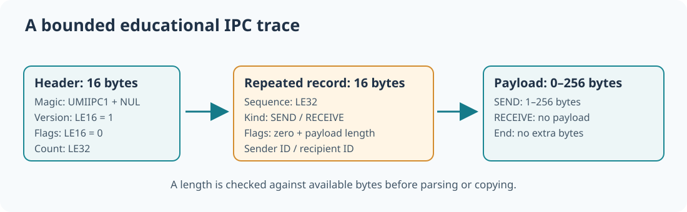

# 99. Inspect a bounded IPC trace using native C23

A service can record what happened during a message exchange so a developer can examine message order without receiving a real customer message or executing any software from the trace. Such a record is a *trace*.

Umicom Education now provides a read-only C23 command that checks a simple **teaching trace**. This is not an existing Umicom Kernel trace format and does not authenticate events. It demonstrates how binary records, byte order, message lengths and FIFO sequencing can be checked before a report is trusted.

## 1. Understand the file structure



The file begins with 16 bytes:

| Byte position | Contents |
| --- | --- |
| 0–7 | Exact magic bytes `UMIIPC1` and a zero byte |
| 8–9 | Format version, unsigned little-endian 16-bit integer (`1`) |
| 10–11 | Reserved flags, which must be zero |
| 12–15 | Number of following records, unsigned little-endian 32-bit integer |

Each record starts with a 16-byte header. It contains a one-based sequence number, an event kind, reserved flags, a payload length and numeric sender/recipient identifiers. A SEND is followed by 1–256 payload bytes. A RECEIVE has zero payload bytes and must match the oldest waiting SEND.

The inspector accepts at most **1 MiB of input**, **4096 records**, and **64 unreceived messages**. It requires increasing sequence numbers and rejects trailing bytes not declared by the header.

## 2. Why byte order and capacity matter

Different processors and protocols may encode multibyte numbers in different ways. The new trace explicitly uses **little-endian** integers. A two-byte value `0x0123`, for example, is stored as `23 01`.

Do not read a file header by casting an arbitrary byte pointer into a C struct. Such a cast may depend on padding, alignment, byte order and the compiler's record layout. Instead, the Framework parser reads each byte at its documented offset and combines the values with unsigned shifts.

Every declared length must be checked against the number of remaining bytes before the parser attempts to access them. An attacker or damaged file could otherwise claim that a small input contains billions of records.

## 3. Build the native inspection command

After integrating this update and rebuilding Umicom Education, the new command is:

```powershell
Set-Location "C:\umicom\Umicom-Applications"
$env:Path = "C:\msys64\ucrt64\bin;$env:Path"
cmake -S ".\framework\tools\umicom-education" -B ".\build\umicom-education" -G Ninja -DCMAKE_C_COMPILER="C:\msys64\ucrt64\bin\gcc.exe" -DBUILD_TESTING=ON
cmake --build ".\build\umicom-education" --parallel 2
ctest --test-dir ".\build\umicom-education" --output-on-failure
```

The `framework.education.ipc_trace` test creates a synthetic fixture at a path containing spaces. Run the inspector against that file:

```powershell
$Education = ".\build\umicom-education\bin\umicom-education.exe"
$Trace = ".\build\umicom-education\education-ipc-trace-test\fixture with spaces\owned messages.ipc"
& $Education ipc-trace --file $Trace
```

Expected summary:

```text
IPC trace: 4 records
Sends: 2 | Receives: 2
Pending: 0 | High-water: 2
Copied payload bytes: 5
Simulation only: no IPC or system call was executed.
```

## 4. Read the parser and test its refusal paths

Open `framework/src/education/ipc_trace.c`. It keeps a small FIFO of sender/recipient pairs while checking the records. Every SEND adds one pending pair; every RECEIVE must match the **oldest** pair. The report is published only after the complete trace is validated.

Then open `framework/tests/education/test_ipc_trace.c`. It deliberately supplies an invalid magic value, unsupported format version, truncated record, mismatched receiver and more pending sends than the queue can hold. The test also performs 20,000 deterministic byte mutations to check that corrupted inputs do not crash the parser.

A rejected file must not partially overwrite the result object. That failure-atomic behaviour is important in any native file inspector.

## 5. Consider what the report cannot establish

A successful trace proves that the bytes follow **this teaching format**. It does not prove that real messages were sent, that the recorded identifiers are genuine, that an application had permission to send, or that the operating system was healthy. Logging and auditing require additional evidence, trustworthy source attribution and a well-defined production format.

As an exercise, add an input file with a valid SEND but no RECEIVE. The parser should report one pending message. Explain why a pending message is not automatically an error. Then change the next RECEIVE's recipient to the wrong identifier and verify that the inspector refuses the entire trace.

Next: [validate a service request before changing state](100-design-checked-service-requests.md).
