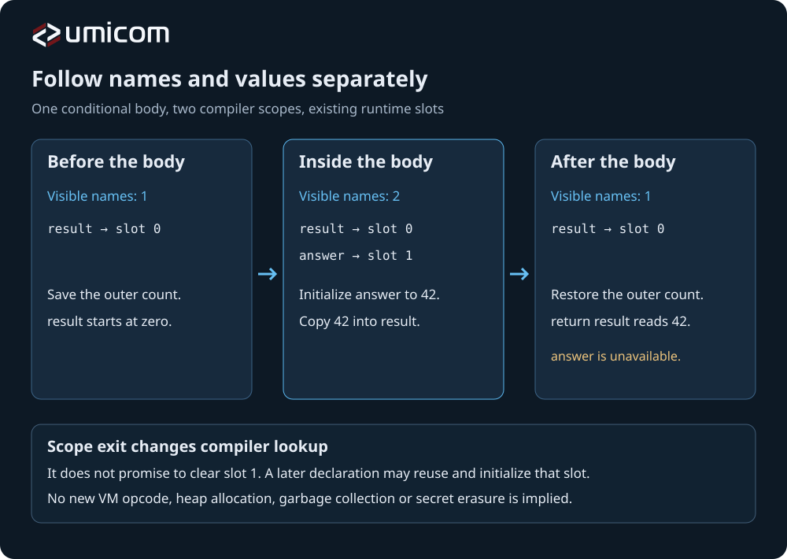

<!--
Umicom Bits2Banking
File: content/lessons/05-engineering/building-a-compiler-in-c/82-give-branch-locals-a-lexical-scope.md

PURPOSE:
Give branch locals a lexical scope without changing the VM

AUTHOR AND ORGANISATION:
Sammy Hegab
Umicom Foundation

LICENCE:
MIT
-->

# Give branch locals a lexical scope without changing the VM

[Course contents](index.md)

## What you will learn

A compiler needs to decide which declaration each name refers to. That decision happens before a program executes. In this lesson you will follow a temporary name through a conditional body, see why it cannot be used afterward, and inspect how the compiler reuses a bounded symbol table. You will also separate three different ideas: the name written in source, a runtime storage slot and the value currently stored there. Confusing them can produce incorrect scope rules or misleading memory-safety claims.

Use the earlier lessons about initialized local integers, braced conditionals, the VM instruction budget and source diagnostics first. The example uses the current small Umicom C source language. The implementation is compiled by a host C23 compiler, but the language it accepts remains a restricted integer language. You do not need to change the Kernel, install a GUI or run an external language server for this exercise.

## Start with an outer result and an inner calculation

~~~c
int main(void) {
    int result = 0;
    if (1) {
        const int answer = 42;
        result = answer;
    }
    return result;
}
~~~

Read the program from top to bottom. int says that result holds an integer. The initializer = 0 supplies its first value. if (1) selects its braced body because one is nonzero. const int answer = 42 initializes a second integer whose source-level updates are forbidden. result = answer copies that value into the existing outer variable. The final return reads result after the body has ended. It does not need the name answer to remain available.

A scope is a region of source in which a name is available. The name result belongs to the main statement sequence. The name answer belongs to the selected conditional body. Source visibility is decided from the program structure, not from whether a human knows that this particular condition is always true. A later return answer is therefore refused even for if (1). This keeps the rule consistent for conditions that are not constants.

## Run the checked example

~~~powershell
.\build\bin\umicom-c.exe check .\examples\branch_locals.uc
.\build\bin\umicom-c.exe run .\examples\branch_locals.uc --max-steps 10
.\build\bin\umicom-c.exe trace .\examples\branch_locals.uc
~~~

1. Open PowerShell in your Umicom C checkout. Use a configured hosted build containing the current compiler and runtime. The commands below assume build/bin; replace that directory if your executable is elsewhere.
2. Open examples/branch_locals.uc and identify the opening and closing braces of the conditional body. Do not confuse them with the braces surrounding main.
3. Run check, then run with ten steps, then trace. Execute each command separately and stop when a command reports an error.
4. Record both the compiled instruction count and the number actually executed. They are different concepts even when this example gives the same number.

Check should accept ten instructions. Run should report Result: 42 and Instructions: 10. The const spelling is enforced by the compiler and emits no separate runtime operation. A nine-step budget is too small. The runtime must report instruction-budget exhaustion and leave the caller result unpublished. A successful syntax check does not promise that every runtime arithmetic operation will succeed.

## Trace the symbol table by hand

The symbol table is a compiler data structure that connects a source name to information about it. In this implementation the table records source spans, the corresponding local slot and whether a source update is permitted. It borrows the source bytes for the duration of compilation. It does not copy the source names into the executable bytecode. There is no need to allocate a separate table for every nested body.

1. After compiling result, the visible-name count is one and result uses slot zero.
2. Before parsing the conditional body, save that count as a mark. A mark is simply the number of outer names that must remain visible.
3. Compile the initializer 42 before registering answer. Then answer becomes the second visible name and uses slot one.
4. Compile result = answer by resolving both names while they are visible.
5. After the closing brace, restore the visible-name count to the saved mark, one. The subsequent return can resolve result but cannot resolve answer.

The actual parser restores the count even if the body fails to parse. That makes ownership of parser state explicit and prevents a failed nested parse from leaving extra names visible. The compiler already refuses publication of a failed program; restoring the mark is still useful because it keeps the internal state consistent and makes future error handling easier to reason about. Inspect if_body in src/compiler.c and compare the active implementation with its preserved predecessor.

## Make three deliberate mistakes

1. Copy the example to a separate practice file and change return result to return answer. Run check. The diagnostic should say that a local must be declared and initialized before use, at the escaped name. Restore the original return.
2. Inside the body, write int result = 7. The current compiler refuses this duplicate visible name. Full C permits some forms of shadowing; this bounded Umicom C grammar deliberately does not.
3. Try const int answer = answer. The new name is not registered until its initializer has compiled, so it cannot initialize itself. Give it a valid literal or an earlier visible local instead.

Testing a refusal is useful only when the source is supposed to be invalid under the current language contract. When a language gains a feature, a former negative fixture may need to become a positive example. Keep the older case for review, exercise the newly accepted behavior and retain the genuinely invalid cases. Otherwise a passing implementation can appear to be a regression merely because the test still describes an older grammar.

## Use the same temporary name in separate branches

~~~c
int main(void) {
    int result = 0;
    if (0) {
        int value = 7;
        result = value;
    } else {
        const int value = 42;
        result = value;
    }
    return result;
}
~~~

The two declarations named value belong to separate bodies. After parsing the first body, its name is removed from lookup before the second body is parsed. Reusing the name is permitted. The const flag for the second declaration is set from that declaration; it must not inherit stale metadata from the first one. In contrast, a nested body cannot redeclare a name that remains visible from its outer body.

Only the selected body executes. Both bodies must nevertheless compile: an unknown name or forbidden const update in if (0) is still a compile-time error. A valid expression such as 1 / 0 in a skipped initializer is not evaluated. If the condition later selects that initializer, the checked runtime reports the arithmetic error. Syntax validity, name validity and safe execution are related but separate checks.

## Keep storage and scope distinct

A slot is a runtime location holding one signed 32-bit integer. Closing a source scope removes names from compiler lookup; it does not emit an erase operation. A later disjoint declaration can reuse the slot and initialize it again. The old value may remain in the VM storage until overwritten or the execution state is reinitialized. Do not use this feature as a promise of secret erasure, automatic heap release or a general-purpose garbage collector.

The limit is 32 simultaneously visible names, including outer names. A program can contain more than 32 declarations across disjoint bodies if no point in parsing needs more than 32 visible entries. It must still fit the source, parsing-depth and 256-instruction limits. Slot reuse is a bounded allocation strategy, not permission to bypass those other limits. The runtime separately checks initialization on structural execution paths before accepting the program.

## Preserve the independent runtime contract

The example lowers to existing local load/store and forward-branch instructions. Its wire format remains version 4. The compiler exposes UMC_FEATURE_BRANCH_LOCALS, bit 1048576, because it now understands a source construct. The runtime does not need that source feature bit. Keeping these responsibilities separate lets embedded consumers execute existing bytecode without importing a parser or pretending to understand source names.

~~~powershell
.\build\bin\umicom-c.exe compile .\examples\branch_locals.uc .\scope-practice.umcb
.\build\bin\umicom-c.exe exec .\scope-practice.umcb --max-steps 10
.\build\bin\umicom-c.exe trace-bytecode .\scope-practice.umcb
.\build\bin\umicom-c.exe profile
~~~

Choose a new output filename. Compile refuses to replace an existing artifact. Compare the source trace with the decoded trace, including instruction offsets. If you query an older executable, its capability profile may lack branch locals even when the source checkout contains the new header. Record the executable you actually used and do not diagnose a stale binary by editing a correct example.

## Verify the boundaries

Read tests/test_branch_locals.c. Its checks cover escaped names, sibling visibility, nested bodies, exact source spans, 32-slot capacity, reuse across disjoint bodies, native C reference results, runtime errors and instruction fuel. The CLI test additionally compares source and bytecode execution and verifies that refused source does not publish an output artifact. These tests do not establish full C23 conformance, native-machine-code compilation or support for arbitrary nested statement blocks.

1. Change the example condition to zero in a copy. Predict result zero and six executed instructions before running it.
2. Add a nested conditional that reads answer and assigns result. Predict which names remain visible at each closing brace.
3. Place a use of the nested temporary after its inner body and confirm the refusal.
4. Write down why clearing a symbol-table count does not erase runtime memory.
5. Explain why the compiler gains a capability bit while the runtime bytecode operations remain unchanged.

## Further reading

- [Umicom C branch-local scope guide](https://github.com/umicom-foundation/umicom-c/blob/main/docs/branch-local-scope.md)
- [Complete branch-local source example](https://github.com/umicom-foundation/umicom-c/blob/main/examples/branch_locals.uc)
- [Branch-local regression source](https://github.com/umicom-foundation/umicom-c/blob/main/tests/test_branch_locals.c)

[Previous: Share slices with Framework and OS](81-share-slices-with-framework-and-os.md)

[Next: Parse standalone blocks with one scope owner](83-parse-standalone-blocks-with-one-scope-owner.md)
