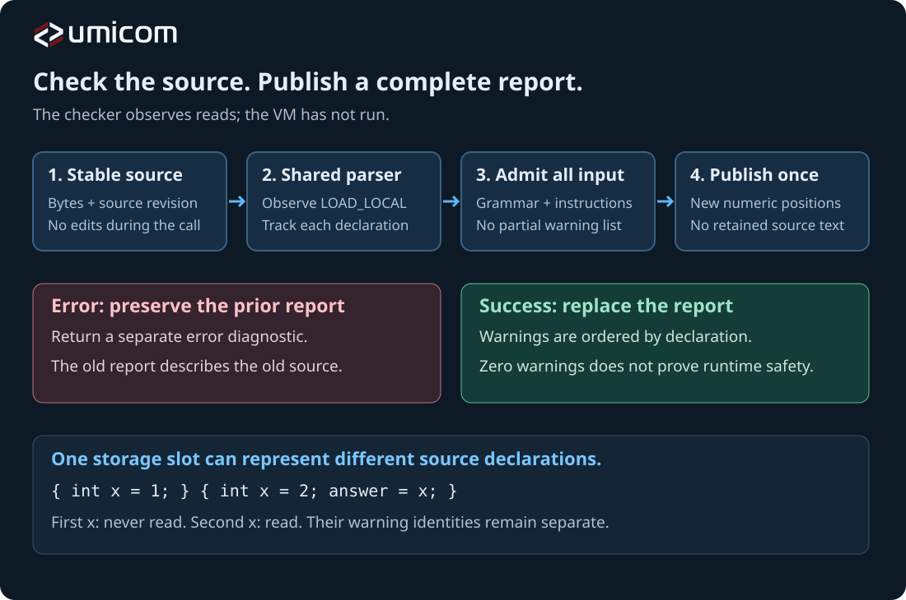

<!--
Umicom Bits2Banking
File: content/lessons/05-engineering/building-a-compiler-in-c/84-report-source-warnings-without-running-a-program.md

PURPOSE:
Report source warnings without running a program

AUTHOR AND ORGANISATION:
Sammy Hegab
Umicom Foundation

LICENCE:
MIT
-->

# Report source warnings without running a program

[Course contents](index.md)

## A warning is a question about intent

Imagine writing down the price of an item but never using that price in your total. The instructions can still be well formed, yet an important calculation may be missing. A compiler warning can point at such a situation before you run the program. A warning does not prove that you made a mistake. Perhaps the value is deliberately kept for a later exercise. It gives you a precise place to review your intent.

In this lesson you will add and use one specific kind of warning: a local integer is initialized, but no supported source expression reads its value. Local means that the name belongs to a function or block, rather than the whole application. Initialized means that a starting value has been supplied. Read means that an operation obtains that value. Writing a new value and reading an old value are different actions. We will follow those actions through the existing Umicom C parser instead of constructing a second parser that could disagree with it.

## Know the supported boundary first

Umicom C currently accepts a bounded integer language with one main function, initialized local integers, supported arithmetic and comparison expressions, conditional statements and lexical blocks. It is not a complete implementation of C23. This exercise does not add arrays, pointers, loops, arbitrary function calls or a complete C preprocessor. Its source check compiles that supported language to the existing internal instructions and validates their structure. It does not run those instructions or invoke a system compiler to build your entire application.

## Create a small source file

1. Open a plain-text editor in your Umicom C checkout. Create a new file named warning_demo.uc; do not overwrite a file that already contains work.
2. Enter the complete program below. Save it as plain UTF-8 text. The example uses ordinary ASCII characters, which have the same byte values in UTF-8.
3. Read the two declarations aloud: omitted starts with 6, and answer starts with 40. Then follow the update and return. Decide which value actually contributes to the answer.

~~~c
int main(void)
{
    int omitted = 6;
    int answer = 40;
    answer += 2;
    return answer;
}
~~~

The equal sign in a declaration supplies an initial value. The statement answer += 2 reads the existing answer, adds two and stores the result. The return expression reads answer again. Nothing reads omitted. A human might notice that the word omitted was deliberately chosen for the demonstration, but a compiler should not guess intent from the spelling of a name. It reports the observable source relationship.

## Run the smallest relevant check

1. Locate the Umicom C executable from your own configured build. These commands assume build/bin inside the checkout. If your build uses another folder, substitute its exact path. An executable-not-found message is a path or build problem, not a warning about this source file.
2. Run the ordinary check first. Then run the same check with the optional --warnings argument. Run each command separately and inspect its output before continuing.
3. Keep the source unchanged between the two commands so that differences are caused by the option, rather than different input bytes.

~~~powershell
.\build\bin\umicom-c.exe check .\warning_demo.uc
.\build\bin\umicom-c.exe check .\warning_demo.uc --warnings
~~~

The first command reports that syntax and bytecode structure were accepted. The second reports ten instructions and one warning. It also identifies omitted at line 3, column 9 in the exact unadorned source printed above. If you use examples/source_warnings.uc, its licence header adds lines, so the reported line number is different. A warning is written to the diagnostic stream and the acceptance summary to the normal output stream; a terminal or log collector may display those streams in different orders.

## Understand exit status and arithmetic limits

An exit status is a small number returned by a command to its caller. Here, zero means that source admission succeeded, even when warnings were reported. Two means invalid command use, unreadable input or rejected source. A stream output failure is reported separately. Warnings are optional observations, not silently converted into errors. A caller that wants a stricter policy should make that policy explicit instead of assuming every diagnostic changes the exit status.

Replace the initializer 6 with 1 / 0 in your scratch copy and check again. The syntax and instruction structure can still be accepted, with the same never-read warning. This is expected: source checking does not execute division. If you choose to run that tiny program, the existing VM reports an arithmetic error. The unused initializer still executes in the current language. Removing a never-read declaration is therefore not automatically behavior preserving. It might remove an error, or in a larger language a future side effect.

This definition is deliberately narrower than a dead-store analysis. Dead-store analysis asks whether a particular written value can influence a later observation. Our warning asks whether a declared local has any source read. A variable repeatedly incremented but never returned may still have no effect on the final answer, yet each increment reads it. The current warning therefore stays silent. Naming that limit helps you avoid turning a useful small check into an unsupported claim about all unused computation.

## Keep declaration identity separate from storage

~~~c
int main(void)
{
    int answer = 0;
    { int temporary = 7; }
    { int temporary = 42; answer = temporary; }
    return answer;
}
~~~

The two names spelled temporary belong to different, nonoverlapping scopes. The first is never read. The second is read when assigning answer. The VM can reuse one local storage slot for both because their lexical lifetimes do not overlap. If warnings were recorded only by slot number, reading the second temporary could incorrectly hide the warning for the first. The compiler therefore assigns each declaration its own warning identity while retaining the existing runtime slot number. The source name, scope identity and storage slot serve related but different purposes.

## Observe reads at one existing lowering point

Lowering means translating a source construct into simpler internal operations. In this compiler a source read eventually emits LOAD_LOCAL. The expression parser uses it for an identifier, the compound-assignment parser uses it before arithmetic, and the increment helper uses it before adding or subtracting one. The warning collector observes that one emission point. This avoids three independent lists of what counts as a read. When contributors add another supported expression, they can reuse the established load operation and its diagnostic observation.

A plain store does not set the read flag. On a declaration, the optional collector records the name’s byte offset and byte length and attaches a fresh identity to the visible local. After leaving a block, the name table shrinks as before. Collected declarations remain available until the whole check ends, so warnings can be returned in declaration order. No source pointer goes into the warning report or the runtime bytecode. Ordinary compilation passes no collector, so it does not allocate the report arrays.

## Use the native API directly

~~~c
#include "umicom_c/source_check.h"

const char source[] = "int main(void){int x=1;return 42;}";
UmcSourceReport report;
UmcDiagnostic error;
UmcStatus status = umc_check_source(
    source, sizeof source - 1U, &report, &error);
if (status == UMC_OK) {
    /* report.warning_count is 1; report.instruction_count is 4. */
    /* Read only report.warnings[0..warning_count). */
} else {
    /* Handle error; do not treat report as a newly published result. */
}
~~~

This fragment belongs inside an existing C function and links to UmicomC::Compiler. sizeof source includes the terminating zero byte that C adds to a string array; subtracting one admits only the source text. The API takes a bounded byte span, so it does not search arbitrary memory for a terminator. The caller provides report and diagnostic storage. The source, report and diagnostic objects must not overlap. A nonzero length still requires that many readable source bytes; a length argument cannot make an invalid pointer safe.

## Publish results only after complete admission

Suppose an editor still displays a successful report from the previous keystroke. The learner then types an incomplete return statement. If a checker overwrote the old report with partial warnings before noticing the syntax error, the editor could display a mixture of old and new facts. The API avoids that mixture. It gathers declarations and read flags in temporary bounded storage, checks the whole source, validates the emitted instructions and only then replaces the caller’s report. On failure the report bytes remain unchanged, while the error diagnostic explains why admission failed.

Unchanged does not mean current. An editor must still associate the old report with the source revision that produced it and show it as stale after an edit. Numeric offsets do not retain the source text and do not track later insertions. A future Studio client should copy a source snapshot, record its revision, run this service and publish only if the revision still matches. This lesson supplies the compiler service; it does not claim that a new Studio warning gutter or background scheduling path has been implemented.

## Read byte locations carefully

Offsets start at zero because the first byte is zero bytes away from the beginning. Displayed line and column numbers start at one. The existing location routine treats a CRLF pair as one line break, and also recognizes lone CR and LF line breaks. A tab contributes one byte column here, even if an editor draws it across several spaces. These are byte locations, not measured screen coordinates or Unicode grapheme positions. To underline a name correctly, a UI must translate from the exact source bytes using its own text display rules.

## Explain the memory bound

The compiler admits at most 256 internal instructions. Every declaration needs at least one store instruction, so that bound also provides a conservative ceiling for declaration records. The warning collector uses fixed arrays with that ceiling, plus the existing 32 simultaneously visible local names. Disjoint scopes can contain more total declarations than visible names because their slots are reused. These arrays use stack memory for the call; no heap allocation or global mutable warning list is introduced. Fixed storage is bounded storage, not free storage. An embedded caller must still provide a sufficient stack.

## Try controlled experiments

1. Change return answer; to return omitted;. The warning should now name answer only if no earlier expression reads answer. Notice that answer += 2 already reads it, so this version has no never-read warning. Explain why before changing the code again.
2. Replace answer += 2; with answer = 42; and return omitted. Now answer is written but never read, so it should be reported.
3. Create two disjoint blocks with the same temporary name, using only the second value. Confirm that the first declaration alone is reported.
4. Introduce an unknown name at the final return. Expect a source error and no newly published warning list. Repair the typo and check again.
5. Put a read inside if (0). Explain why a lexical checker sees it even though execution will not visit that branch.

## Verify behavior rather than implementation details

The regression suite checks all supported update forms, branch reads, reused slots, source ordering, line-ending conventions and every truncated prefix of a small program. It fills the caller’s report with sentinel bytes and verifies that refused input leaves them unchanged. Another case reaches exactly 256 instructions using 127 disjoint declarations and a return, then confirms that one additional declaration is refused. Finally, the ordinary compiler and the checking API must agree on admission status and instruction count. These tests protect observable contracts; they do not merely assert that a particular helper was called.

~~~powershell
ctest --test-dir .\build -R "source-warnings" --output-on-failure
~~~

Run that command only against a build configured with the regression targets enabled and compiled from the corresponding source. A missing test executable is not a passing check. A stale configuration receipt means the build inputs changed after configuration; configure again in the same intended checkout, rebuild the affected targets and rerun. Keep the first failing log when investigating a problem so that a later success does not erase the reason for the change.

## What you can build next

A small editor integration can show these reports alongside syntax errors while preserving revision identity and cancellation boundaries. A stricter build policy can decide whether a never-read warning should fail a project gate. A more advanced compiler can add definite assignment, unreachable-code or dead-store analyses, but each requires its own precise rules and evidence. The useful foundation is one shared source owner, explicit limits and a clear distinction between an observation, a refused program and a program that has actually executed.

## What the current warning observes

| Source after int x = 1; | Counts as reading x? | Reason |
| --- | --- | --- |
| x = 2; | No | Replaces the value without obtaining the old value. |
| x = x + 2; | Yes | The right expression loads the existing value. |
| x += 2; | Yes | The compound update loads before storing. |
| ++x; or x++; | Yes | Both supported statement forms load and update. |
| return x; | Yes | The returned expression obtains the value. |
| if (0) { x++; } | Yes | The warning follows source reads, including an unselected path. |

## Further reading

- [Native warning API contract](https://github.com/umicom-foundation/umicom-c/blob/main/include/umicom_c/source_check.h)
- [Compiler owner](https://github.com/umicom-foundation/umicom-c/blob/main/src/compiler.c)
- [Regression cases](https://github.com/umicom-foundation/umicom-c/blob/main/tests/test_source_warnings.c)

[Previous: Parse standalone blocks with one scope owner](83-parse-standalone-blocks-with-one-scope-owner.md)

[Next: Check document snapshots before building](85-check-document-snapshots-before-building.md)
