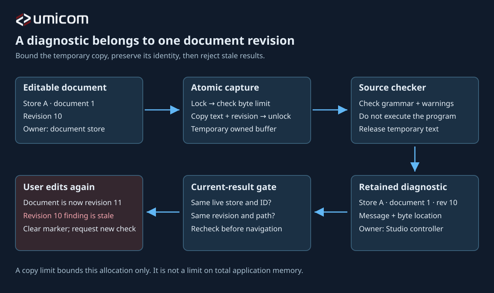

<!--
Umicom Bits2Banking
File: content/lessons/05-engineering/building-a-compiler-in-c/85-check-document-snapshots-before-building.md

PURPOSE:
Check document snapshots before building

AUTHOR AND ORGANISATION:
Sammy Hegab
Umicom Foundation

LICENCE:
MIT
-->

# Check document snapshots before building

[Course contents](index.md)

## What you will build and observe

An editor holds text that may not yet exist in a file. A compiler check examines that text and produces findings, such as a missing name or an unused variable. Between checking and displaying a finding, the learner may edit another line. If the editor applies the old line number to the new text, its marker can point to the wrong place. In this lesson you will run Umicom Studio's optional native source-check command and inspect the shared Framework service that makes results belong to a specific document revision. You do not need to understand a graphical toolkit to follow this exercise.

Complete the previous source-warning lesson first. You should be able to open PowerShell, change directory, recognize a source file and distinguish a compiler from a running program. Keep your experiments in a practice folder. The checker accepts the current small Umicom C subset; it does not replace a complete C23 compiler. In particular, a valid source check is not proof that a native application builds, links, launches or produces the right answer.

## Name the things before combining them

A document store is the object that owns open text. An ID identifies one document within that live store. A revision is an integer that changes when the text changes. A snapshot is a copy of the text and its identifying metadata at one moment. A mutex is a synchronization object: while one operation holds it, another participating operation waits before changing the same protected state. A diagnostic is a structured finding with a severity, message, code and source location. These ideas solve different problems. An ID alone cannot establish which version was checked; a revision alone cannot distinguish two different document stores.

Ownership means responsibility for keeping storage alive and eventually releasing it. The document store owns the editable original. The checker temporarily owns a copied buffer. The Studio controller owns one retained result, but borrows the store. Borrowing does not give permission to destroy the store or keep using it after its owner releases it. Destroy the controller before its store, and discard all borrowed result pointers before either owner is destroyed.

## Prepare the isolated contributor build

1. Use the supported C23 compiler, CMake and Ninja environment from the setup lessons. Confirm that the compiler command is available in this same terminal.
2. Locate your Applications and Umicom C source checkouts. This example uses C:\practice\Umicom-Applications and C:\practice\umicom-c. Substitute your own paths, keeping the second path absolute.
3. From Applications, configure the focused Studio source-check project with the command below. The -S argument selects source; -B selects a separate generated build directory.
4. Read the final configure result. If it fails, stop. A configured build directory does not yet contain the executable.
5. Build, then run CTest. These tests use native code and controlled examples. They do not launch Studio's graphical application or contact a model provider.

~~~powershell
Set-Location "C:\practice\Umicom-Applications"
cmake -S applications/studio/tests/source_check -B build/source-check-practice -G Ninja -DCMAKE_BUILD_TYPE=Debug -DUMICOM_C_PREVIEW_SOURCE=C:/practice/umicom-c
cmake --build build/source-check-practice
ctest --test-dir build/source-check-practice --output-on-failure
& ".\build\source-check-practice\umicom-studio-source-check.exe" --help
~~~

For the ordinary Applications build, UMICOM_STUDIO_CVM_CHECKS=ON enables the same controller and command. This option is off by default because it requires a compatible compiler SDK. UMICOM_C_PREVIEW_SOURCE selects source explicitly; without it, the adapter looks for an installed compiler package. This lesson's focused source build does not demonstrate the installed-package route. The executable uses the supplied Umicom Windows icon through the existing branding helper; no new logo is drawn.

## Write a tiny source file

Create a folder C:\practice\checks and save the following text as warning.uc using your editor. Use a plain UTF-8 text file. The .uc ending is a filename convention that reminds us which language subset we selected; it does not make an arbitrary program compatible. The function starts at main. The declaration creates an integer named unused and gives it seven. The return statement describes the function's eventual result, forty-two, if a suitable runtime later executes the program.

~~~c
int main(void) {
    int unused = 7;
    return 42;
}
~~~

~~~powershell
& ".\build\source-check-practice\umicom-studio-source-check.exe" "C:\practice\checks\warning.uc"
$LASTEXITCODE
~~~

Expect a warning containing UMC_LOCAL_NEVER_READ and a final line saying that instructions were checked, not executed. The exit code is zero because this warning does not reject the source. PowerShell's LASTEXITCODE records the most recent native program's exit code; inspect it immediately. A warning is useful feedback, not a crash. Here the declaration is never read, so you can either remove it when appropriate in your own exercise or use it deliberately. In the Umicom repositories, follow the project's preservation rules when changing existing implementations.

## Turn the warning into a compiler error

Change return 42; to return missing;. No declaration introduces the name missing. Run the same command again. Expect an error location and exit code 2. The error result is still current: it describes the file snapshot just checked. This distinction matters in an editor. Current does not mean successful. A current compiler error should be displayed; an old success should not conceal it. Restore the original return statement before continuing.

Now try int unused = 1 / 0; in the declaration. The source-only checker can accept the grammar and report the unused name without evaluating that division. This is a deliberate boundary: checking is not execution. A later execution must handle arithmetic failure. Do not interpret the absence of a compile error as proof that all operations are safe. A complete development workflow combines structural checks, executed tests, review and the final native build.

## Follow one bounded capture

The native command uses Framework's UmiInputFileRead to read the selected ordinary local file under the compiler's source-byte limit. The editor controller instead starts from an already-open document. For that route, UmiDocumentStoreCopySnapshotBounded acquires the store mutex, finds the document, checks its current byte length against the requested maximum, allocates exactly enough room for the text plus a terminating zero, and copies the text and metadata before releasing the mutex. All allocation admission occurs while the relevant state is protected.

Why not first inspect the length, release the lock, then copy? Another thread could insert a large block between those operations. A small length observed earlier would no longer justify the later allocation. Checking under the same lock as copying closes this particular race. It does not make every part of an application thread-safe. The bound covers this snapshot copy only; the editable document, compiler working storage, diagnostics and operating system still consume memory. A byte is one storage unit; a visible Unicode character may occupy several UTF-8 bytes.

~~~c
UmiDocumentSnapshot snapshot;
char *copy = NULL;
UmiStatus status = UmiDocumentStoreCopySnapshotBounded(
    store, document_id, 4096U, &snapshot, &copy);
if (status == UMI_STATUS_OK) {
    /* Read snapshot.length bytes from copy here. */
    umi_document_store_free_text(copy);
}
~~~

This fragment assumes store and document_id already identify a live document; it is not a complete standalone program. The & operator supplies the address of output storage. NULL means the copy pointer does not yet own a buffer. The function requires that empty pointer to avoid losing an existing allocation. On refusal, neither output changes. A zero-byte limit admits an empty document only. The extra terminating zero is not part of snapshot.length.

## Understand stale findings with three revisions

1. At revision 10, check a document containing an unused variable on line two. Retain its diagnostic as belonging to that ID and revision.
2. Insert a blank line before the declaration. The store advances its revision. The previous diagnostic's line number is now stale.
3. Ask umi_studio_source_check_current for the controller's result. It returns no current result after this edit.
4. Run the check again. The new result carries the new revision and the declaration's new location.
5. Even if you restore exactly the old bytes with another edit, recheck them. Content equality does not roll the revision counter backward.

A failed new request also clears old findings. For example, checking a document after it has closed must not leave yesterday's warning visible as if it were today's result. Two open stores can each contain document ID one at revision two; the checker retains the original store identity too. Results are valid only while that original store remains alive. Reusing a memory address after destruction does not revive the earlier ownership relationship.

## Project a result into Problems

Studio delegates warning and error projection to Framework. Each UmiDiagnosticSnapshot contains a source name, diagnostic code, document correlation ID, revision, message and location. For an untitled document the path is empty; the ID still identifies the live editor document. The projection builds a temporary complete record and publishes it only on success. Stale input, missing warning indexes or a location that cannot fit the destination leave the caller's previous record untouched.

The compiler locations use one-based byte columns. One-based means the first position is column one, not column zero. Byte columns differ from display columns when tabs or multi-byte characters occur. They also differ from the UTF-16 units used by some language-server protocols. Before moving a graphical caret, convert the location against the same current source. Do not reuse a conversion made from an older revision. A freshness check observes state at that moment; serialize the subsequent navigation with editor changes or check again immediately before acting.

## Handle failures as carefully as success

The command returns 1 for input or output failures and 64 for incorrect usage. A missing file, an oversized file and an unsupported path are not compiler successes. If stdout fails halfway through a report, the already-written fragment remains a fragment. The command must return failure and retain the I/O cause through cleanup. The focused tests inject broken print and flush operations to exercise this path without exhausting a real disk. They also inject failed snapshot allocation and verify that the mutex is released, the output pointers stay unchanged and a later permitted copy can succeed.

## What is available and what comes next

The shared bounded snapshot API, document-aware compiler checker, diagnostic projections, Studio controller and optional native command are implemented. Automatic background scheduling, GTK menu entries, editor markers and keyboard shortcuts are not connected to this controller yet. Those frontends must use the same owner and freshness rules rather than create another compiler. A passing focused test is evidence about the exercised native paths, not a complete application or installed-SDK qualification.

## Practice and explain your result

1. Run the accepted, warning and undeclared-name examples. Record each exit code and distinguish compiler refusal from execution.
2. Explain why a zero snapshot limit still needs one byte for an accepted empty string's terminator.
3. Draw two stores that both contain document ID one. Show why matching only the ID and revision is insufficient.
4. Describe which memory is bounded by a snapshot limit and which memory is not.
5. Read the native tests for concurrent copying. Explain why the reader may either receive a consistent small snapshot or a capacity refusal while a writer alternates small and large text.
6. Before connecting a new UI, write down the owner thread, store lifetime, result invalidation point and byte-to-caret conversion policy.

## Interpret the observations

| Observation | Meaning | Next action |
| --- | --- | --- |
| Exit 0 with unused-local warning | Supported source was checked; warning is advisory | Review the variable, then retain native tests |
| Exit 2 with compiler error | This snapshot was refused by the subset compiler | Correct the source or use the appropriate full compiler |
| No current controller result | Document identity or revision no longer matches, or capture failed | Clear stale markers and request a new check |
| Exit 1 or missing executable | Input/output or build preparation failed | Inspect the first failure; do not count skipped work as a pass |

## Further reading

- [Framework document source-check contract](https://github.com/umicom-foundation/umicom-framework/blob/main/include/umicom/toolchain/cvm_document_check.h)
- [Umicom C source-only warnings](https://github.com/umicom-foundation/umicom-c/blob/main/include/umicom_c/source_check.h)

[Previous: Report source warnings without running a program](84-report-source-warnings-without-running-a-program.md)

[Next: Check bit shifts before publishing a result](86-check-bit-shifts-before-publishing-a-result.md)
