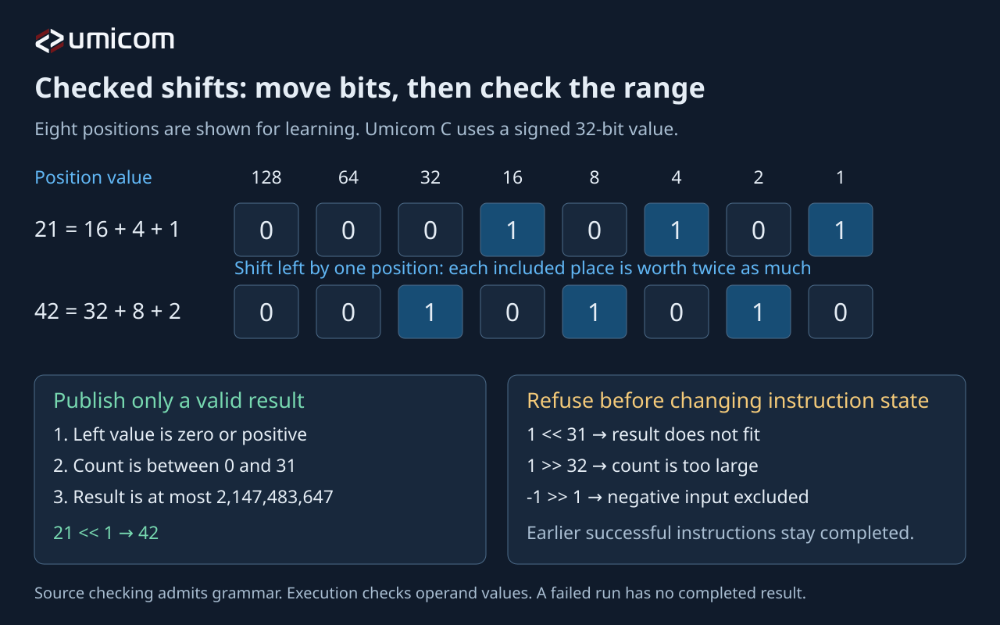

<!--
Umicom Bits2Banking
File: content/lessons/05-engineering/building-a-compiler-in-c/86-check-bit-shifts-before-publishing-a-result.md

PURPOSE:
Check bit shifts before publishing a result

AUTHOR AND ORGANISATION:
Sammy Hegab
Umicom Foundation

LICENCE:
MIT
-->

# Check bit shifts before publishing a result

[Course contents](index.md)

## Start with a row of switches

A bit is a storage position that can hold one of two values: zero or one. Imagine a row of switches. Each position has a different value. Starting on the right, the values are 1, 2, 4, 8, 16, 32, 64 and 128. A one means include that position's value in the total; a zero means leave it out. The written binary number 00010101 therefore means 16 + 4 + 1, which is 21 in our everyday decimal notation. Leading zeros do not change its value. We draw eight positions to make the picture readable, but the Umicom C integer in this lesson has 32 bits. A diagram of eight bits must not be mistaken for the implementation's numeric range.

## Move the positions and predict the answer

A left shift moves every included position to a place worth twice as much. Moving 00010101 left by one position produces 00101010: 32 + 8 + 2 = 42. A right shift moves each position toward the place worth half as much. A bit that moves past the right edge is discarded. For example, 85 shifted right once produces 42, not 42.5. Our integer cannot store the fractional half. The shift count tells us how many positions to move. A count of zero changes nothing. A shift is an operation on a value; it does not move the variable itself to another memory address.

## Know the contract before using an operator

An operator is a symbol that asks a language to perform an operation. Umicom C spells left shift as << and right shift as >>. The expression 21 << 1 has two operands: the value 21 and the count 1. The current checked profile accepts a nonnegative left value, a count from zero through 31, and a result no greater than 2,147,483,647. Nonnegative means zero or greater. That upper limit is INT32_MAX, the largest positive signed 32-bit integer. This is a specific supported subset. It is not a promise that every shift accepted by every other C compiler has the same meaning. In particular, negative left values and unsigned integer types are outside this profile.

| Expression | Outcome | Explanation |
| --- | --- | --- |
| 21 << 1 | 42 | Double 21 |
| 85 >> 1 | 42 | Discard the fractional part |
| 21 << 0 | 21 | Move zero positions |
| 0 << 31 | 0 | Zero still fits |
| 1 << 31 | Arithmetic error | The positive result does not fit |
| 1 >> 32 | Arithmetic error | The count is outside 0..31 |
| -1 >> 1 | Arithmetic error | The checked domain excludes negative left values |

## Prepare the compiler

~~~powershell
Set-Location C:\umicom\umicom-c
cmake --preset windows-ucrt64-debug
cmake --build --preset windows-ucrt64-debug
& ".\build\windows-ucrt64-debug\bin\umicom-c.exe" check examples/checked_shifts.uc
~~~

1. Open PowerShell. A terminal is a program that sends typed commands to other programs and displays their replies.
2. Change into your Umicom C checkout. On the owner's Windows layout this is C:\umicom\umicom-c. If your checkout is elsewhere, use that actual path.
3. Confirm that CMake, Ninja and the UCRT64 compiler are available. The earlier environment lessons explain installation; do not replace a working toolchain merely to copy a path.
4. Configure and build with the Windows preset below. Run each command separately and stop if it reports an error.
5. Use the resulting compiler through its explicit path. An explicit path avoids accidentally running an older executable found elsewhere on PATH.

## Read the complete program

The declaration int value = 84 creates an initialized integer local named value. A local belongs to this function's execution. The statement value >>= 1 means read its current value, shift it right by one, and store the checked result back into that local. It changes 84 to 42. The next statement shifts by zero, so 42 remains 42. A semicolon ends each statement. return supplies the completed result. Neither update writes a file, opens a network connection or allocates a native pointer.

~~~c
int main(void)
{
    int value = 84;
    value >>= 1;
    value <<= 0;
    return value;
}
~~~

## Check structure, then execute

Checking and running answer different questions. Checking asks whether the source belongs to the supported grammar and can form a valid instruction sequence. Running calculates the values. The example has twelve VM instructions: two for the declaration, four for each update, and two for the return. The VM is the small interpreter that executes those instructions. A budget is the maximum number of instructions it may perform. It is not a timeout measured in seconds.

~~~powershell
& ".\build\windows-ucrt64-debug\bin\umicom-c.exe" run examples/checked_shifts.uc --max-steps 12
~~~

## Understand the expected output

These are the expected values for this particular example, not a claim that another installed build has been checked. Repeat with --max-steps 11. The interpreter should report instruction-budget exhaustion and must not print a completed result. The return instruction itself needs one step. This distinction matters when Studio displays results: an old successful value must not remain visible as if it came from a new failed request.

~~~text
Result: 42
Instructions: 12
~~~

## Observe a valid program that refuses at runtime

Save the following program as shift-overflow.uc in your checkout. The syntax is valid, so check should accept it. Running it should report an arithmetic error at the << token. Mathematically the answer is 2,147,483,648, but that does not fit this signed integer type. The VM reports the problem rather than wrapping it into an unrelated negative number. Checking a file without executing it cannot establish every value-dependent property.

~~~c
int main(void)
{
    return 1 << 31;
}
~~~

## Use grouping to explain your intent

Precedence is the language's rule for deciding which operators group together when parentheses are absent. Addition binds more tightly than shifts. Therefore 1 + 2 << 3 means (1 + 2) << 3 and produces 24. Likewise 1 << 2 + 3 means 1 << (2 + 3) and produces 32. Comparisons bind less tightly than shifts, so 2 << 3 < 17 compares 16 with 17 and produces true, represented by one. Repeated shifts associate left to right: 64 >> 2 >> 1 means (64 >> 2) >> 1. Parentheses are useful documentation even when they repeat the default grouping. Never guess the grouping from how many spaces someone typed.

## Follow one instruction through the implementation

Open src/lexer.c, src/compiler.c and src/vm.c. The lexer recognizes a token, which is a meaningful piece of source such as <<=. It must check the remaining byte count before looking ahead. The compiler's shift-expression layer sits between addition and comparisons. It emits SHIFT_LEFT or SHIFT_RIGHT; local updates also emit a load and store. The VM admits the stack shape before execution. At the operation it checks both values before calculating. For left shift it multiplies in a wider 64-bit temporary by a power of two. For right shift it divides by that power. The shared range check runs before publishing the new stack value. Reusing this execution path keeps ordinary runs, traces and paused debugger steps consistent.

## Distinguish a failed instruction from a failed transaction

A transaction groups changes that should either all succeed or leave the old state intact. Here the boundary is one VM instruction. If the shift fails, its input stack values, instruction position and execution count stay unchanged. Earlier successful instructions remain completed. This is not a promise to undo the entire program. A separate output rule says that the caller's final result is published only after a successful return. A trace can still describe the failed attempt. This is useful error evidence, not a successful calculated value. When designing Framework services, choose and document the boundary instead of using the word atomic without explaining what it covers.

## Transfer the program without confusing versions

The serialized program is called bytecode. It stores operation identities and operands in a documented byte order; it does not dump a C structure's raw memory. SHIFT_LEFT and SHIFT_RIGHT use identities 22 and 23. A program containing them needs canonical format 7. Canonical means the one format selected by its actual requirements, not an arbitrary larger number. An older program keeps its older encoding. Runtime capability queries report whether the linked library understands shifts and format 7. Copying a new header into an old SDK does not change the old library's implementation. Kernel's optional diagnostic checks independent literal bytes in real user mode; Framework's preview remains a thin client of the same runtime.

## Test the boundaries and explain each result

~~~powershell
ctest --test-dir build/windows-ucrt64-debug -R "umicom.c.shifts|umicom.c.cli-shifts" --output-on-failure
~~~

1. Run the focused CTest command below after building. A failed test is a reason to inspect the log, not to alter the expected answer until it passes.
2. Predict 3 << 2, 32 >> 3 and 1 << 2 + 1 on paper, then run small programs. The answers are 12, 4 and 8.
3. Try counts -1, 31 and 32 with left values zero, one and INT32_MAX. Explain which rule allows or rejects each pair.
4. Declare const int value = 21 and try value <<= 1. Explain why this is a source mutation error before execution.
5. Try 0 && (1 << 32). Explain why short-circuit evaluation can skip the arithmetic fault while still requiring valid source syntax.
6. Read tests/test_shifts.c. Locate an independent literal-byte test and a native comparison that only executes defined, representable C arithmetic.

## Recover from common problems

If PowerShell cannot find the executable, check whether the build completed and whether you used its actual output directory. If compilation refuses an existing .umcb file, choose a new output filename; that refusal protects previous artifacts. If check accepts a program but run fails, inspect the operator's source position and operand values. If another compiler produces a result for negative shifts, that does not change this VM's documented subset. If a consumer rejects format 7, query the linked runtime's capability mask and align source, headers and libraries before transferring the program. Do not relabel the header to make incompatible code appear older.

## Further reading

- [Checked shift guide and contract](https://github.com/umicom-foundation/umicom-c/blob/main/docs/checked-shifts.md)
- [Independent regression cases](https://github.com/umicom-foundation/umicom-c/blob/main/tests/test_shifts.c)

[Previous: Check document snapshots before building](85-check-document-snapshots-before-building.md)

[Next: Inspect managed memory without collecting](87-inspect-managed-memory-without-collecting.md)
