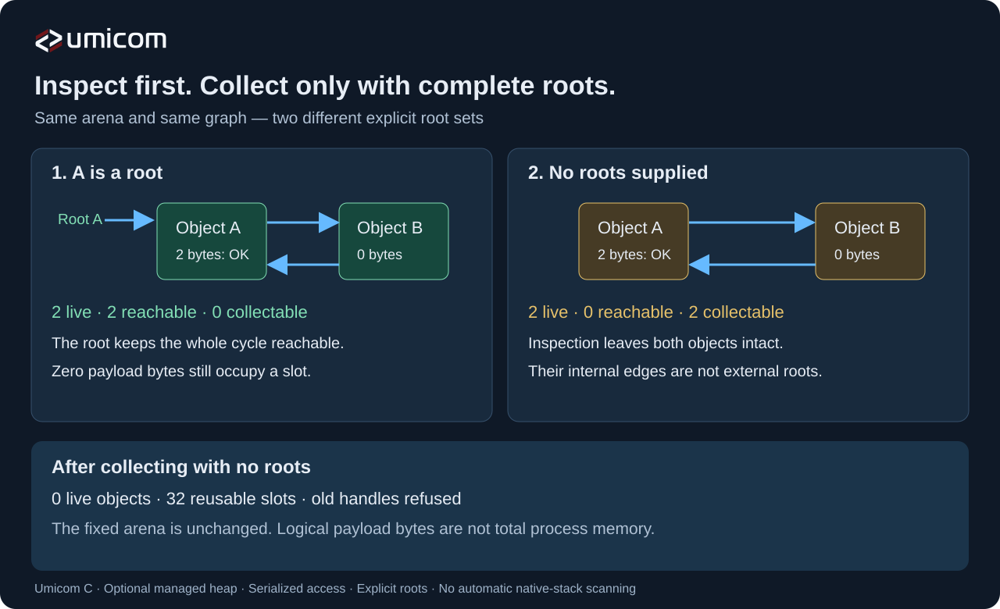

<!--
Umicom Bits2Banking
File: content/lessons/05-engineering/building-a-compiler-in-c/87-inspect-managed-memory-without-collecting.md

PURPOSE:
Inspect managed memory without collecting

AUTHOR AND ORGANISATION:
Sammy Hegab
Umicom Foundation

LICENCE:
MIT
-->

# Inspect managed memory without collecting

[Course contents](index.md)

## Begin with a storage question

Suppose a program says that it has only two bytes of useful data. Does that mean the program occupies two bytes of memory? No. It also needs storage for instructions, metadata, buffers and other values. This lesson uses Umicom C’s small optional managed heap to distinguish useful payload, object occupancy and reserved storage. You will inspect a graph before deciding whether to collect it. This is an original bounded teaching runtime, not a replacement for every allocation made by a native application.

## Recall objects, handles and roots

An object is one slot containing a declared payload and explicit references to other objects. The payload is the object’s user data. A handle is an integer identifying a slot and its current generation. Reusing a slot advances its generation so an older handle is refused. A root is a handle that the caller explicitly supplies as a starting point for reachability. The runtime follows the declared references from these roots. A handle stored only in an ordinary C variable or hidden among payload bytes is not automatically a root.

1. Open include/umicom_c/managed_heap.h in the Umicom C checkout. Find the limits: 32 slots, 128 payload bytes per slot and four edges per object.
2. An edge is one declared outgoing reference. Follow umc_heap_set_edge to see how that relationship is recorded.
3. Open examples/managed_cycle.c. Identify the two handles first and second, the static arena, and the two-byte message O and K.

## Draw the reachability before running it

The example creates first → second and second → first. Together they form a cycle. If first is a root, both objects are reachable. If no roots are supplied, both are unreachable even though they still point to one another. The first object has two logical payload bytes; the second has zero. Both occupy a slot. A zero-length object can still participate in a graph.

| Question | With first as a root | With no roots |
| --- | --- | --- |
| Live objects before collection | 2 | 2 |
| Reachable objects | 2 | 0 |
| Collectable objects | 0 | 2 |
| Logical payload bytes | 2 | 2 |
| Does inspection mutate the graph? | No | No |

## Call the read-only service

UmcHeapReport is a structure containing the result fields. The caller owns its storage separately from the heap and roots. umc_heap_inspect validates the entire graph and the supplied roots before publishing a report. Always check its status. On failure the report is unchanged, so an old report must not be mistaken for a successful new one. The heap parameter is const, expressing that this operation does not modify the heap through that pointer.

~~~c
UmcHeapReport report;
UmcHeapStatus status = umc_heap_inspect(&heap, &first, 1, &report);
if (status != UMC_HEAP_OK) {
    return 1;
}
printf("%zu reachable; %zu collectable\n",
       report.reachable_objects, report.collectable_objects);
~~~

## Understand the ampersand and count

&heap passes the address of the arena. &first passes the address of the one handle used here as a root. The count 1 says that this root array has one entry. &report passes the address of the result structure. A pointer alone does not tell C how many elements can be read. The count is therefore part of the contract. Pass NULL and zero for an empty root set. NULL with a nonzero count is refused. More than 32 root entries is refused before reading them.

## Build the example step by step

The example is ordinary host C compiled by GCC, Clang or another supported C23 compiler. It is not source accepted by the small Umicom C integer-language frontend. You need CMake and Ninja as well as the compiler. Configure the Umicom C checkout using the existing first-program setup if this is your first build. Run one command at a time and stop after any failure. The last command selects both the existing collector tests and the new inspection tests.

~~~powershell
Set-Location "C:\umicom\umicom-c"
$env:Path = "C:\msys64\ucrt64\bin;$env:Path"
cmake -S . -B build/debug -G Ninja -DUMICOM_C_BUILD_TESTS=ON
cmake --build build/debug --parallel 2
ctest --test-dir build/debug -R "umicom.c.(managed-heap|heap-inspection)" --output-on-failure --no-tests=error
~~~

## Observe expected output

The example prints an inspection with two live and two reachable objects, none collectable, and two payload bytes. It then inspects with no roots and reports two collectable objects without deleting them. A real collection with first as a root still retains the cycle and reads OK. Finally a collection with no roots clears both objects and an old handle is refused. The last line says that 32 slots are reusable and arena storage is unchanged. The test verifies these conditions; it does not rely only on printing plausible numbers.

~~~text
Inspection: 2 live, 2 reachable, 0 collectable, 2 payload bytes
Inspection with no roots: 2 collectable; heap unchanged
Rooted cycle retained: OK
Unrooted cycle collected: 2; old handle refused
After collection: 32 reusable slots; arena storage unchanged
~~~

## Separate logical bytes from arena bytes

live_payload_bytes adds the requested lengths of live objects. It does not add all 128 bytes reserved inside each slot. arena_bytes is sizeof(UmcManagedHeap), which includes every fixed slot and its metadata. The exact value can depend on target layout and alignment, so read the field instead of guessing a universal number. Collection clears unreachable slots; it does not shrink the caller-owned structure. This is why the arena size stays the same after collection. Neither field includes native malloc allocations, graphics resources, the executable, the traversal stack or all memory used by the process.

## Read the slot accounting

live_objects + reusable_slots + retired_slots equals 32. A reusable slot is unused and can advance its generation. A retired slot is unused and already has the largest generation value. Reusing a retired slot would wrap the generation and could make an ancient handle appear valid again, so allocation skips it. A live object at the final generation remains live until collected; it is not counted as retired early. Collectable objects therefore do not always translate into the same number of newly reusable slots.

## Share graph logic instead of copying it

Open src/managed_heap.c and find reachable. It validates object metadata, checks every root and marks each encountered slot when adding it to a bounded work stack. Marking at insertion means duplicate roots, repeated edges and cycles cannot enqueue the same object repeatedly. Inspection and collection call this same helper. Inspection reads the marked set to form counters. Collection clears unmarked live objects. Keeping these two operations on one traversal prevents them drifting into contradictory definitions of reachable.

## Test the contract independently

The regression file tests known graphs and a separate matrix-based transitive-closure oracle. An oracle is another way to calculate the expected result. The matrix algorithm does not reuse the production traversal stack, reducing the chance that the test merely repeats the same mistake. Failure tests prefill the report with a recognizable pattern and verify that invalid roots or graph metadata preserve it. Heap snapshots are compared before and after successful inspection. Generation-boundary tests inject controlled metadata only inside the test; application code must not modify heap fields directly.

## Use reports carefully in tools

A debugger could show these counters without collecting a paused graph. A lesson viewer could explain why one root keeps a cycle alive. Such clients must supply complete roots and serialize access. A report becomes historical when roots, edges or allocations change. Recompute it before presenting a current view. This service does not enumerate roots from native stacks, make collection concurrent, close files, release GPU resources or diagnose an unrelated application crash. Those require their own ownership and measurement work.

## Practice before moving on

1. Predict the report if first keeps its reference to second but second no longer references first. With first as a root, both remain reachable.
2. Predict the report if the only root is second and its edge back to first is cleared. Only second remains reachable; first becomes collectable.
3. Explain why a zero-length object still reduces reusable_slots by one. It occupies a metadata and storage slot even without logical payload bytes.
4. Explain why a successful inspection with no roots is not permission to collect a real application whose current roots you forgot to supply. Completeness of the root set is the caller’s responsibility.

[Previous: Check bit shifts before publishing a result](86-check-bit-shifts-before-publishing-a-result.md)

[Next: Parse an empty statement without emitting code](88-parse-an-empty-statement-without-emitting-code.md)
