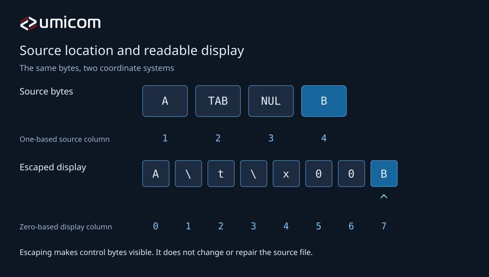

<!--
Umicom Bits2Banking
File: content/lessons/05-engineering/building-a-compiler-in-c/92-show-source-errors-without-printing-control-bytes.md

PURPOSE:
Show source errors without printing control bytes

AUTHOR AND ORGANISATION:
Sammy Hegab
Umicom Foundation

LICENCE:
MIT
-->

# Show source errors without printing control bytes

[Course contents](index.md)

## What you will learn

A compiler diagnostic is a message about source code. It may report a spelling that the parser cannot understand, a name that has not been declared, or an operation that cannot produce a valid result. A useful message shows where the problem happened. This lesson builds on the compiler you already have: it explains how Umicom C displays a small piece of the source without allowing hidden bytes to control the terminal. You will deliberately cause an error, read the location, correct the program, and distinguish source coordinates from display coordinates.

## Start with four small definitions

| Term | Meaning in this lesson |
| --- | --- |
| Byte | A storage unit holding a value from 0 to 255. A source file is a sequence of bytes. |
| Offset | A count from the beginning of that sequence. The first byte has offset zero. |
| Line and column | A human-facing location. Here lines and source byte columns start at one. |
| Excerpt | A limited part of a source line, rendered for reading. It is not another source file. |
| Caret | The visible ^ character used to point at the reported position. |

## Prepare an isolated practice file

1. Open PowerShell in the Umicom C repository where you built the command-line tool in earlier lessons.
2. Confirm the path to your actual build directory. Do not assume an example directory contains an executable.
3. Create a practice folder outside your source tree or use an existing ignored practice directory. Keep your own work intact.
4. Open a plain-text editor, enter the program below and save it as divide.uc in that practice folder. Use UTF-8 without a byte-order mark.

~~~c
int main(void) {
    return 1 / 0;
}
~~~

## Predict before running

The slash is integer division. There is no integer result for one divided by zero. The parser can still understand the expression: syntactically valid does not mean safe to execute. In Umicom C the checked preview runtime reports the arithmetic error instead of supplying a fabricated number. This distinction matters when you use fast checking before a larger build. A syntax check cannot replace every execution test.

## Run the current tool

Adjust both paths to your real build and practice locations. The ampersand asks PowerShell to execute the program. LASTEXITCODE is the exit status left by the most recent native command. A nonzero value is expected for this deliberately invalid calculation. Do not continue a deployment sequence after such a failure.

~~~powershell
& .\build\windows-ucrt64-debug\bin\umicom-c.exe run .\practice\divide.uc
$LASTEXITCODE
~~~

## Read the message in order

1. Read the filename to confirm which input was processed.
2. Read the line number to find the line containing the division.
3. Read the source byte column and message. The slash is the failing operation in this example.
4. Read the line below the message. The vertical bar is a display gutter, not part of your program.
5. Follow the caret to the reported byte. An operation can be reported where it fails even when its inputs were introduced elsewhere.

## Correct and compare

Replace the return expression with 84 / 2, save the file, and run exactly the same command. The result should now be 42. If you still see the old diagnostic, check the file path, editor save state and executable path. A successful result verifies this small execution; it does not prove that all possible programs are correct. Keep the deliberately failing version only as a named practice fixture if you want to revisit it.

## Why a tab can move the caret

A tab is one byte with value nine. A terminal often expands it to a variable number of spaces, depending on the current position and tab-stop settings. Printing raw source and then counting source bytes as screen columns would place the caret incorrectly. Umicom C instead shows a tab as visible backslash followed by t. Those are two display characters, while the source location still counts one byte. The formatter computes the caret after applying the same escaping rules to every preceding byte.

## Understand hexadecimal byte escapes

Hexadecimal is base sixteen. Its digit symbols are 0 through 9 and A through F. Two hexadecimal digits can represent every byte: 00 is zero and FF is 255. A visible backslash-x followed by two digits describes one original byte in this excerpt. For example, 1B represents decimal 27, the escape control byte. Terminals can interpret sequences beginning with that control byte as commands. Showing the characters backslash-x-1-B makes the value readable instead of sending that byte to the terminal.

## Follow one complete coordinate example

The B has source column four because source columns start at one. Its caret uses display column seven because the visible representations before it occupy seven characters. A doubled backslash also occupies two characters. Non-ASCII bytes are escaped individually; this is intentionally a byte view, not a Unicode character or grapheme display.

| Source byte offset | Original value | Visible spelling | Starting display column |
| --- | --- | --- | --- |
| 0 | Letter A | A | 0 |
| 1 | Tab | \t | 1 |
| 2 | Zero byte | \x00 | 3 |
| 3 | Letter B | B | 7 |

## Newlines are a storage convention

Unix-style text often ends a line with LF, byte ten. Windows text commonly uses the pair CR LF, bytes thirteen and ten. Older files may use CR alone. The source locator treats CRLF as one line break and also accepts the individual forms. A position at a newline byte generally refers to the preceding line end. The special position between CR and LF maps to the next line start, matching the existing location contract. This matters to reusable services even if normal parser diagnostics rarely choose that interior position.

## An error can be at the end

If a closing brace is missing, the parser may reach the end of the file before it can complete the program. The offset is then equal to the file length; it is not an attempt to read a byte outside the buffer. The display can put the caret just after the last character. If the file ends with a line break, the final line is empty. An empty excerpt with a caret is meaningful in that case. An offset greater than the length is refused.

## Keep long lines bounded

A file may contain a very long line or accidental binary content. Printing all of it would make a small error message expensive and unreadable. The service selects at most eighty source bytes around the location. It reuses unused space near the right edge to show more preceding context. Three dots mark a clipped edge. Each source byte needs at most four display characters, and two edge markers need at most six. One final zero terminates the C string. The maximum array size is therefore 80 times 4 plus 6 plus 1, or 327 bytes.

## Call the reusable API

This is a fragment for a compiler client linked to UmicomC::Compiler. sizeof bytes supplies the complete array length, including the deliberate zero byte. strlen would stop early and would describe the wrong input. A borrowed span means the caller owns and keeps the input alive. The output is a separate caller-owned object. Neither object may be concurrently changed while the function is using it.

~~~c
#include "umicom_c/diagnostic_excerpt.h"

const char bytes[] = {'A', '\t', '\0', 'B'};
UmcDiagnosticExcerpt excerpt;
UmcStatus status = umc_diagnostic_excerpt(
    bytes, sizeof bytes, 3, &excerpt);
if (status == UMC_OK) {
    /* excerpt.column == 4; excerpt.caret_column == 7.
       Present excerpt.text using a literal format string. */
}
~~~

## Preserve state when admission fails

Admission means checking whether the request fits the service contract before producing a result. NULL pointers, an excessive source length and an impossible offset are refused. The function computes a local candidate and assigns it to the output only after success. A failed call leaves an existing output unchanged. This makes error handling predictable, but it does not initialize an output that was never initialized. Always inspect the return status before using the result. The API does not discover whether an arbitrary pointer really has the memory its caller promised.

## Test different failures deliberately

1. Run a source file with an unexpected punctuation character and confirm that syntax errors show context.
2. Run check with --warnings on a program containing an unused local and confirm that the warning also shows context.
3. Try a long source line in a practice file and look for clipped-edge dots.
4. Use the automated regression tests for zero bytes, control bytes and malformed spans; do not type terminal control sequences manually.
5. Run the diagnostic-excerpt CTest group from your configured build directory. An authored test is not evidence until it executes and its result is checked.

## Know the boundary of this change

The service sanitizes the source excerpt. It does not sanitize every filename, implement a terminal, change compiler grammar, add native machine-code generation or alter bytecode. Bytecode commands do not present binary input as source. The interactive debugger has separate presentation. An editor with Unicode-aware layout may later reuse byte locations and implement its own glyph mapping, but it must document that extra contract instead of guessing that one byte always equals one character.

## Practice and check your understanding

1. For the source bytes A, tab, zero and B, explain why B has source column four but display column seven.
2. Explain why strlen is wrong for the deliberate embedded-zero array.
3. Calculate the worst-case text array size and identify where its final extra byte is used.
4. Explain why a valid syntax check can be followed by a division-by-zero error during execution.
5. Describe the recovery steps when an error message shows a file you did not intend to run.

[Previous: Count structural paths before running bytecode](91-count-structural-paths-before-running-bytecode.md)

[Next: Lower Boolean words without changing the VM](93-lower-boolean-words-without-changing-the-vm.md)
