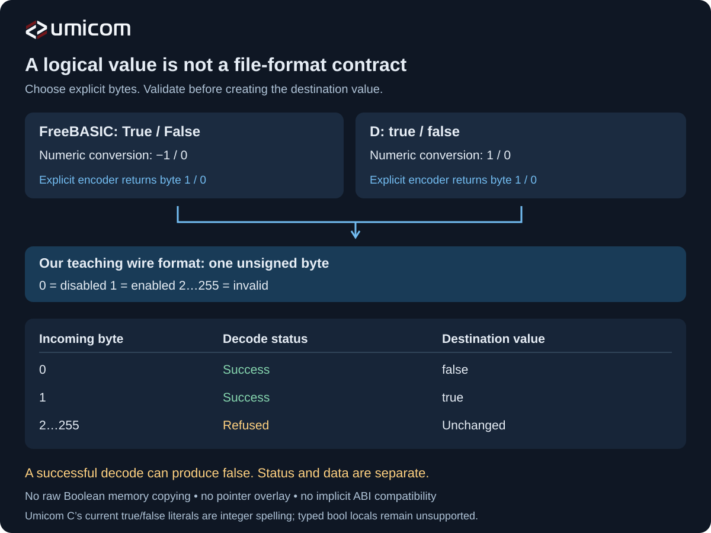

<!--
Umicom Bits2Banking
File: content/lessons/05-engineering/building-a-compiler-in-c/93-lower-boolean-words-without-changing-the-vm.md

PURPOSE:
Lower Boolean words without changing the VM

AUTHOR AND ORGANISATION:
Sammy Hegab
Umicom Foundation

LICENCE:
MIT
-->

# Lower Boolean words without changing the VM

[Course contents](index.md)

## Begin with a decision that has two answers

A Boolean idea has two alternatives: true and false. An example is whether a task is enabled. A programming language must separately decide how that idea is written, which type represents it, and which operations execute it. Umicom C's current language stores bounded signed integers. This lesson adds the written words true and false as integer values 1 and 0. It does not add a bool variable type or a complete C23 type system.

## Follow text through three existing owners

| Owner | Input | Result |
| --- | --- | --- |
| Lexer | The exact source bytes true | An INTEGER token with value 1 and the keyword's byte position |
| Parser/compiler | An integer token in a valid expression | The existing PUSH instruction |
| VM | PUSH 1 followed by RETURN | The integer result 1 |

## Read a minimal accepted program

~~~c
int main(void) {
    return true;
}
~~~

## Name every part

int names the supported integer return type. main is the single supported entry function. void says it takes no arguments. Braces enclose its body. return supplies its result. true is one literal token; the semicolon ends the statement. The generated program needs two instructions, PUSH and RETURN, just as return 1 does. A new spelling does not require a new runtime operation.

## Inspect the actual source change

Open src/lexer.c in the Umicom C checkout. The lexer already reads an identifier-shaped sequence of letters, digits and underscores. It then uses matches to compare the whole sequence with each reserved word. The new branch checks true and false after the existing control-flow keywords. It sets the token kind to UMC_TOKEN_INTEGER and stores 1 or 0. The existing parser already accepts that token, so it needs no second Boolean expression parser. Source positions continue to come from the same bounded lexer.

## Make keyword boundaries deliberate

| Spelling | Meaning in this profile |
| --- | --- |
| true / false | Exact lowercase integer literals 1 / 0; reserved names |
| true_value / falsehood | Ordinary identifiers requiring declarations |
| True / FALSE | Ordinary case-sensitive identifiers; not alternate keywords |
| int true = 1; | Rejected: a local name cannot be a reserved literal |
| bool ready = true; | Unsupported typed declaration; the grammar still has integer locals |

## Build the current source

1. Open PowerShell in C:\umicom\umicom-c, or your equivalent Umicom C checkout.
2. Follow the toolchain setup guide if CMake, Ninja or GCC is unavailable. Configuration prepares the build; building produces the executable.
3. Run the commands one at a time. A failed build can leave an older executable, so stop on errors.
4. The focused test selection exercises this feature. A broader release qualification remains a separate step.

## Run the focused checks and example

~~~powershell
Set-Location "C:\umicom\umicom-c"
cmake -S . -B build -G Ninja -DCMAKE_C_COMPILER=C:/msys64/ucrt64/bin/gcc.exe
cmake --build build
ctest --test-dir build -R "boolean-literals" --output-on-failure
& ".\build\bin\umicom-c.exe" check .\examples\boolean_literals.uc
& ".\build\bin\umicom-c.exe" run .\examples\boolean_literals.uc
~~~

## Trace the larger example before running it

~~~c
int main(void) {
    const int enabled = true;
    int ready = false;
    if (enabled && !ready) {
        ready = 42;
    }
    return enabled ? ready : 1 / 0;
}
~~~

## Understand the result

enabled starts as 1 and cannot be reassigned through this source name. ready starts as 0. Logical ! turns zero into 1, so both sides of enabled && !ready are true. The selected block assigns 42. The conditional return chooses ready and does not execute division by zero. The expected returned integer is 42. Notice that ready can hold 42: an integer initialized with false does not become a Boolean storage type.

## Separate syntax checks from execution

The compiler parses both alternatives, including unselected expressions. An unknown name or malformed expression on a skipped path still fails compilation. The runtime evaluates only the selected path. Therefore false && missing is a compile error, while false && (1 / 0) compiles and returns zero. Changing the first operand to true makes division execute and fail. These are different kinds of feedback. A source checker is not a proof that every run is safe.

## Preserve portable bytecode

A single literal return keeps existing canonical format 1. The larger example contains forward branches and uses existing format 4. These formats were not renumbered or reinterpreted. The wire representation still records integer operations and source offsets, not the original word spelling. Header profile UMC_BOOLEAN_LITERAL_PROFILE and compiler feature UMC_FEATURE_BOOLEAN_LITERALS describe the source extension. Query the linked compiler's named feature bit instead of assuming a new header upgrades an old library. The VM must not advertise a source-only feature.

## Design checks that find real mistakes

1. Compare simple expressions with values evaluated by the host C compiler: true + true, !false, true ? 42 : 3, and combinations with comparisons.
2. Check exact words and longer names. A starts-with test would incorrectly reserve true_value.
3. Pass each truncated prefix of a complete source span to the compiler. It must not read beyond the declared length to search for a terminator.
4. Verify that source offsets point to the first byte of the keyword and survive bytecode encoding and decoding.
5. Run with one instruction of fuel: PUSH alone cannot finish the return, so the caller's prior result must remain unchanged.
6. Check the actual CLI process and its output artifact. A unit test of the lexer cannot establish that the launcher passed the right source filename.

## Learn from a test-wrapper error

A test is also a program. In CMake, ${SOURCE} substitutes the value of a variable; closing the braces before SOURCE leaves a different expression and can pass a literal wrong filename. A compiler error about an unopenable file can therefore be a test-harness problem rather than a lexer bug. Inspect the exact command arguments first. Similarly, a declaration rejection may have a specific message such as expected a local integer name; requiring a generic syntax error string would make a correct rejection fail the test. Keep the status, the precise intended diagnostic and the source identity together.

## Try a small investigation

1. Create your own file containing return true. Check it, inspect it, and predict the two executed instructions.
2. Change it to return true + true. Explain why the result is 2 in this integer language.
3. Declare int true_value = 42 and return it. Then deliberately shorten the name to true and inspect the error position.
4. Initialize an unused integer with true and run check with --warnings. Explain why a constant token does not count as a read of that variable.
5. Explain what would still be needed to implement typed bool locals: type tracking, assignment conversions, operator rules, diagnostics, ABI decisions and additional tests. Do not claim those behaviors from literal support alone.

## Use the same compiler in Framework

Framework's optional compiler integration can consume the linked compiler API and feature query. Keep it as an adapter rather than duplicating keyword handling in Studio. This lesson qualifies a language contract and its CLI checks; it does not establish installed SDK compatibility, editor coloring, a warning gutter or a full native C23 compiler. BASIC and D have their own Boolean rules, so cross-language interfaces should state the accepted numeric flag values explicitly.

[Previous: Show source errors without printing control bytes](92-show-source-errors-without-printing-control-bytes.md)

[Next: Supply a signed input in a browser worker](94-supply-a-signed-browser-input.md)

Logical meaning, numeric conversion and an external byte contract are separate decisions.
