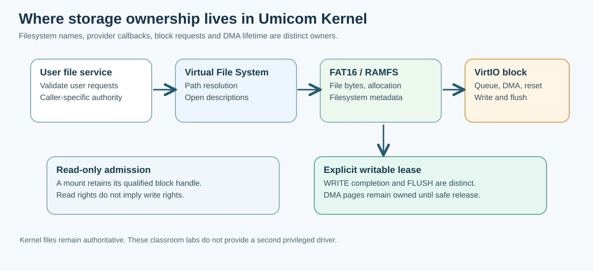

# 136. Follow storage and filesystem code in Umicom Kernel

You have built a four-sector write-back model and a single-record Notes journal. Now examine how the **actual Umicom Kernel** separates the same underlying concerns across its filesystem, driver and user-service boundaries.

Umicom Kernel is a freestanding C23/RISC-V research kernel. It is separate from the production-oriented Umicom OS distribution, which currently uses a Linux-libre kernel baseline. We are studying the Kernel's native implementation, not claiming that the educational laboratory or the research Kernel is a production banking operating system.



## 1. Find the source files

Open the [Umicom Kernel repository](https://github.com/umicom-foundation/umicom-kernel) and inspect these files in order:

| Source | Responsibility |
| --- | --- |
| [`kernel/vfs.c`](https://github.com/umicom-foundation/umicom-kernel/blob/main/kernel/vfs.c) | Path components, file descriptions and a filesystem-provider interface |
| [`kernel/ramfs.c`](https://github.com/umicom-foundation/umicom-kernel/blob/main/kernel/ramfs.c) | In-memory directories and file pages |
| [`kernel/disk_filesystem.c`](https://github.com/umicom-foundation/umicom-kernel/blob/main/kernel/disk_filesystem.c) | Mount and qualified block-handle ownership |
| [`kernel/fat16_provider.c`](https://github.com/umicom-foundation/umicom-kernel/blob/main/kernel/fat16_provider.c) | Read-only FAT16 VFS provider |
| [`kernel/fat16_writable_provider.c`](https://github.com/umicom-foundation/umicom-kernel/blob/main/kernel/fat16_writable_provider.c) | Explicitly admitted writable operations and uncertainty retention |
| [`kernel/virtio_block.c`](https://github.com/umicom-foundation/umicom-kernel/blob/main/kernel/virtio_block.c) | Modern VirtIO MMIO requests, queue ownership, DMA staging and reset |
| [`kernel/user_files.c`](https://github.com/umicom-foundation/umicom-kernel/blob/main/kernel/user_files.c) | Checked per-task requests through the native service boundary |

Start by reading the introductory comments of each file. They explain its ownership and why one source file should not take over another layer's responsibilities.

## 2. Understand the VFS boundary

The **Virtual File System** (VFS) gives programs one interface for working with files and directories. A provider supplies the actual file content and metadata behind that interface.

Umicom Kernel's `vfs.c` resolves bounded paths and manages client-local descriptors. `ramfs.c` provides one implementation backed by Kernel-owned memory pages. A disk provider can supply data through a block device instead. The namespace interface does not need to be reimplemented for every storage device.

In the Notes journal laboratory there is no directory, user identity or descriptor. That is precisely why it should not be presented as a substitute for this VFS.

## 3. Read before permitting writes

The [read-only filesystem provider guide](https://github.com/umicom-foundation/umicom-kernel/blob/main/docs/READ_ONLY_FILESYSTEM_PROVIDER.md) explains how a filesystem mount keeps its qualified VirtIO block handle alive. The filesystem cannot keep reading disk sectors after the transport owner is closed.

The [writable VirtIO guide](https://github.com/umicom-foundation/umicom-kernel/blob/main/docs/WRITABLE_VIRTIO_BLOCK.md) describes a separate writable lease. Opening a read-only provider is not secretly upgraded just because the driver has implemented additional write operations.

Look for `UmicomKernelBlockOpenWritable`, `UmicomKernelBlockWrite` and `UmicomKernelBlockFlush` in the source. Read the adjacent comments about whether an operation was submitted, completed or confirmed by a flush. The distinction is the same concept we tested with `BtbStorageStage()` and `BtbStorageFlush()`—but real VirtIO work has far more demanding ownership and hardware boundaries.

## 4. Why a failed write is an uncertain event

The Kernel's [writable VirtIO documentation](https://github.com/umicom-foundation/umicom-kernel/blob/main/docs/WRITABLE_VIRTIO_BLOCK.md) records three different mutation outcomes:

- **NOT_SUBMITTED:** the admitted request did not become available to the device.
- **SUBMITTED_UNCONFIRMED:** the device may have acted on the request, but completion was not fully verified.
- **COMPLETED:** the particular request's successful completion was checked; a completed WRITE still needs a suitable later FLUSH to establish its storage protocol's stable-write boundary.

A timeout does not revoke ownership of memory still reachable by DMA. The driver must wait for an authorised reset acknowledgement before returning that memory to its allocator. This prevents an old device request from writing into memory that has already been reassigned to another service.

## 5. A dirty marker is not our write-ahead log

Read [Ordered FAT16 commits and interruption detection](https://github.com/umicom-foundation/umicom-kernel/blob/main/docs/FAT16_ORDERED_COMMITS.md).

That Kernel feature marks an update dirty before its change, flushes and verifies the new data, and later finishes the clean finalisation. The dirty flag tells the next reader that an operation was unfinished. It does **not** retain the old and new data needed to replay arbitrary changes.

Our classroom journal stores an explicit redo record, so it can replay a one-note change in its deterministic memory model. Those are different mechanisms. Do not describe the FAT dirty marker as a complete write-ahead log or present our classroom exercise as a production filesystem.

The [FAT16 regular-file lifecycle](https://github.com/umicom-foundation/umicom-kernel/blob/main/docs/FAT16_FILE_LIFECYCLE.md) also distinguishes staging from finalisation and documents the supported subset of file operations. Its limits matter when assessing what a system can actually do.

## 6. Verify the research build without editing the Kernel

You can inspect the Kernel using GitHub alone. If you already have a local Umicom Kernel checkout and the required compiler/QEMU installation, the official [build and test guide](https://github.com/umicom-foundation/umicom-kernel/blob/main/docs/BUILD_AND_TEST.md) provides its current commands.

The ordinary PowerShell build sequence is:

```powershell
Set-Location "C:\umicom\umicom-kernel"
cmake --preset riscv64-clang-debug
cmake --build --preset riscv64-clang-debug --parallel 2
ctest --preset riscv64-clang-debug --output-on-failure
```

These commands are **read/build/test only** and do not change the source repository. A successful QEMU test qualifies only the selected emulator, firmware and feature profile; it is not a general hardware or power-failure certification.

Our Update 21 archive intentionally contains **no files** for Umicom Kernel, Framework, OS or Applications. The Kernel sources remain read-only references for the educational course.

## 7. Your next engineering task

Prepare a diagram for a future multi-file Notes application. Show the ownership of:

1. The user's document working copy.
2. The file descriptor and pathname authority.
3. The filesystem's allocation and metadata records.
4. A block-device request and its DMA buffers.
5. The acknowledged persistence or error result.

Then explain where you would place a write-ahead record and which recovery component would verify it after a restart. Keep a clear distinction between the *application data transaction* and the *filesystem's own metadata consistency*.

**Questions:** Why does a read-only mount not automatically gain write authority? Why does a dirty FAT marker not contain redo information? Who owns the device memory after a submitted request times out? Why should the Kernel not depend on the Umicom Framework user-space libraries?

[Return to the systems-engineering course](../05-engineering/index.md).
