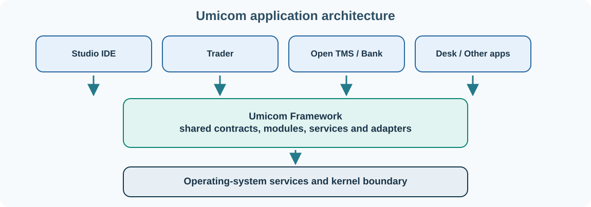

# 23. Introducing Umicom Framework and its architecture

As software grows, developers often discover that several applications need the same capabilities: windows, document handling, configuration, logging, networking, database access and test execution. If every application implements these independently, bugs and maintenance work multiply.

**Umicom Framework** provides shared C23-based application services and contracts. Applications such as Umicom Studio IDE, Umicom Trader and Umicom Bank are intended to use those shared capabilities while keeping their own product-specific behaviour separate.

## Why the Framework was created

The original Umicom Framework research explored how to reduce tangled code in web and desktop applications. It used **modular Model–View–Controller**, a common application structure and a hierarchy of **Master Controller** and **Slave Controllers**. The aim was to make software easier to understand, extend and maintain.

The contemporary Framework carries that idea into a modular, C-first system. The implementation uses explicit C interfaces, module descriptors, lifecycle rules, services and adapters. Instead of every part of the application knowing about every other part, modules communicate through defined contracts.

## Master Controller and Slave Controllers

The **Master Controller** coordinates the application as a whole: initialisation, startup ordering, module registration and shutdown. It should not implement every banking rule, editor command or widget itself.

A **Slave Controller** is responsible for a particular module or functional area. For example, a document module can coordinate editing and saving, while a task-board module can own the task lifecycle. A controller can depend on another service through a public contract without reaching into that service's private memory.

A typical module may declare the capabilities it provides and the capabilities it requires. During startup, the Framework can validate those dependencies before activating the module.

## Stable C interfaces

The Framework uses a stable **C Application Binary Interface (ABI)** at important boundaries. An ABI defines agreements about data layout, calling conventions and binary compatibility. It allows independent components and language adapters to interact without requiring their private implementation types to be shared.

A public header is part of a contract; a `.c` file provides implementation. A C++ adapter may use classes internally, but those classes should not unexpectedly become part of a public C ABI. Java and Python integration similarly needs explicit boundaries.

## What belongs in the Framework?

Reusable features such as logging, configuration, shared widgets, storage contracts, messaging, diagnostics and application launch policy belong in Framework modules when their responsibilities and dependencies are clear.

An application's unique trading strategy, a specific bank's product conditions or a particular editor command may belong in a product module. The decision is not based on which source file was written first: it is based on who owns the rule and which other applications should be able to reuse it.

## Commands, queries and events

Suppose an Umicom task board needs to complete a task. It sends a **command** requesting the state change. The owning module validates the command and, after success, emits an **event** such as `TaskCompleted`. A dashboard can then perform a **query** for the current number of open tasks.

These distinctions help the system avoid ambiguous, uncontrolled state changes. Persistent events can also support audit and replay when the service's reliability requirements demand it.

## Inspect the source structure

The real Framework repository has public headers under `include/umicom`, implementation files under `src`, examples under `examples` and tests in their own directories. The source includes an illustrative Master Controller example at `examples/framework_demo/main.c`.

Read that file in the [Umicom Framework repository](https://github.com/umicom-foundation/umicom-framework/blob/main/examples/framework_demo/main.c). Identify the module descriptor, the capability arrays, the lifecycle callback and the calls that create, start, stop and destroy the Master Controller. Notice that the example uses actual Framework types rather than inventing a parallel application system.

## Check your understanding

Why should a task-board application not implement its own general logging library? What is the difference between a command and an event? Which responsibilities belong to the Master Controller, and which should remain inside a Slave Controller?

**Next:** [Get the Umicom source and prepare a development computer](24-development-setup.md).
