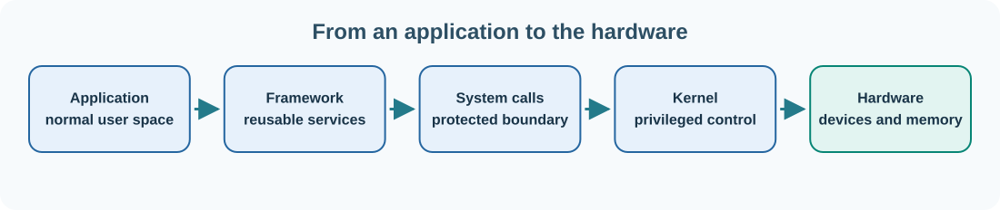

# 26. Umicom Kernel: from boot instructions to operating-system services

A **kernel** is the privileged core of an operating system. It manages fundamental resources such as memory, CPU execution, interrupts and the mechanisms through which programs request services. Applications should not be able to overwrite arbitrary kernel memory or take unrestricted control of hardware.

**Umicom Kernel** is a separate native-kernel research and implementation project. It is not the same codebase as Umicom Framework, and a successful Framework build does not mean a native kernel has booted.

## Why build a kernel?

Kernel development makes computer architecture practical. A kernel has to discover a machine's environment, initialise early memory, handle exceptions and timers, and eventually support processes, device drivers and communication between protected parts of the system.

The Umicom Kernel design studies a small hybrid-microkernel approach. It aims to keep privileged mechanisms bounded and to move restartable services to user space where appropriate. **Capabilities**—explicit rights associated with kernel objects—help define which process may access a particular resource.



## What happens during boot?

On a typical computer, firmware begins execution after power-on. It initialises essential hardware and transfers control through a documented boot process. A kernel receives control, configures essential processor state, sets up memory and starts the software needed to provide operating-system services.

The early Umicom Kernel research profile targets **QEMU RISC-V 64 `virt`**. QEMU is an emulator and virtual machine monitor that lets us run a target-machine environment without replacing the operating system on the development computer.

The repository documents freestanding boot, serial diagnostics, exception and timer handling, page-frame management and work on RISC-V virtual memory. These are research capabilities; they are not proof of a complete desktop operating system.

## Read the kernel source and guides

Open [Umicom Kernel on GitHub](https://github.com/umicom-foundation/umicom-kernel). Start with `README.md`, then read `docs/FIRST_BOOT.md` and `docs/BUILD_AND_TEST.md`. Find where the source enters C from the architecture-specific boot code. Follow one diagnostic message from its call site to the serial output routine.

At this stage, the important distinction is between **host** and **target**. Your Windows computer runs the build tools (host). The generated RISC-V kernel image is meant to run on the emulated RISC-V machine (target). They need not have the same instruction set.

## Build the research image

Once the cross-compiler and QEMU prerequisites in the repository's Windows setup guide are installed, open PowerShell:

```powershell
Set-Location "C:\umicom\umicom-kernel"
cmake --preset riscv64-clang-debug
cmake --build --preset riscv64-clang-debug --parallel 2
ctest --preset riscv64-clang-debug --output-on-failure
```

A successful build produces a kernel ELF image according to the current preset. Tests may include host-side checks, but they do not replace boot verification. Use the documented QEMU command for the corresponding image:

```powershell
& "C:\msys64\ucrt64\bin\qemu-system-riscv64.exe" `
    -machine "virt,aclint=off" `
    -bios ".\build\riscv64-clang-debug\bin\umicom-kernel.elf" `
    -display none `
    -monitor none `
    -serial stdio `
    -m 128M `
    -smp 1 `
    -no-reboot
```

This command runs the kernel inside QEMU with a serial console. It does not install Umicom Kernel onto your host computer's SSD. If QEMU cannot locate the ELF file, first confirm that the build produced it. If the CPU or firmware setup differs from the documented preset, inspect the repository's current boot guide rather than guessing flags.

## Understand memory and interrupts

An **interrupt** tells the processor that an event needs attention, such as a timer or device signal. An **exception** may occur when the processor encounters a fault or special instruction. The kernel handles these events in a controlled context.

**Page tables** map virtual addresses to physical memory under processor rules. RISC-V's Sv39 scheme is one form of page-based virtual memory. It is not enough to create page-table data structures: the kernel must also configure hardware translation correctly and enforce access rights across privilege levels.

## Follow the next question

After you see a serial diagnostic, ask what evidence would prove that the kernel can safely schedule two tasks, isolate their memory and deliver a message between them. Kernel engineering advances by testing such specific guarantees, not merely by displaying a boot banner.

**Next:** [Understand Umicom OS](27-umicom-os.md).

## Continue with a connected course

[Read a native kernel without booting it](../../courses/umicom-kernel-from-scratch/lessons/01-native-kernel-and-host-models.html) — Compare the host exercise with the actual native Kernel responsibilities.

[Find prerequisites and other learning routes](../../start/systems-learning.md). Return to this chapter whenever the course refers to its concepts.
