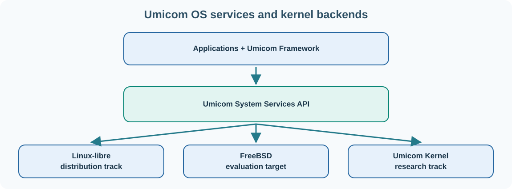

# 27. Umicom OS: the complete system above the kernel

A kernel is only one part of an operating-system environment. A usable system also needs program-loading facilities, libraries, configuration, filesystems, services, accounts, application packaging and often a graphical desktop.

**Umicom OS** is the broader operating-system project. Its architecture separates the underlying kernel from Umicom applications through a **System Services API**. This boundary allows the same higher-level application ideas to be explored over different supported kernel backends.

## Kernel, services and applications



The current free-system distribution track is based on **GNU Linux-libre**. FreeBSD is an evaluation and portability target. **Umicom Kernel** is a separate native implementation under development. These are not three finished, interchangeable production systems: their capabilities and readiness differ.

The System Services boundary sits between application services and kernel-specific facilities. It helps Umicom Framework and applications avoid unnecessary dependencies on one underlying kernel's private interfaces.

## A Linux-based operating-system distribution

A distribution brings together a kernel, essential user-space programs, libraries, configuration and a method of building and maintaining the installed system. **User space** is the environment where normal programs run under restrictions applied by the kernel. The **root filesystem** contains the directories and files needed by that environment.

A **service manager** supervises long-running programs. A **package manager** helps install, update or remove software. A **desktop shell** offers windows, menus, task switching and settings. These are related parts of a system, but each has its own responsibility.

## The first safe experiments

The Umicom OS repository includes instructions for a small **diskless QEMU recovery profile**. Diskless means its teaching environment uses a virtual guest and an in-memory root filesystem instead of installing itself on your computer's normal storage.

Open [Umicom OS](https://github.com/umicom-foundation/umicom-os). Read `README.md` and the guide `docs/foundation/first-boot.html`. That guide explains what the image is intended to boot, how its files are assembled and which checks constitute a real QEMU boot test.

The repository also provides user-space development presets. With an appropriate toolchain and its submodules checked out, a basic headless build follows:

```powershell
cmake --preset headless-debug
cmake --build --preset headless-debug
ctest --preset headless-debug --output-on-failure
```

These commands belong in the **Umicom OS repository root**, not the Umicom Applications root. A GTK4 user-space build uses the repository's `gtk4-debug` preset when its graphical prerequisites are installed.

## Why the desktop is not the kernel

A settings window may show CPU information, manage a session or launch another application. It does not thereby become part of the kernel. Umicom Desk and the Umicom OS Control Centre are user-space programs that consume Framework facilities and operating-system services.

This distinction protects the architecture. The native kernel must not depend on a graphical widget library merely to manage interrupts, and an application must not need privileged access just to display a chart.

## Try explaining an OS event

Imagine selecting an Umicom Studio icon. Describe the chain of responsibility: desktop launcher, application process, framework services, system-call boundary, kernel and device access. Which parts can be restarted without rebooting the whole computer? Which part must enforce memory protection?

**Next:** [Explore the Umicom applications](28-umicom-applications.md).

## Continue with a connected course

[A system has several layers](../../courses/umicom-os-from-scratch/lessons/01-system-boundaries.html) — Connect this overview to the OS startup source and its separate owners.

[Find prerequisites and other learning routes](../../start/systems-learning.md). Return to this chapter whenever the course refers to its concepts.
