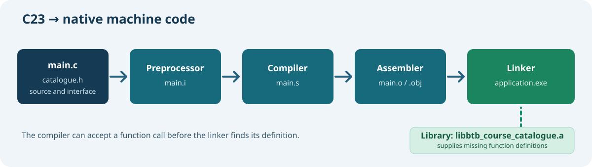

# 76. Build a freestanding C23 and Assembly kernel image

When you run a console programme on Windows or Linux, the operating system prepares a process, loads its executable, supplies a stack, and arranges for C startup code to call `main`. A new kernel cannot assume those services already exist. It helps *create* the environment in which later programmes will run.



Umicom Kernel provides a real example of that difference. Its RISC-V64 research target uses Assembly for the earliest machine instructions and C23 for the kernel logic that follows.

## 1. Start with the source structure

Open the [Umicom Kernel repository](https://github.com/umicom-foundation/umicom-kernel), then locate:

| Path | What it teaches |
| --- | --- |
| [`arch/riscv64/boot.S`](https://github.com/umicom-foundation/umicom-kernel/blob/main/arch/riscv64/boot.S) | First instructions, stack, BSS and transition into C. |
| [`kernel/main.c`](https://github.com/umicom-foundation/umicom-kernel/blob/main/kernel/main.c) | The kernel's C23 entry and early orchestration. |
| [`docs/FIRST_BOOT.md`](https://github.com/umicom-foundation/umicom-kernel/blob/main/docs/FIRST_BOOT.md) | Why the first milestone is loaded as QEMU firmware. |
| [`docs/BUILD_AND_TEST.md`](https://github.com/umicom-foundation/umicom-kernel/blob/main/docs/BUILD_AND_TEST.md) | Current build, test and QEMU commands. |

The kernel uses original code. Its implementation is **separate** from Umicom Framework. The graphical applications and educational website must not become dependencies of the kernel's earliest boot stage.

## 2. Understand freestanding C

Normal application code may call `printf`, open a file, create a process or use an operating-system socket. Kernel code at boot cannot assume any of those services are present.

A **freestanding** C implementation uses only the language facilities and explicitly provided runtime support appropriate to its environment. The Umicom Kernel build uses a cross-compiler and linker configuration selected for its RISC-V64 target rather than the ordinary Windows C runtime.

A successful compilation proves that the compiler and linker produced the requested image. It does not prove that the machine executed it correctly. That second question requires an emulator or real hardware test.

## 3. Follow the first machine instructions

In [`boot.S`](https://github.com/umicom-foundation/umicom-kernel/blob/main/arch/riscv64/boot.S), the `_start` symbol marks the kernel's initial execution entry. The bootstrap reads the hardware-thread identifier, parks additional harts during the first-boot stage, disables interrupts until a trap handler is available, sets a stack pointer, and clears the BSS region.

BSS is the region typically used for zero-initialised static storage. Clearing it matters because C requires static objects without explicit initial values to begin with zero values.

Only when these prerequisites are ready does the bootstrap arrange arguments in `a0` and `a1` and transfer control into `UmiKernelMain()`.

**Question:** Why would calling an ordinary C function before establishing a valid stack be unsafe? Think about automatic local variables and saved return addresses.

## 4. Configure the real RISC-V64 build

Open PowerShell at the kernel checkout:

```powershell
Set-Location "C:\umicom\umicom-kernel"
cmake --preset riscv64-clang-debug
cmake --build --preset riscv64-clang-debug --parallel 2
ctest --preset riscv64-clang-debug --output-on-failure
```

These commands assume the required Clang, LLD, Ninja and QEMU dependencies are installed. If your machine is not yet configured, follow [the Windows beginner setup](https://github.com/umicom-foundation/umicom-kernel/blob/main/docs/WINDOWS_BEGINNER_SETUP.md) first. Do not change compiler targets until the cross-compilation setup is understood.

The resulting ELF belongs to the **RISC-V target**, even if you performed the build on an x86-64 Windows computer.

## 5. Inspect the file before booting it

From the Umicom Applications checkout, invoke the C23 binary inspector introduced in Lesson 74:

```powershell
Set-Location "C:\umicom\Umicom-Applications"
& ".\build\umicom-education\bin\umicom-education.exe" binary `
    --file "C:\umicom\umicom-kernel\build\riscv64-clang-debug\bin\umicom-kernel.elf"
```

You should see `Format: ELF` and `Architecture: RISC-V`. This verifies that the file header declares the intended target. It does not prove the kernel's behaviour or complete binary integrity.

## 6. Boot using the current project instructions

Return to the kernel checkout. The project's [normal build-and-test guide](https://github.com/umicom-foundation/umicom-kernel/blob/main/docs/BUILD_AND_TEST.md) gives the current QEMU command. Its first-boot foundation uses the RISC-V `virt` machine and loads the ELF with `-bios` because the image begins in machine mode.

A command similar to the documented launch is:

```powershell
& "C:\msys64\ucrt64\bin\qemu-system-riscv64.exe" `
    -machine "virt,aclint=off" `
    -bios ".\build\riscv64-clang-debug\bin\umicom-kernel.elf" `
    -display none -monitor none -serial stdio `
    -m 128M -smp 1 -no-reboot
```

Run the command from `C:\umicom\umicom-kernel`, not from the Bits2Banking repository. Review the exact current kernel guide if a later milestone changes QEMU options.

The serial output shows whether code actually started and reached the milestone's validation checks. A QEMU smoke-test pass does not establish full hardware compatibility or a complete, secure operating system.

## 7. Separate kernel, system and applications

The repositories have different responsibilities:

- **Umicom Kernel** implements the original native kernel mechanisms: privileged execution, address spaces, interrupts, IPC, scheduling and the driver foundations.
- **Umicom OS** owns the distribution, images, system integration and compatibility layers; its Linux-libre distribution track is distinct from the research kernel.
- **Umicom Framework** offers reusable user-space services to applications such as Studio IDE, Bank and Trader.
- **Bits2Banking** explains, demonstrates and tests these concepts without taking ownership of their production implementations.

You can now follow one continuous sequence: C23 source → object file → linked ELF image → RISC-V `_start` → C23 kernel entry → serial validation.

**Exercise:** Identify which parts of the sequence use a compiler, linker, firmware loader, Assembly or C23. Explain why the compiler's success alone does not prove that `UmiKernelMain()` ran.

**Review:** [Lessons 72–75](../05-engineering/72-source-to-machine-code.md) before investigating virtual memory, exception handling or kernel services.
