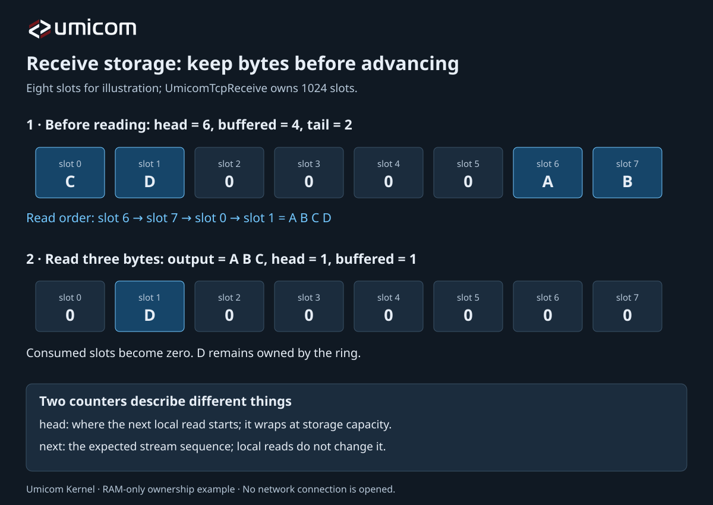

<!--
Umicom Bits2Banking
File: content/lessons/06-umicom/umicom-kernel-from-scratch/123-own-received-bytes-before-advancing.md

PURPOSE:
Own received bytes before advancing the stream

AUTHOR AND ORGANISATION:
Sammy Hegab
Umicom Foundation

LICENCE:
MIT
-->

# Own received bytes before advancing the stream

[Course contents](index.md)

## What you will build and why it matters

A network packet is a temporary container of bytes. A program might need those bytes after the packet container is reused. If the receiver remembers only a pointer into that container, the program can later read somebody else’s data. This lesson follows a small C component that copies admitted payload into its own fixed storage. Payload means the message bytes after the protocol headers. The component is part of Umicom Kernel; it does not open a network connection. You will inspect ownership, predict a short execution, run host checks and distinguish those checks from a real diagnostic guest.

## 1. Review the starting tools

Work through the earlier Kernel setup and TCP sequence lessons first. You need the Kernel source folder, CMake, Ninja, a host C compiler and a PowerShell terminal. CMake prepares build instructions; Ninja executes them; the compiler translates C into machine instructions. A host is the computer running those tools. Later, Clang can produce RISC-V code for a different processor. QEMU can execute that code as a guest. Those are separate steps, so a successful Windows test does not imply that the guest works.

1. Open the Kernel folder and find include/umicom/kernel/tcp_receive.h. Read the comments before the function declarations.
2. Find kernel/tcp_receive.c, which implements those declarations. A header explains the public contract; the C file supplies the behavior.
3. Open tests/tcp_receive/receive_tests.c. Each named case checks an observable property, such as preserving output when an append is refused.

## 2. Define ownership, lifetime and capacity

An owner is the component responsible for keeping storage valid while it is used. A lifetime is the interval during which that storage may be accessed. The new receiver contains an array of 1024 bytes inside its own structure. It makes no dynamic allocation and retains no pointer to the incoming payload. After a successful append, the caller may reuse its input array because the receiver has a separate copy. The caller still owns the receiver structure and must keep that structure alive. Placing it in a function’s local variables does not make it safe to keep a pointer after the function returns.

## 3. Read the state without confusing its counters

| Field | Meaning | Important boundary |
| --- | --- | --- |
| next | Sequence expected for the next new stream byte | Wraps modulo 2^32; a read does not advance it |
| head | Index of the oldest buffered byte | Always smaller than 1024 |
| buffered | Number of bytes retained for the reader | From 0 through 1024 |
| available | Copied observation: 1024 minus buffered | Local free storage, not a negotiated TCP window |
| initialized | Whether Init established this lifetime | Public fields are not permission to edit internal state |

## 4. Understand circular storage

A circular buffer reuses the beginning of an array after reaching its end. The bytes still have one stream order even when they occupy two physical parts of the array. The next insertion index is (head + buffered) modulo capacity. Modulo means the remainder after division. With an eight-slot teaching buffer, (6 + 4) modulo 8 is 2. The production buffer has 1024 slots; the smaller drawing makes the wrap visible. Reading moves head and reduces buffered, while appending increases buffered and advances next. A zero-valued byte is valid payload: occupancy comes from the counters, not from whether a slot contains zero.

## 5. Trace an exact four-byte append

UmicomU8 is an unsigned eight-bit integer, so one array element holds one byte. UmicomU32 is an unsigned 32-bit integer. The ampersand gives a function the address of a variable it may update according to the API contract. The initializer {0} starts the object with zero values; Init establishes the actual expected sequence and clears storage. The sequence argument labels the first payload byte. Four bytes at 100 occupy positions 100, 101, 102 and 103, so 104 is the next expected position. Check the returned decision before using the published cursor.

~~~c
UmicomTcpReceive receiver = {0};
UmicomU8 incoming[4] = {10U, 20U, 30U, 40U};
UmicomU32 cursor = 99U;
UmicomKernelTcpReceiveInit(&receiver, 100U);
UmicomTcpSequenceDecision decision = UmicomKernelTcpReceiveAppend(
    &receiver, 100U, incoming, 4U, &cursor);
/* On ACCEPT: cursor=104, buffered=4, next=104. */
~~~

## 6. Store first, publish second

Append checks the state, required pointers, exact next sequence, positive length and free capacity before changing any slot. It then copies every byte into the ring. Only after those copies does it increase buffered and publish next and the output cursor. This order matters: promising a byte has been retained before it has storage can lose data. The output cursor is not a transmitted acknowledgment. A future connection owner would decide whether and how to send one after performing all the other protocol checks. Serialization is required: one owner must prevent concurrent reads or writes. This code is not a lock-free queue.

## 7. Read bytes without acknowledging them twice

Read copies at most the smaller of the supplied output capacity and the buffered byte count. It then clears the consumed ring slots, moves head and reduces buffered. The unused output tail remains unchanged. The remaining stream bytes are 30 and 40. Reading them is local consumption, not arrival of new network bytes, so next stays 104. Slot clearing limits retention in this particular buffer; it cannot erase copies in the input, output, processor cache or elsewhere and is not a forensic-erasure guarantee.

~~~c
UmicomU8 result[6] = {91U, 91U, 91U, 91U, 91U, 91U};
UmicomU32 readCount = 77U;
decision = UmicomKernelTcpReceiveRead(&receiver, result, 2U, &readCount);
/* On ACCEPT: result[0]=10, result[1]=20, result[2]=91.
   readCount=2, buffered=2, next=104. */
~~~

## 8. Refusal is an observable contract

| Request | Decision | State and outputs |
| --- | --- | --- |
| Exact next sequence, positive count that fits | ACCEPT | Copies bytes; publishes new cursor |
| Gap, duplicate, zero count or insufficient space | REJECT | Unchanged |
| Null required pointer or malformed state | INVALID | Unchanged |
| Read an empty initialized receiver | REJECT | Read count and output unchanged |
| Read with zero capacity | INVALID | Read count and output unchanged |

## 9. Explain backpressure before increasing memory

Backpressure means a producer cannot continue faster than a consumer can accept data. If all 1024 slots are occupied, even one extra byte is refused. Increasing an allocation automatically would hide that bound and could multiply memory consumption across many connections. The caller can wait for a reader to consume data, then retry an appropriate in-order payload. A live TCP stack must connect this local storage policy to correct receive-window signaling, retransmission and connection state. Simply dropping an entire network segment whenever this helper refuses is not a complete TCP implementation.

## 10. Keep pointer promises explicit

C cannot prove that an arbitrary non-null pointer names accessible memory. The caller supplies a readable count-byte input span and writable output spans of the stated sizes. Input, output and receiver storage must obey the disjointness rules in the header. Do not pass receiver.bytes back as the incoming array, and do not place the cursor output inside the receiver. Do not write internal counters to simulate progress. The implementation rejects malformed counter values it can recognize, but it is not a general memory-safety system. These explicit boundaries make reviews and tests more useful than assuming that C automatically checks every access.

## 11. Configure and run the host checks

Start in the Kernel source root. These commands build a small test executable, not the whole operating system. Use a new directory if a previous cache selected a different compiler. Run each command separately and stop when it reports an error.

~~~powershell
$env:Path = "C:\msys64\ucrt64\bin;$env:Path"
cmake -S tests/tcp_receive -B build/tcp-receive -G Ninja -DCMAKE_C_COMPILER=C:/msys64/ucrt64/bin/gcc.exe
cmake --build build/tcp-receive --parallel 2
ctest --test-dir build/tcp-receive --output-on-failure
~~~

## 12. Predict what the tests establish

The eight host groups cover a normal cycle, full capacity, sequence and ring wraparound, copied-input ownership, refusals, malformed state, consumed-slot clearing and an independent queue model. The model executes thousands of operations against a simple linear queue and compares the visible bytes and counters. That oracle is deliberately organized differently from the circular implementation. The ownership case changes the original input after appending and requires the original values on read. Together these checks give evidence for the stated finite contract; they do not prove all possible C programs or a future network stack safe.

## 13. Link without a host runtime

Freestanding means the program cannot assume the usual operating-system C library exists. A compiler may lower an innocent-looking copy into a call such as memcpy, which would need an implementation. The optional link checks compile production receive and sequence code at O0 and O2, without a standard library. O0 favors straightforward debugging; O2 enables optimization. LLVM’s linker is selected explicitly because a Windows-only GNU linker cannot produce the required RISC-V ELF image. A linker combines object code into the target executable format.

~~~powershell
cmake -S tests/tcp_receive -B build/tcp-receive -DUMICOM_RECEIVE_CLANG=C:/msys64/ucrt64/bin/clang.exe
ctest --test-dir build/tcp-receive -R rv64_link --output-on-failure
~~~

## 14. Distinguish link evidence from guest execution

A valid ELF file is an output artifact, not proof it executed. The Kernel diagnostic image additionally calls the production receiver through four ordered packet-admission groups: ownership, refusal, backpressure and ring wrap. The guest check requires the current-image fixture, a successful QEMU exit and the complete ordered transcript. It disables the virtual network device with -nic none. Use the configured Kernel build directory from the earlier setup lesson.

~~~powershell
cmake --build build/riscv64-debug --target umicom-kernel --parallel 2
ctest --test-dir build/riscv64-debug -R "^kernel.riscv64.packet_admission$" --output-on-failure
~~~

## 15. Diagnose failures at the correct boundary

1. If gcc, Ninja or CMake is not found, check your tool installation and PATH before editing the receiver. A missing tool is not a C ownership defect.
2. If linking reports unrecognised emulation mode elf64lriscv, confirm that the active link command includes -fuse-ld=lld and LLVM’s linker is installed. Do not replace the target with Windows just to make the error disappear.
3. If a host assertion fails, read its case name and line number, then compare expected state and bytes with the API contract. Keep the failing input for a regression test.
4. If the guest reports a stale image, rebuild the configured Kernel target and rerun its current-image fixture. Do not reuse an older successful transcript as evidence for changed source.
5. If memory use is still high in a larger application, measure allocations, model weights and concurrency there. A bounded Kernel buffer does not diagnose unrelated application crashes.

## Practice and check your reasoning

Start at sequence 4294967294 and append four bytes: the next cursor becomes 2 because the 32-bit sequence wraps. Read two bytes: next remains 2 and two bytes remain buffered. An append at sequence 3 is a gap and must preserve state. An append at sequence 2 with more bytes than available must also preserve state. Explain why neither an empty read nor a rejected append can be treated as a successful data transfer. Then modify a test to use payload bytes containing zero; the result should still depend on buffered, not on a sentinel byte.

## What remains outside this component

Connection handshakes, SYN/FIN/RST/URG handling, overlap trimming, out-of-order segments, retransmission, timers, congestion control, socket APIs, drivers and actual transmission remain separate work. Init deliberately starts a new lifetime and discards any old buffered data, so do not call it as a harmless refresh during an active stream. The useful result here is a small, bounded, independently testable owner that future connection logic can compose after packet and connection admission.

[Previous: Encode and check an ICMP echo message in RAM](122-encode-and-check-an-icmp-echo-message.md)

[Next: Keep sent bytes until they are acknowledged](124-keep-sent-bytes-until-they-are-acknowledged.md)
