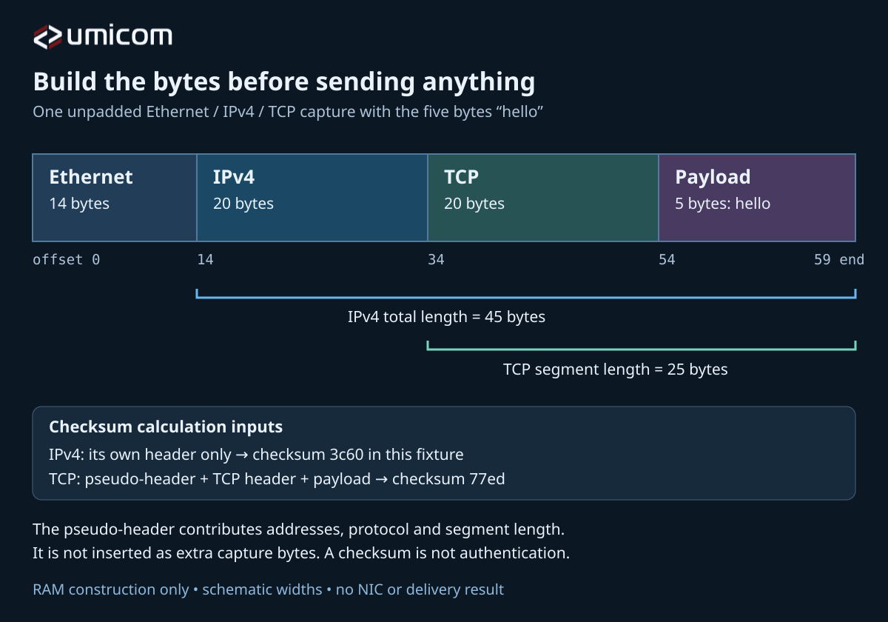

<!--
Umicom Bits2Banking
File: content/lessons/06-umicom/umicom-kernel-from-scratch/125-construct-a-tcp-capture-before-transmission.md

PURPOSE:
Construct a TCP capture before transmission

AUTHOR AND ORGANISATION:
Sammy Hegab
Umicom Foundation

LICENCE:
MIT
-->

# Construct a TCP capture before transmission

[Course contents](index.md)

## What you will make

A packet is a structured sequence of bytes. A capture is a representation of those bytes held in memory for inspection. In this lesson you construct an Ethernet/IPv4/TCP capture containing the five ASCII bytes hello, then check its bytes without sending anything. Ethernet identifies a local link frame, IPv4 supplies network addresses, and TCP supplies transport fields. None of those fields proves a connection exists. Complete the earlier UDP, ICMP and TCP storage lessons first; they introduce buffers, offsets and ownership.

## 1. Count the bytes before writing them

An offset is the number of bytes before a field, starting at zero. This restricted format has a 14-byte Ethernet header, a 20-byte IPv4 header and a 20-byte TCP header. The payload therefore starts at 14 + 20 + 20 = 54. Five payload bytes produce a 59-byte capture. IPv4's total length is only 20 + 20 + 5 = 45; TCP's segment length is 20 + 5 = 25. Mixing these three lengths creates corrupt checksums or out-of-bounds access.

| Region | Offsets inclusive | Length | Responsibility |
| --- | --- | --- | --- |
| Ethernet | 0–13 | 14 | Destination/source MAC and type 0x0800 |
| IPv4 | 14–33 | 20 | Addresses, protocol 6, total length and IP checksum |
| TCP | 34–53 | 20 | Ports, sequence/ACK, flags, window and TCP checksum |
| Payload | 54–58 in this example | 5 | ASCII bytes 68 65 6c 6c 6f in hexadecimal |

## 2. Separate a C object from serialized bytes

A C structure is a named set of fields. Its compiler may insert padding for alignment, and its integers use the host machine's byte order. A wire format is an explicit external representation. Never send sizeof(spec) bytes by treating the structure as a packet. The writer stores each integer byte deliberately. Network byte order puts the most significant byte first: port 12345 is hexadecimal 0x3039, so its two bytes are 0x30, then 0x39. A struct cast does not perform that conversion.

~~~text
12345 = 0x3039
source port bytes = 30 39
sequence 0x12345678 bytes = 12 34 56 78
payload text hello bytes = 68 65 6c 6c 6f
~~~

## 3. Read the public contract

Open include/umicom/kernel/network_tcp.h in Umicom Kernel. UmicomEthernetIpv4TcpSpec describes explicit field values. UmicomKernelEthernetIpv4TcpWrite receives that spec, a payload pointer and length, a destination pointer and capacity, and a pointer for the written count. A pointer identifies storage; a length states how much of it the caller promises is accessible. These are separate facts. The service cannot discover whether an arbitrary pointer refers to mapped RAM.

## 4. Follow the serializer call

This fragment belongs inside a C function after including the public header. Zero initialization gives unspecified fields a known value. The addresses come from documentation ranges; no device receives them. Status OK means the RAM capture was built. It does not reserve send-buffer space or confirm network delivery.

~~~c
UmicomEthernetIpv4TcpSpec spec = {
    .destinationMac={2,0,0,0,0,2}, .sourceMac={2,0,0,0,0,1},
    .sourceAddress={192,0,2,1}, .destinationAddress={198,51,100,2},
    .identification=0x1234, .timeToLive=64,
    .sourcePort=12345, .destinationPort=80,
    .sequenceNumber=0x12345678, .acknowledgmentNumber=0x90abcdef,
    .window=4096, .flags=UMICOM_TCP_ACK|UMICOM_TCP_PSH
};
const unsigned char payload[] = {'h','e','l','l','o'};
unsigned char capture[64];
UmicomSize written = 999;
UmicomNetworkPacketStatus status = UmicomKernelEthernetIpv4TcpWrite(
    &spec, payload, sizeof payload, capture, sizeof capture, &written);
/* Use capture[0..written-1] only when status is UMICOM_NETWORK_PACKET_OK. */
~~~

## 5. Understand the checksum

A checksum is a small arithmetic consistency value, not encryption or authentication. Treat adjacent bytes as unsigned 16-bit big-endian words. Add them, carry overflow back into the low 16 bits, and invert the final 16 bits. If one byte remains, treat it as the high byte of a final word with a zero low byte. That zero is used in calculation; it is not appended to the stored payload. IPv4 checks only its own 20-byte header. TCP checks a pseudo-header plus TCP header and payload. The pseudo-header contributes the two IPv4 addresses, zero, protocol 6 and the TCP segment length; it is calculation input, not a separate region added to the capture.

## 6. Verify the literal result

For the five-byte fixture, the IPv4 checksum is 0x3c60 and the TCP checksum is 0x77ed. The test contains a complete independently specified byte array and compares the whole capture. It also constructs the pseudo-header separately and folds after every word. These checks are useful alongside reading the result with the production parser: a writer and reader could otherwise share the same mistaken assumption.

## 7. Recognize a valid zero TCP checksum

Changing this fixture's window from 0x1000 to 0x87ed makes the computed TCP checksum exactly zero. The serializer stores 00 00. TCP still requires the entire checksum calculation to validate. Do not import UDP/IPv4's special handling of a zero checksum field. A literal zero field can be valid in TCP, but zero does not switch checksum checking off.

## 8. Build the hosted checks

A hosted test runs as an ordinary operating-system process using a C compiler. It is different from booting the Kernel. In PowerShell, check that CMake, Ninja and a C23 compiler are available. Run each line separately and stop if it fails. Use a new build directory if an existing one belongs to a different compiler. Nothing below installs software or opens a network connection.

~~~powershell
Set-Location C:\umicom\umicom-kernel
cmake -S tests/network_packet -B build/packet-contracts -G Ninja -D CMAKE_C_COMPILER=C:/msys64/ucrt64/bin/gcc.exe
cmake --build build/packet-contracts --target umicom-network-tcp-write-tests
ctest --test-dir build/packet-contracts -R "^kernel.network_tcp_write\." --output-on-failure
~~~

## 9. Read failures as evidence

The test reports the source line and failed condition. If the target is unknown, confirm you configured the current tests/network_packet source, not a stale root build. If the executable is missing, finish the build before running CTest. A failing all-lengths case points to a boundary or checksum discrepancy; inspect the first failing length. A successful hosted run does not establish freestanding linking, actual guest execution, physical hardware or a working TCP connection.

## 10. Practice refusal without partial publication

Reduce destination capacity from 64 to 58 for the five-byte fixture. Expect LENGTH and unchanged destination bytes and written. Set TTL to zero and expect HEADER. Request 1461 payload bytes and expect LIMIT; the supported maximum is 1460. Pass a payload inside the destination's unused tail and expect ARGUMENT: the entire declared capacity must be disjoint. Use separately allocated test arrays; do not create invalid real memory accesses while exploring these checks.

## 11. Connect this boundary to retained stream data

The send-storage lesson retains bytes until an admitted acknowledgment releases them. A future connection owner may copy a selected retained span into a separate packet payload buffer, choose valid sequence and protocol fields, then call this writer. Keep those stages explicit. The writer does not consume retained bytes; a retry can serialize them again. Peer windows, connection states, congestion, timers, NIC queues, DMA and acknowledgment admission still need their own owners.

## Exercise and answers

Lengths are (54,40,20), (55,41,21), and (1514,1500,1480). The odd byte occupies the high half of its word. Anyone can recompute an unkeyed checksum, so it provides no identity or authorization proof. Ethernet minimum padding, FCS, options and live transmission are outside this RAM-capture contract.

1. Predict the total capture, IPv4 and TCP lengths for 0, 1 and 1460 payload bytes before checking the tests.
2. Explain why the fifth payload byte in hello is added as 0x6f00 during checksum calculation.
3. Explain why a correct checksum cannot prove the sender is trusted.
4. Modify only a payload byte after writing and confirm the TCP reader rejects its checksum. Restore the byte before another test.

## Further reading

- [TCP specification, including headers and checksums (RFC 9293)](https://www.rfc-editor.org/rfc/rfc9293.html)
- [Internet checksum calculation (RFC 1071)](https://www.rfc-editor.org/rfc/rfc1071.html)

[Previous: Keep sent bytes until they are acknowledged](124-keep-sent-bytes-until-they-are-acknowledged.md)

[Next: Walk TCP options without trusting lengths](126-walk-tcp-options-without-trusting-lengths.md)
