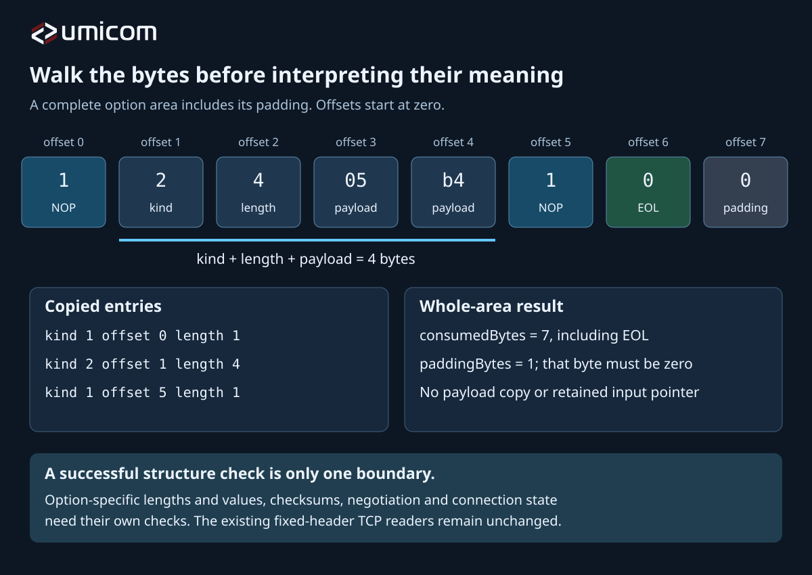

<!--
Umicom Bits2Banking
File: content/lessons/06-umicom/umicom-kernel-from-scratch/126-walk-tcp-options-without-trusting-lengths.md

PURPOSE:
Walk TCP options without trusting lengths

AUTHOR AND ORGANISATION:
Sammy Hegab
Umicom Foundation

LICENCE:
MIT
-->

# Walk TCP options without trusting lengths

[Course contents](index.md)

## Start with a short row of bytes

A byte is a storage unit that holds a value from 0 through 255. A network packet is a row of bytes. Its header carries information used to interpret the bytes that follow. TCP, the Transmission Control Protocol, has a basic header of 20 bytes and can include an additional option area. Options carry extra protocol information. Reading their structure safely is a separate job from deciding what their contents mean for a connection. This lesson studies the native Kernel option-area reader; it does not transmit a packet or open a connection.

1. Complete the earlier packet-length and TCP-capture lessons. You should be able to count bytes and explain an array index.
2. Open include/umicom/kernel/tcp_options.h and kernel/network_packet.c in the Kernel repository. Search for UmicomKernelTcpOptionsRead.
3. Keep the existing fixed-header TCP readers separate: they still accept their documented no-options profile. Passing this new helper does not extend their profile.

## An offset is a position, not a pointer

Number the first byte zero, the next byte one, and so on. That number is an offset. A length counts how many bytes belong to an item, including its own header. If an item begins at offset 1 and has length 4, it occupies offsets 1, 2, 3 and 4. The next item starts at 5. A pointer instead represents a memory address. Returning copied offsets lets this reader avoid retaining addresses into caller-owned input. The caller must still keep the original bytes alive when using an offset to inspect an option payload.

## Three shapes use the same row

| Kind byte | Shape | Meaning in this reader |
| --- | --- | --- |
| 0 | One byte, then zero padding | End of option list; not returned as an entry |
| 1 | One byte | No-operation (NOP); returned with length 1 |
| 2 through 255 | Kind, length, then optional payload | Length includes kind and length bytes; must be at least 2 |

## Trace an eight-byte example

The values below use hexadecimal notation, where 0x05 means five and 0xb4 means 180. The two payload bytes 0x05, 0xb4 can encode 1460 in a maximum-segment-size option. This structural reader deliberately does not interpret that number. It copies the kind, offset and total length. EOL is an abbreviation for end of list.

~~~c
const unsigned char bytes[8] = {1, 2, 4, 0x05, 0xb4, 1, 0, 0};
UmicomTcpOptionsView view;
UmicomNetworkPacketStatus status =
    UmicomKernelTcpOptionsRead(bytes, sizeof bytes, &view);
if (status == UMICOM_NETWORK_PACKET_OK) {
    /* view.count == 3; view.consumedBytes == 7;
       view.paddingBytes == 1; view.endSeen is true. */
}
~~~

1. At offset 0, kind 1 is a NOP. Record offset 0, length 1. Advance one byte.
2. At offset 1, kind 2 requires a length byte. Offset 2 contains 4. Four bytes fit, so record offset 1, length 4. Advance to offset 5.
3. At offset 5, record another NOP and advance to 6.
4. At offset 6, kind 0 ends the list. Verify that the remaining byte at offset 7 is zero.
5. Publish three entries. consumedBytes is 7 because it includes the EOL byte; paddingBytes is 1. EOL and padding are not returned as entries.

## Understand the complete-area boundary

This helper accepts an explicitly supplied complete option area, including padding. Its length must be 0 through 40 and divisible by four. These limits follow the bounded TCP-header shape; they are not a license to read 40 bytes from an arbitrary pointer. An enclosing packet reader must first prove that its header and data-offset field fit the captured bytes and then locate the option area. This helper does not perform that enclosing admission. Empty input is valid, and only the empty case permits a null input pointer. A nonempty input can start at an unaligned address because its contents are bytes.

## Check remaining space before advancing

Suppose the area has eight bytes and the cursor is at seven. A non-NOP, non-EOL kind would need a length byte at eight, outside the area. Refuse before reading that byte. After a valid length byte is available, compare the requested length with the bytes remaining. A length of zero or one cannot describe the required kind-plus-length prefix. This rule also prevents an infinite loop in which a zero length never advances the cursor.

~~~c
/* Reasoning sketch, not an additional parser implementation. */
remaining = areaBytes - cursor;
/* First handle the single-byte EOL and NOP cases. */
if (remaining < 2) { /* refuse missing length */ }
if (length < 2) { /* refuse invalid structure */ }
if (length > remaining) { /* refuse overrun */ }
/* Only after these checks may cursor advance by length. */
~~~

## Why unknown does not automatically mean malformed

Protocols can gain new option kinds. A structural reader can skip or describe an unfamiliar kind when its length is well formed. It cannot infer that the peer supports the option or that it is legal in the current connection state. Repeated kinds are also returned, leaving the semantic layer to decide whether a particular repetition is permitted. For example, an MSS-shaped item with total length 2 is structurally bounded, but lacks the payload expected by the MSS definition. This helper can succeed while a later MSS validator correctly refuses the option.

## Failure must not publish half a result

A packet may contain several valid items before a bad final item. If the reader wrote directly into the public output as it went, a caller could accidentally use that partial result. The implementation builds a local candidate and publishes it only after the entire area passes. Every refusal preserves the whole output object. Output needs proper structure alignment and must be disjoint from the input. Checked address arithmetic avoids wrapping an address calculation, but cannot prove that a supplied address refers to mapped RAM.

1. Fill an output object with a known sentinel pattern in a test. A sentinel is a recognizable value used to detect unexpected writes.
2. Give the reader a valid first option followed by a kind with no length byte.
3. Check the failure status and compare every output byte with the saved sentinel.
4. Repeat with a nonzero byte after EOL. The reader must refuse instead of silently ignoring the padding error.

## Read the status without guessing

| Status family | Example | Next action |
| --- | --- | --- |
| OK | The whole complete area is structurally valid | Use copied metadata while preserving input lifetime |
| ARGUMENT | Misaligned output, overlap, bad pointer extent | Correct caller memory ownership and addresses |
| LIMIT | Area exceeds 40 bytes | Recheck enclosing header and length calculation |
| HEADER | Non-four-byte area, length below 2, nonzero EOL padding | Reject malformed structure or correct the fixture |
| LENGTH | Missing length byte or item overruns area | Reject truncation or correct the fixture |

## Run the actual hosted regression groups

Use a PowerShell terminal with CMake, Ninja and a C23 compiler available. Run one command at a time and stop if it fails. These commands build the small packet-contract project, rather than a complete operating system. Adjust the source location if your checkout has another path.

~~~powershell
Set-Location C:\umicom\umicom-kernel
cmake -S tests/network_packet -B build/packet-contracts -G Ninja -D CMAKE_C_COMPILER=C:/msys64/ucrt64/bin/gcc.exe
cmake --build build/packet-contracts
ctest --test-dir build/packet-contracts -R tcp_options --output-on-failure
~~~

1. Inspect tests/network_packet/tcp_options_tests.c to see the golden byte row and failure sentinels.
2. Expect 19 TCP-option groups in this source revision. A zero-test match is not a pass; inspect the registered names with ctest --test-dir build/packet-contracts -N.
3. Run ctest --test-dir build/packet-contracts --output-on-failure to include the surrounding packet regressions.
4. The RISC-V diagnostic image separately checks four option groups in memory without a NIC. A hosted result does not establish guest execution, live networking or device-driver behavior.

## Exercises with answers

1. What happens to {0, 0, 0, 1}? It fails because the final byte after EOL is nonzero; the output stays unchanged.
2. What does {253, 2, 1, 1} describe? One unknown two-byte option followed by two NOP entries; all four bytes are consumed with no EOL.
3. Can a 40-byte area contain 40 entries? Yes: 40 NOP bytes. This is why a fixed array of 40 entry slots is sufficient.
4. Can metadata survive after input is overwritten? The copied kind, length and offset remain unchanged, but the old payload no longer exists in that input buffer. Metadata is not a payload copy.
5. Does a successful result prove a safe TCP connection? No. Header admission, checksums, option-specific rules, negotiation, sequence state and network policy remain separate responsibilities.

## Primary protocol reference

- [RFC 9293: TCP header and option definitions, sections 3.1 and 3.2](https://www.rfc-editor.org/rfc/rfc9293.html#section-3.1)

[Previous: Construct a TCP capture before transmission](125-construct-a-tcp-capture-before-transmission.md)

[Next: Decode option values before changing connection state](127-decode-option-values-before-changing-connection-state.md)
