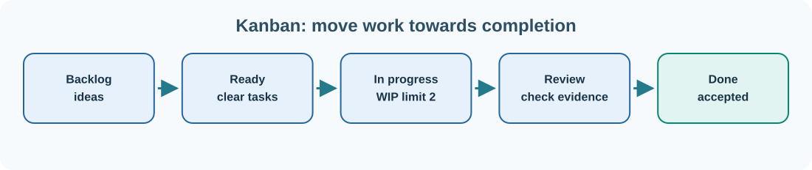

# 29. Project management and Kanban boards

Software projects contain more work than one person can do at once. A **Kanban board** makes the flow of work visible and helps a team decide what to start, what is blocked and what has been completed.

A basic board has columns such as **Backlog**, **Ready**, **In progress**, **Review** and **Done**. Each card represents one piece of work, not merely a colourful note. A useful card describes the desired outcome and gives the team a way to recognise when that outcome has been achieved.

## Start with one project goal

Suppose the goal is to improve our task-board application so it saves tasks between sessions. That goal can be broken into smaller cards:

| Card | What must be achieved | Evidence |
| --- | --- | --- |
| Store tasks | Save new tasks in persistent storage | Restarting does not remove them |
| Restore tasks | Read saved tasks on startup | A known task reappears with the same identifier |
| Handle errors | Explain a failed save | The user sees a useful message; no false success |
| Test storage | Add repeatable tests | Tests cover normal saves and a failed write |

A **user story** describes a need from the perspective of the person using a feature: “As a project contributor, I want tasks to remain after restarting so that I can continue the work tomorrow.” **Acceptance criteria** describe the evidence needed to call the story complete.

## Limit work in progress

If everyone starts new tasks before finishing existing ones, the board fills with unfinished work. A **work-in-progress (WIP) limit** sets a maximum number of cards in a stage. For example, set the **In progress** column's limit to two. When it already contains two cards, the team should finish or unblock one before taking another.

A WIP limit is not a punishment. It highlights bottlenecks and encourages completing valuable work rather than repeatedly starting more work.

## What happens in review?

A code change is ready for review when another contributor can understand its purpose, inspect its diff and run the relevant checks. In an Umicom project, a review should consider correctness, module ownership, compatibility, error handling, documentation and regression coverage.

The **Done** column should mean more than “someone stopped typing”. It should mean the agreed acceptance criteria have been demonstrated.

## Connect a card to GitHub

GitHub issues can describe work, and pull requests can link the proposed source change to that issue. A typical flow is:

1. Create an issue describing the problem or feature.
2. Agree on a small, testable outcome.
3. Put the card in Ready and assign a contributor when appropriate.
4. Begin work when the WIP limit allows it.
5. Open a pull request with the changed files and test evidence.
6. Review and merge the change.
7. Move the card to Done after checking the acceptance criteria.

The application we built with HTML, CSS and JavaScript can eventually display this workflow, while a backend stores tasks and GitHub integration links them to development activity.

## Try it

Create five cards for building a simple notes window. Give each one a title, description and measurable acceptance criterion. Move only two into In progress. Which task must finish before testing can begin? Write that dependency on the appropriate card.

**Next:** [Understand the different meanings of an account](30-accounts.md).
