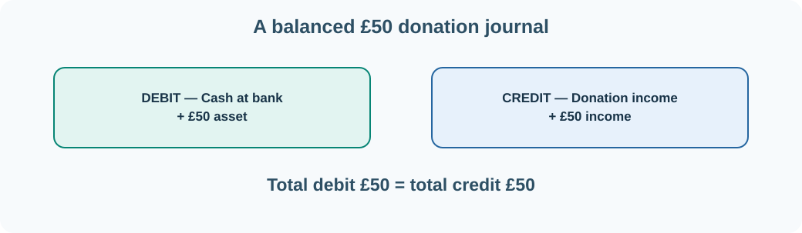

# 31. Accounting: understand journals and the general ledger

Accounting records economic events so an organisation can understand what it owns, owes, earns and spends. A reliable accounting system must produce figures that can be explained and checked, not just displayed on a screen.

A useful starting point is the accounting equation:

**Assets = Liabilities + Equity**

Assets are resources controlled by the organisation. Liabilities are obligations. Equity is the residual interest after liabilities are deducted from assets. Income and expenses affect equity through the organisation's results.

## Debits and credits are directions, not opinions

In **double-entry accounting**, a transaction normally has at least two postings. Every complete journal must balance: **total debits equal total credits**.

| Account category | Debit normally | Credit normally |
| --- | --- | --- |
| Asset | Increases | Decreases |
| Expense | Increases | Decreases |
| Liability | Decreases | Increases |
| Equity | Decreases | Increases |
| Income | Decreases | Increases |

These are normal balance rules for basic ledger teaching. They show why “debit means money out” is incorrect: a debit to a cash asset account records an increase, not a decrease.

## Example 1 — receive a £50 donation

A fictional organisation receives £50 into its bank account as donation income. The journal is:

| Account | Debit | Credit |
| --- | ---: | ---: |
| Cash at bank (asset) | £50.00 | — |
| Donation income (income) | — | £50.00 |
| **Total** | **£50.00** | **£50.00** |

The cash asset rises by £50 and income rises by £50. The debits and credits balance.



## Example 2 — pay £12 for supplies

Later, the organisation pays £12 for supplies that are expensed immediately in this simplified example:

| Account | Debit | Credit |
| --- | ---: | ---: |
| Supplies expense | £12.00 | — |
| Cash at bank | — | £12.00 |
| **Total** | **£12.00** | **£12.00** |

Cash is now £38 higher than before these two transactions. The statement of financial position and the income statement describe different aspects of these events; the reporting periods and accounting policies determine how the figures are presented.

## The chart of accounts and general ledger

A **chart of accounts** is an organised list of ledger accounts and their classifications. The **general ledger** contains transactions or balances organised by those accounts. A **sub-ledger** supplies more detailed information, such as individual customer balances or supplier invoices, which should reconcile to the appropriate general-ledger control accounts.

A **trial balance** lists account balances as a check that debit and credit totals agree. Equal totals are necessary but do not prove every transaction is correctly classified; an incorrect amount posted to the wrong account can still balance.

## Build a journal validator

We can test a simplified journal in Python using integer pence:

```python
journal = [
    {"account": "Cash", "debit": 5000, "credit": 0},
    {"account": "Donation income", "debit": 0, "credit": 5000},
]

total_debit = sum(entry["debit"] for entry in journal)
total_credit = sum(entry["credit"] for entry in journal)

if total_debit == total_credit:
    print("Balanced journal")
else:
    print("Journal is not balanced")
```

The result should be `Balanced journal`. Change one credit to 4,900 pence and rerun. This catches an unbalanced posting. A real accounting engine must also validate account identifiers, currency, amounts, effective dates, approvals, period controls and idempotency.

## Reconciliation and audit

**Reconciliation** compares records held by different systems or components to identify differences. A bank statement might show a payment that the internal ledger has not yet matched. A good system records the difference, assigns responsibility, resolves it and preserves evidence of what changed.

The Umicom accounting learning material develops these ideas into journals, ledgers, accounting rules and control services reusable by Bank, Open TMS, Trader and other applications.

**Next:** [Understand Treasury Management Systems](32-treasury.md).
