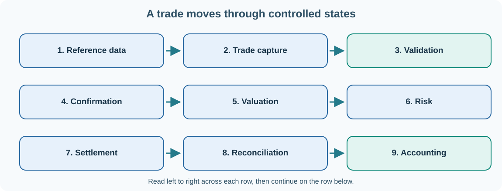

# 32. Treasury Management Systems: follow a trade from start to finish

An organisation must know how much money it has, what it owes, which payments are due and how market changes affect its financial position. **Treasury management** brings together cash visibility, liquidity planning, funding, investments and financial risk.

A **Treasury Management System (TMS)** supports these activities by keeping trades, cashflows, market data, controls, settlement information and reporting connected. A TMS is more than a form for entering transactions.

## Front, middle and back office

Different teams perform different functions, even when they work in the same building:

| Function | Main responsibility | Example |
| --- | --- | --- |
| Front office | Prices, negotiates and captures financial transactions | Agrees a foreign-exchange forward |
| Middle office and risk | Independently checks exposures, valuation and limits | Reviews currency risk and trade limits |
| Back office | Confirms, settles and reconciles obligations | Sends or receives payments and matches statements |
| Finance and accounting | Records transactions and explains results | Posts accounting entries and reconciles the ledger |
| Treasury/ALM | Plans liquidity, funding and balance-sheet exposure | Forecasts a currency cash requirement |

This separation helps reduce the risk of one person initiating, approving and concealing an unauthorised transaction.

## Example: a foreign-exchange forward

Imagine a fictional business that must pay a supplier **USD 1,250,000** in one month. It agrees an FX forward to **receive USD 1,250,000** and **pay GBP 1,000,000** on an agreed future date. This example uses a simple rate of 1.25 USD per GBP for teaching; an actual contract includes full terms and market conventions.

Follow the transaction:

1. **Reference data:** the currencies, counterparty, legal entities, settlement calendars and permitted book must be recognised.
2. **Trade capture:** the two currencies, amounts, value date and economic terms are recorded with a unique trade identifier.
3. **Validation and workflow:** required data, permissions and limits are checked before the trade reaches the next authorised state.
4. **Confirmation:** counterparties check that they agree on the contract's terms.
5. **Market data and valuation:** appropriate FX rates and valuation rules measure the trade's current value.
6. **Risk:** the system measures currency exposure, limits and other relevant risks.
7. **Cashflows and settlement:** the expected GBP payment and USD receipt become operational obligations on the agreed value date.
8. **Reconciliation:** internal records are compared against confirmations, settlement reports and bank statements.
9. **Accounting and reporting:** the trade and subsequent lifecycle events produce controlled ledger and reporting records.

A trade can be economically valid yet operationally unconfirmed, unmatched, unsettled or not fully accounted for. Recording these states separately is important.

## Cash positioning and forecasting

A treasury team often needs a **cash position**: what money is available in each account and currency now? A **cash forecast** asks how those balances might change as expected receipts and payments occur.

| Currency | Starting cash | Expected receipts | Expected payments | Forecast closing cash |
| --- | ---: | ---: | ---: | ---: |
| GBP | 300,000 | 75,000 | 110,000 | 265,000 |
| USD | 90,000 | 150,000 | 80,000 | 160,000 |

These fictional forecasts must not be combined across currencies without an explicit FX conversion and valuation date. Timing and uncertainty also matter: a payment expected next week cannot necessarily fund one due today.

## Calypso and Umicom Open TMS

**Nasdaq Calypso** is an enterprise financial platform with established product, workflow, risk and operational concepts. We can study those concepts without using proprietary source code or assuming all releases have identical APIs.

**Umicom Open TMS** is an independent educational and development implementation of treasury and trade-management ideas. Its framework-first design uses reusable services for data authority, messaging, risk, settlement, accounting and integration. The learning examples should not be confused with live institutional processing.

## Check your understanding

Why must risk and settlement use the same authorised trade terms? What should happen if a trade is amended after confirmation? Why are balances in different currencies reported separately unless a conversion rule has been applied?

**Next:** [Learn how trading platforms work](33-trading-platforms.md).
