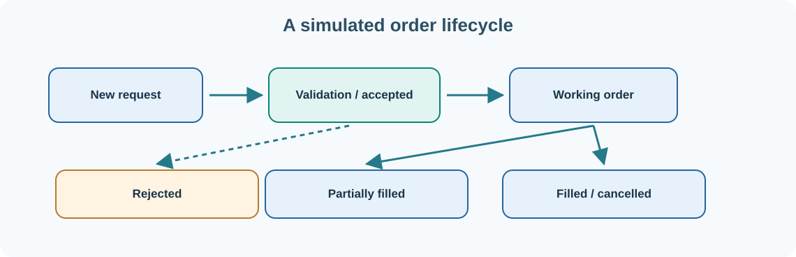

# 33. Trading platforms: market data, orders and execution

A trading platform brings together information about financial instruments, prices, orders, executions, positions and risk. A graphical chart is only one part of the system. Reliable trading software must know what a user requested, what the broker or exchange accepted and what actually happened in the market.

We will use simulated orders and prices throughout this chapter.

## Instruments and market data

An **instrument** identifies what may be traded: for example, a share, bond, currency pair, futures contract or option. Its identity includes more than its displayed symbol. An exchange, currency, contract month, trading calendar or other attributes may be required to distinguish it correctly.

Market data can include last-traded prices, bid and ask prices, order-book depth and trading volume. The **bid** is the price a buyer is willing to pay; the **ask** (or offer) is the price a seller is willing to accept. These prices can change rapidly and may have different quality or delay characteristics.

## Market and limit orders

A **market order** requests execution according to the available market and venue rules, but does not guarantee a particular price. A **limit order** includes a price constraint: a buy limit normally sets a maximum acceptable price, while a sell limit sets a minimum. An order can be partially filled, cancelled or rejected.

**Time in force** describes how long an order should remain eligible. Examples include DAY, GTC (Good Till Cancelled) and IOC (Immediate Or Cancel). Actual availability depends on the broker, venue, instrument and trading session; do not assume every order type or time-in-force combination is supported everywhere.

## Build a simulated order lifecycle

Suppose a practice trader wants to buy **10 shares** with a limit price of **£5.00 per share**. The order passes through several potential states:

| Event | Example state | What it means |
| --- | --- | --- |
| User submits the request | Pending validation | The platform has not yet accepted it |
| Validation succeeds | Accepted | The internal system accepted the request for processing |
| Simulation produces an execution | Partially filled | Some, but not all, quantity has traded |
| More execution occurs | Filled | The order's full quantity has traded |
| Cancel request succeeds before full fill | Cancelled | Remaining eligible quantity is no longer active |
| Validation or venue rejects it | Rejected | The request was not accepted under the applicable rule |

Order status can be more complex than this teaching table: an order might be pending cancellation while additional fills arrive. A correct Order Management System (OMS) must reconcile external reports and track cumulative quantity, remaining quantity and average execution price.

## Calculate a simulated position

If a simulator fills all 10 shares at £4.95 each, the purchase value is **£49.50 before fees**. If it fills 4 shares at £4.95 and 6 at £4.98, the total is £49.68 and the average is £4.968. Display rounding rules do not change the underlying execution records.

The simulator must account for currency, quantity units, fees and any instrument-specific multiplier. A futures contract or option may not behave like one ordinary share.

## Risk before execution

The platform should validate instrument eligibility, available resources, permissions, maximum order quantity and relevant exposure limits **before** sending a live request. A strategy or chart button must not bypass independent risk controls.

Umicom Trader's learning path separates simulated, paper and live environments. A simulated fill proves only that the simulator applied its rules; it does not establish that a broker would have executed at that price or time.

## Audit and reconciliation

A complete record preserves the original request, validation decision, accepted order identifier, execution updates, fees and eventual position changes. If the connection drops after an order is accepted, the platform should reconcile state with the authoritative execution venue rather than inventing a new order automatically.

These principles also connect Trader with Umicom Open TMS, Bank, clearing, custody and accounting services.

**Next:** [Bring the lessons together in a practical project](34-capstone.md).
