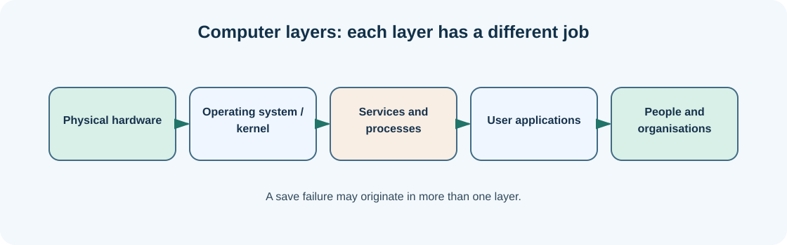

# Chapter 02 — Understand the computer, operating system and user account

**Bits to Banking · System Administration: From Zero · Umicom Foundation**  
**Audience:** first-time users and returning learners; no prior system-administration knowledge required.  
**Code policy:** interactive PowerShell 7 and Bash commands; native C23/Assembly for Umicom executable development.  
**Estimated study time:** 25–50 minutes (longer when practising).

## What you will learn

Explain hardware, the operating system, applications and accounts as separate layers.

## Why this matters




A computer has physical components such as a processor, memory, a drive and a network interface. The operating system coordinates these components and supplies standard services. Applications use those services to open files, display windows, send network requests and use memory. Your user account controls the identity and permissions under which an application acts.

It helps to picture the layers from bottom to top: hardware, operating-system kernel and drivers, operating-system services, applications and the person using them. If a text editor cannot save a document, the cause may be inside the editor, a directory permission, a full drive or a read-only file. One symptom can have several possible causes.

Windows and Linux organise these concepts differently. Windows normally shows drives such as `C:` and uses backslashes in paths. Linux usually presents a single directory tree rooted at `/`. Neither choice tells you whether a file is safe to delete. Always inspect the actual path and ownership first.

## New words, explained

| Term | Plain-English meaning |
|---|---|
| **CPU** | Processor that executes instructions. |
| **RAM** | Working memory used while programs run. |
| **Storage** | Persistent space for files and installed software. |
| **Kernel** | Privileged part of the operating system that controls hardware and processes. |
| **Account** | Identity whose access rights are checked by the operating system. |

## Windows practice — PowerShell 7

> **Before typing:** Run these commands in a normal, non-elevated PowerShell window. Where a file is used, complete the previous practice-folder chapters first. Do not paste the `PS C:\...>` prompt into the terminal.

**Start:** Use the Windows Start menu or Windows Terminal to open PowerShell. Check the prompt is ready. Commands beginning with `$` are still commands; type them exactly as shown.

### Step 1 — Show basic OS details

```powershell
Get-ComputerInfo | Select-Object WindowsProductName, OsVersion, OsArchitecture
```

**Expected observation:** Windows returns values describing the installed operating system.

**Check:** Read the output before continuing. If it does not match, stop and investigate the specific command; do not add `-Force` or run as Administrator automatically.

### Step 2 — Show the current PowerShell version

```powershell
$PSVersionTable.PSVersion
```

**Expected observation:** A table-like version value appears; version 7 or higher identifies PowerShell 7.

**Check:** Read the output before continuing. If it does not match, stop and investigate the specific command; do not add `-Force` or run as Administrator automatically.

### Step 3 — Show your home folder

```powershell
$HOME
```

**Expected observation:** You see the folder assigned to your account.

**Check:** Read the output before continuing. If it does not match, stop and investigate the specific command; do not add `-Force` or run as Administrator automatically.

## Linux comparison — terminal/Bash

> Linux commands are alternatives on a Linux machine or authorised VM. Do not paste them into Windows PowerShell as though the shells have identical syntax.

### Linux step 1 — Ask Linux which kernel is running

```bash
uname -sr
```

**Expected observation:** The kernel name and release are printed.

### Linux step 2 — Display account and groups

```bash
id
```

**Expected observation:** Your user ID and group memberships are shown.

## Worked support scenario

Imagine a finance reporting application closes unexpectedly. A support record should state the operating system, application version, account affected and whether the problem reproduces on another account. “The computer is broken” is not specific enough to decide whether a hardware, application or permission fix is appropriate.

## Common problems and how to respond

| Problem or assumption | Better response |
|---|---|
| Confusing memory with disk space | RAM is temporary working storage; disk space is persistent file storage. |
| Assuming all PowerShell versions are the same | Check `$PSVersionTable.PSVersion` rather than relying on an icon. |
| Confusing the kernel with every program running on the machine | The kernel provides services; most applications execute in user space. |

## Exercise: demonstrate understanding

1. Write down the purpose of **two commands** from this chapter, in your own words.
2. Run a **read-only command** and record only the information needed to answer its question.
3. Explain which command would change the machine, if any, and why the chapter avoids it.
4. Explain the difference between an observation, a conclusion and an unverified assumption.

## Review questions

1. Why can a full drive prevent an application from saving?
2. Does changing a user account alter the CPU?

<details><summary>Show the suggested answers</summary>

1. The operating system cannot allocate enough persistent storage for the file.
2. No. The account changes identity and permissions, not the physical processor.

</details>

## How this connects to Umicom

Umicom Kernel owns privileged hardware and process boundaries. Umicom OS coordinates an operating environment; Umicom Framework provides reusable user-space services; an application such as Studio consumes those contracts.

## Where to go next

Continue with [Chapter 03 — Open PowerShell 7 or the Linux terminal without confusion](03-open-powershell-or-linux-terminal.md).
