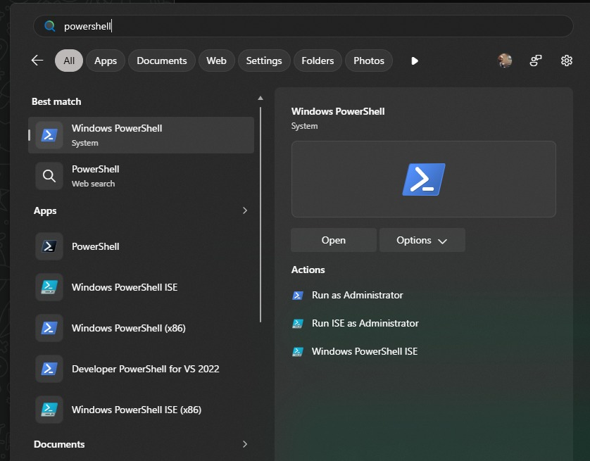

# Chapter 03 — Open PowerShell 7 or the Linux terminal without confusion

**Bits to Banking · System Administration: From Zero · Umicom Foundation**  
**Audience:** first-time users and returning learners; no prior system-administration knowledge required.  
**Code policy:** interactive PowerShell 7 and Bash commands; native C23/Assembly for Umicom executable development.  
**Estimated study time:** 25–50 minutes (longer when practising).

## What you will learn

Identify the program you have opened before typing unfamiliar commands.

## Why this matters


The screenshot below is from the supplied Windows search example. It shows why the programme name and version matter more than the colour of the icon.




The Start menu can show Windows PowerShell, Windows PowerShell ISE, PowerShell and Developer PowerShell for Visual Studio. They are not identical products. **Windows Terminal** is the tabbed terminal application. It can host different command-line shells. **PowerShell 7** is a modern shell normally launched using `pwsh`. **Windows PowerShell 5.1** is the older Windows-included shell, normally launched with `powershell.exe`. **CMD** runs Command Prompt commands, which sometimes resemble PowerShell commands but do not share all syntax.

Your screenshot illustrates this confusion well: it shows several similar blue terminal icons in the Windows search results. To avoid mistakes, use the program name and verify the running version *inside* the shell. Windows PowerShell can be useful for installing PowerShell 7 when the latter is not yet available. There is no need to open a privileged shell for the exercises in this course.

A terminal window is a way to communicate with the shell. The shell reads a command, invokes a built-in operation or an external program, and displays the result. A command is not automatically a script. We use individual interactive PowerShell commands for learning and administration; all new Umicom executable implementations remain in C23 or Assembly.

## New words, explained

| Term | Plain-English meaning |
|---|---|
| **Terminal** | A window that hosts one or more command-line sessions. |
| **Shell** | Program that interprets command text. |
| **Prompt** | Text that shows the shell is ready for a new command. |
| **pwsh** | Executable name typically used to launch PowerShell 7. |
| **ISE** | Legacy Windows PowerShell integrated scripting environment, not PowerShell 7. |

## Windows practice — PowerShell 7

> **Before typing:** Run these commands in a normal, non-elevated PowerShell window. Where a file is used, complete the previous practice-folder chapters first. Do not paste the `PS C:\...>` prompt into the terminal.

**Start:** Use the Windows Start menu or Windows Terminal to open PowerShell. Check the prompt is ready. Commands beginning with `$` are still commands; type them exactly as shown.

### Step 1 — Ask which version is actually running

```powershell
$PSVersionTable.PSVersion
```

**Expected observation:** The Major value should be 7 when using PowerShell 7.

**Check:** Read the output before continuing. If it does not match, stop and investigate the specific command; do not add `-Force` or run as Administrator automatically.

### Step 2 — Ask where the executable is installed

```powershell
Get-Command pwsh -ErrorAction SilentlyContinue | Select-Object Name, Source
```

**Expected observation:** If available, the result identifies the executable path.

**Check:** Read the output before continuing. If it does not match, stop and investigate the specific command; do not add `-Force` or run as Administrator automatically.

### Step 3 — Check the current directory before continuing

```powershell
Get-Location
```

**Expected observation:** The working directory is shown without changing files.

**Check:** Read the output before continuing. If it does not match, stop and investigate the specific command; do not add `-Force` or run as Administrator automatically.

## Linux comparison — terminal/Bash

> Linux commands are alternatives on a Linux machine or authorised VM. Do not paste them into Windows PowerShell as though the shells have identical syntax.

### Linux step 1 — Open Terminal from the applications menu

```bash
pwd
```

**Expected observation:** The shell prints the active directory.

### Linux step 2 — Identify the current shell

```bash
printf "%s\n" "$SHELL"
```

**Expected observation:** A login-shell path appears, such as `/bin/bash`, though the actual running shell can differ.

## Worked support scenario

A contributor tries a command from a Windows tutorial in Command Prompt and receives “not recognised”. Instead of repeating it with administrator permissions, check whether the tutorial says PowerShell, CMD or Linux Bash. Launch the expected shell and verify it using its own version command.

## Common problems and how to respond

| Problem or assumption | Better response |
|---|---|
| Selecting Windows PowerShell ISE thinking it is PowerShell 7 | Start `pwsh` or the PowerShell 7 application instead. |
| Typing example output as if it is a command | Only type the contents of clearly labelled command blocks. |
| Copying `PS C:\...>` prompt symbols into a command | Type only what comes after the prompt. |

## Exercise: demonstrate understanding

1. Write down the purpose of **two commands** from this chapter, in your own words.
2. Run a **read-only command** and record only the information needed to answer its question.
3. Explain which command would change the machine, if any, and why the chapter avoids it.
4. Explain the difference between an observation, a conclusion and an unverified assumption.

## Review questions

1. Is Windows Terminal the same thing as PowerShell?
2. What command verifies your PowerShell edition and version?

<details><summary>Show the suggested answers</summary>

1. No. It is a terminal host; PowerShell is a shell running inside it.
2. `$PSVersionTable.PSVersion`.

</details>

## How this connects to Umicom

Use PowerShell 7 for Windows contributor commands. On Linux use your preferred terminal and Bash. Do not add `.ps1` or `.py` scripts to Umicom merely to automate tasks already implemented in Framework.

## Where to go next

Continue with [Chapter 04 — Read a command, its arguments and the help system](04-read-commands-options-and-help.md).
