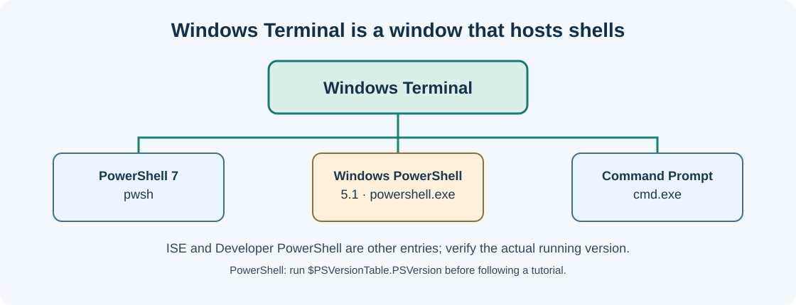

# Chapter 04 — Read a command, its arguments and the help system

**Bits to Banking · System Administration: From Zero · Umicom Foundation**  
**Audience:** first-time users and returning learners; no prior system-administration knowledge required.  
**Code policy:** interactive PowerShell 7 and Bash commands; native C23/Assembly for Umicom executable development.  
**Estimated study time:** 25–50 minutes (longer when practising).

## What you will learn

Understand the pieces of a command and find trusted documentation.

## Why this matters




A command normally contains a command name followed by arguments or options. In `Get-ChildItem -Path "$HOME"`, `Get-ChildItem` is the operation and `-Path` is the name of a parameter. The quoted folder is the value of that parameter. In `git --version`, `--version` is an option recognised by Git, not a PowerShell parameter. Different programs have different option styles.

PowerShell commands are called *cmdlets* when they follow the verb-noun naming convention, such as `Get-Process` and `Test-Path`. It also runs native executables such as `git.exe` and `cmake.exe`. A vertical bar `|` passes output to another command; you can use it to select columns rather than read pages of detail.

Before using an unfamiliar command, prefer `Get-Help`, the program’s `--help` output and its official documentation. Treat copied commands from chats and websites as proposals to review, not instructions to execute blindly. If an option looks like it deletes, formats, force-pushes or rewrites history, do not execute it during a beginner exercise.

## New words, explained

| Term | Plain-English meaning |
|---|---|
| **Parameter** | Named input to a command, such as `-Path`. |
| **Argument** | A value passed to a command or executable. |
| **Pipeline** | A connection that passes command output to another command. |
| **Alias** | An alternate name, such as `pwd` for `Get-Location` in PowerShell. |
| **Exit code** | A number indicating whether a native program succeeded. |

## Windows practice — PowerShell 7

> **Before typing:** Run these commands in a normal, non-elevated PowerShell window. Where a file is used, complete the previous practice-folder chapters first. Do not paste the `PS C:\...>` prompt into the terminal.

**Start:** Use the Windows Start menu or Windows Terminal to open PowerShell. Check the prompt is ready. Commands beginning with `$` are still commands; type them exactly as shown.

### Step 1 — Read help for a safe command

```powershell
Get-Help Get-Location -Examples
```

**Expected observation:** PowerShell displays examples and descriptions.

**Check:** Read the output before continuing. If it does not match, stop and investigate the specific command; do not add `-Force` or run as Administrator automatically.

### Step 2 — See what a command actually resolves to

```powershell
Get-Command pwd
```

**Expected observation:** The alias target should identify `Get-Location`.

**Check:** Read the output before continuing. If it does not match, stop and investigate the specific command; do not add `-Force` or run as Administrator automatically.

### Step 3 — Select a few columns rather than pages of data

```powershell
Get-Process | Select-Object -First 5 Name, Id
```

**Expected observation:** Five process names and IDs are displayed.

**Check:** Read the output before continuing. If it does not match, stop and investigate the specific command; do not add `-Force` or run as Administrator automatically.

### Step 4 — Ask Git for its available options

```powershell
git --help
```

**Expected observation:** Git opens or displays its help; exit any pager or viewer to return to PowerShell.

**Check:** Read the output before continuing. If it does not match, stop and investigate the specific command; do not add `-Force` or run as Administrator automatically.

## Linux comparison — terminal/Bash

> Linux commands are alternatives on a Linux machine or authorised VM. Do not paste them into Windows PowerShell as though the shells have identical syntax.

### Linux step 1 — Read short help for a program

```bash
git --version
```

**Expected observation:** The Git version number appears if Git is installed.

### Linux step 2 — Show the first few processes

```bash
ps -e | head -n 6
```

**Expected observation:** You see a short process list; no process is changed.

## Worked support scenario

You encounter a command showing `git reset --hard` in an online answer. Read its help and identify that it can discard working-tree edits. Because a safer read-only observation such as `git status` is available, do not run the reset. Choosing the correct command is part of administration.

## Common problems and how to respond

| Problem or assumption | Better response |
|---|---|
| Typing spaces inside a single option | Use `--version`, not `- - version`. |
| Assuming Git options and PowerShell parameters are interchangeable | Consult the help for the specific command. |
| Assuming an empty output is always success | Check the command purpose and any error output; for native processes inspect `$LASTEXITCODE` when appropriate. |

## Exercise: demonstrate understanding

1. Write down the purpose of **two commands** from this chapter, in your own words.
2. Run a **read-only command** and record only the information needed to answer its question.
3. Explain which command would change the machine, if any, and why the chapter avoids it.
4. Explain the difference between an observation, a conclusion and an unverified assumption.

## Review questions

1. What does the pipe operator do in a PowerShell pipeline?
2. Why should you inspect help before using reset or force flags?

<details><summary>Show the suggested answers</summary>

1. It passes objects from one command to another.
2. Those operations may overwrite changes or affect shared history.

</details>

## How this connects to Umicom

Read CMake, Git and the built native `umicom` command help separately. They are different programs invoked from the same PowerShell prompt.

## Where to go next

Continue with [Chapter 05 — Folders, file paths and your own safe practice workspace](05-folders-paths-and-safe-workspace.md).
