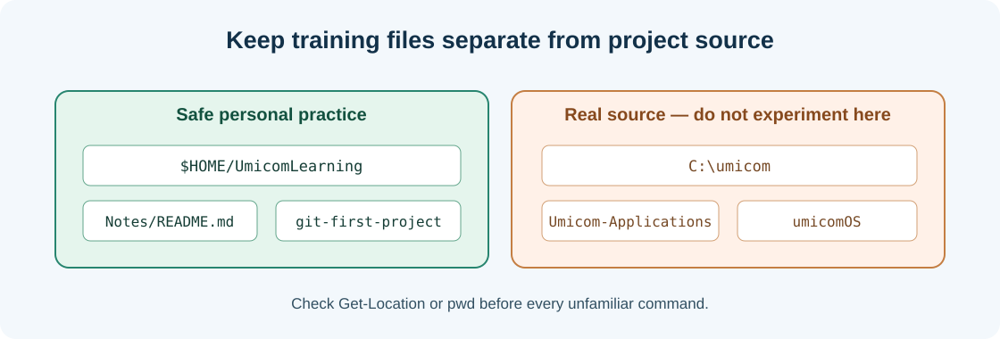

# Chapter 05 — Folders, file paths and your own safe practice workspace

**Bits to Banking · System Administration: From Zero · Umicom Foundation**  
**Audience:** first-time users and returning learners; no prior system-administration knowledge required.  
**Code policy:** interactive PowerShell 7 and Bash commands; native C23/Assembly for Umicom executable development.  
**Estimated study time:** 25–50 minutes (longer when practising).

## What you will learn

Create a private training directory and understand absolute and relative paths.

## Why this matters




A folder groups files and other folders. The **working directory** is the location where relative paths are interpreted. An absolute Windows path such as `C:\Users\Alex\UmicomLearning` identifies a location without depending on where you started. A relative path such as `notes\README.md` begins inside the current directory. You can get unexpected results if you change files while standing in the wrong location.

We deliberately use `$HOME\UmicomLearning` for examples. `$HOME` is your account’s personal home folder, so the exercise does not touch your real `C:\umicom\Umicom-Applications` workspace or require administrator privileges. `$HOME` expands to a path that can contain spaces; the quotation marks keep that path together.

`Get-Location` and `pwd` observe the current directory. `Set-Location` and `cd` change it. `New-Item -ItemType Directory` creates a folder. `Test-Path` checks whether one exists. Do not use `git submodule add` as a synonym for creating a regular folder: it registers a separate Git repository and needs more careful review.

## New words, explained

| Term | Plain-English meaning |
|---|---|
| **Working directory** | Folder used to interpret relative paths. |
| **Absolute path** | Path that specifies its location independently of the working directory. |
| **Relative path** | Path interpreted starting from the working directory. |
| **Home directory** | Private starting folder associated with the signed-in account. |
| **Parent directory** | Directory containing the current directory. |

## Windows practice — PowerShell 7

> **Before typing:** Run these commands in a normal, non-elevated PowerShell window. Where a file is used, complete the previous practice-folder chapters first. Do not paste the `PS C:\...>` prompt into the terminal.

**Start:** Use the Windows Start menu or Windows Terminal to open PowerShell. Check the prompt is ready. Commands beginning with `$` are still commands; type them exactly as shown.

### Step 1 — Create a practice folder within your own home

```powershell
New-Item -ItemType Directory -Path "$HOME\UmicomLearning" -Force
```

**Expected observation:** PowerShell shows the directory or confirms it exists.

**Check:** Read the output before continuing. If it does not match, stop and investigate the specific command; do not add `-Force` or run as Administrator automatically.

### Step 2 — Enter the directory

```powershell
Set-Location "$HOME\UmicomLearning"
```

**Expected observation:** The prompt changes to your new working directory.

**Check:** Read the output before continuing. If it does not match, stop and investigate the specific command; do not add `-Force` or run as Administrator automatically.

### Step 3 — Confirm your location

```powershell
Get-Location
```

**Expected observation:** The path ends in `UmicomLearning`.

**Check:** Read the output before continuing. If it does not match, stop and investigate the specific command; do not add `-Force` or run as Administrator automatically.

### Step 4 — Create a Notes subfolder

```powershell
New-Item -ItemType Directory -Path ".\Notes" -Force
```

**Expected observation:** You now have a `Notes` subfolder; no Umicom repository was touched.

**Check:** Read the output before continuing. If it does not match, stop and investigate the specific command; do not add `-Force` or run as Administrator automatically.

### Step 5 — Show the folder contents

```powershell
Get-ChildItem
```

**Expected observation:** The `Notes` directory appears.

**Check:** Read the output before continuing. If it does not match, stop and investigate the specific command; do not add `-Force` or run as Administrator automatically.

## Linux comparison — terminal/Bash

> Linux commands are alternatives on a Linux machine or authorised VM. Do not paste them into Windows PowerShell as though the shells have identical syntax.

### Linux step 1 — Create the equivalent Linux practice directory

```bash
mkdir -p "$HOME/UmicomLearning/Notes"
```

**Expected observation:** The folder is created or already exists.

### Linux step 2 — Show exactly where you are

```bash
cd "$HOME/UmicomLearning" && pwd
```

**Expected observation:** The printed path ends in `UmicomLearning`.

## Worked support scenario

A student working in `C:\umicom\Umicom-Applications` accidentally runs a file-creation example intended for a throwaway practice folder. The command may alter a real project. The safer pattern is to check `Get-Location` before every unfamiliar operation and enter the private training directory.

## Common problems and how to respond

| Problem or assumption | Better response |
|---|---|
| Using `mkdir` when a directory is supposed to be a Git submodule | Do not pre-create a submodule destination; Git manages that folder. |
| Assuming `cd` creates a folder | Use `New-Item` or `mkdir` to create, and `cd` to enter. |
| Forgetting quotes around a path with spaces | Write `Set-Location "C:\My Training"`, not an unquoted multiword path. |

## Exercise: demonstrate understanding

1. Write down the purpose of **two commands** from this chapter, in your own words.
2. Run a **read-only command** and record only the information needed to answer its question.
3. Explain which command would change the machine, if any, and why the chapter avoids it.
4. Explain the difference between an observation, a conclusion and an unverified assumption.

## Review questions

1. What is `$HOME`?
2. What is the safest first command when you are unsure where you are?

<details><summary>Show the suggested answers</summary>

1. The current user’s home directory in PowerShell.
2. `Get-Location` or `pwd`.

</details>

## How this connects to Umicom

Use a personal sandbox for all practice. Open real Umicom repositories only when a specific chapter asks you to inspect them, and never mix tutorial files into production folders.

## Where to go next

Continue with [Chapter 06 — Create, open and read text files without scripting](06-create-open-and-read-text-files.md).
