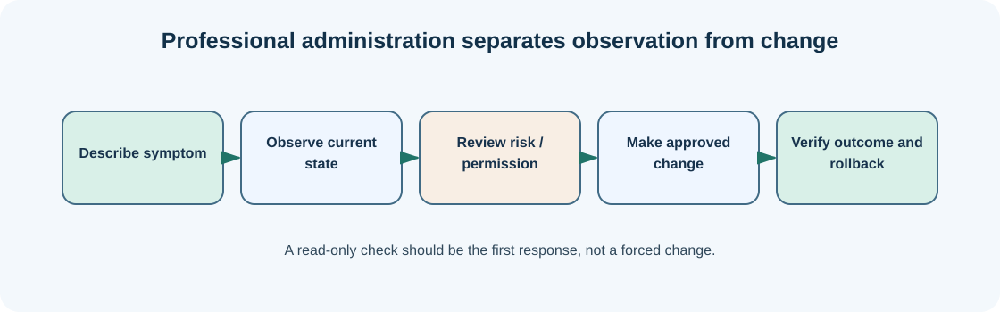

# Chapter 07 — Copy, rename and remove files carefully

**Bits to Banking · System Administration: From Zero · Umicom Foundation**  
**Audience:** first-time users and returning learners; no prior system-administration knowledge required.  
**Code policy:** interactive PowerShell 7 and Bash commands; native C23/Assembly for Umicom executable development.  
**Estimated study time:** 25–50 minutes (longer when practising).

## What you will learn

Distinguish reversible inspection from potentially destructive file operations.

## Why this matters




Moving and deleting files are common administration tasks and common sources of mistakes. A copy creates another file while leaving the source intact. A move changes its location. A rename changes its name. A delete removes it from the location you select, and its recoverability depends on the method and system configuration.

PowerShell includes `-WhatIf` on many commands that change state. It displays the proposed action without executing it. This is useful when learning `Remove-Item`, `Move-Item` and `Copy-Item`. A preview is still not a substitute for checking the target path, but it can catch obvious surprises.

Always practise in `$HOME\UmicomLearning`; never experiment with `C:\Windows`, an installed program directory or a live Umicom repository. If you later administer shared servers, agree on the recovery and approval process before removing even a seemingly unimportant log or cache.

## New words, explained

| Term | Plain-English meaning |
|---|---|
| **Copy** | Create a second file from existing content. |
| **Move** | Relocate a file from one path to another. |
| **Rename** | Change the file name without changing its contents. |
| **WhatIf** | Request supported PowerShell commands to describe a change without making it. |
| **Rollback** | Return a system to a known previous state after an unwanted change. |

## Windows practice — PowerShell 7

> **Before typing:** Run these commands in a normal, non-elevated PowerShell window. Where a file is used, complete the previous practice-folder chapters first. Do not paste the `PS C:\...>` prompt into the terminal.

**Start:** Use the Windows Start menu or Windows Terminal to open PowerShell. Check the prompt is ready. Commands beginning with `$` are still commands; type them exactly as shown.

### Step 1 — Return to the sandbox

```powershell
Set-Location "$HOME\UmicomLearning\Notes"
```

**Expected observation:** You are working only in the practice Notes folder.

**Check:** Read the output before continuing. If it does not match, stop and investigate the specific command; do not add `-Force` or run as Administrator automatically.

### Step 2 — Preview a copy operation

```powershell
Copy-Item .\README.md .\README-backup.md -WhatIf
```

**Expected observation:** PowerShell describes the copy but does not create the destination.

**Check:** Read the output before continuing. If it does not match, stop and investigate the specific command; do not add `-Force` or run as Administrator automatically.

### Step 3 — Create the practice backup

```powershell
Copy-Item .\README.md .\README-backup.md
```

**Expected observation:** Two files now exist.

**Check:** Read the output before continuing. If it does not match, stop and investigate the specific command; do not add `-Force` or run as Administrator automatically.

### Step 4 — Preview a rename

```powershell
Rename-Item .\README-backup.md -NewName "README-practice-copy.md" -WhatIf
```

**Expected observation:** The rename is shown, but not applied.

**Check:** Read the output before continuing. If it does not match, stop and investigate the specific command; do not add `-Force` or run as Administrator automatically.

### Step 5 — Preview a deletion and stop

```powershell
Remove-Item .\README-practice-copy.md -WhatIf
```

**Expected observation:** The file remains present. We deliberately do not perform deletion in this exercise.

**Check:** Read the output before continuing. If it does not match, stop and investigate the specific command; do not add `-Force` or run as Administrator automatically.

## Linux comparison — terminal/Bash

> Linux commands are alternatives on a Linux machine or authorised VM. Do not paste them into Windows PowerShell as though the shells have identical syntax.

### Linux step 1 — Copy within the sandbox

```bash
cp "$HOME/UmicomLearning/Notes/README.md" "$HOME/UmicomLearning/Notes/README-copy.md"
```

**Expected observation:** A second file exists; the original is unchanged.

### Linux step 2 — Inspect both files

```bash
ls -l "$HOME/UmicomLearning/Notes/README"*
```

**Expected observation:** You see filenames and sizes before deciding on any cleanup.

## Worked support scenario

An operator plans to clear space by deleting “old” reports. Before doing so, they identify the required retention period and whether a validated backup exists. They select a narrow set of files and preview the intended removal. This prevents a routine storage task from destroying audit evidence.

## Common problems and how to respond

| Problem or assumption | Better response |
|---|---|
| Using wildcard deletion without first listing matches | Preview the exact matching files and avoid broad patterns. |
| Treating `-Force` as a fix for an unfamiliar error | Understand why the action failed before overriding a check. |
| Believing a copy is a verified backup | Read and compare the copied file; later chapters introduce fingerprints. |

## Exercise: demonstrate understanding

1. Write down the purpose of **two commands** from this chapter, in your own words.
2. Run a **read-only command** and record only the information needed to answer its question.
3. Explain which command would change the machine, if any, and why the chapter avoids it.
4. Explain the difference between an observation, a conclusion and an unverified assumption.

## Review questions

1. What does `-WhatIf` do for supporting PowerShell commands?
2. Why should you not use deletion to practise in a real Git checkout?

<details><summary>Show the suggested answers</summary>

1. Shows the proposed operation without executing it.
2. It may remove work that has not been committed or backed up.

</details>

## How this connects to Umicom

Umicom source preservation is mandatory. Refactoring does not authorise deleting previous functions, comments, educational explanations or features. Review and retain superseded code until the project owner approves removal.

## Where to go next

Continue with [Chapter 08 — Install and verify PowerShell 7, Git and development tools](08-install-programmes-and-verify-tools.md).
