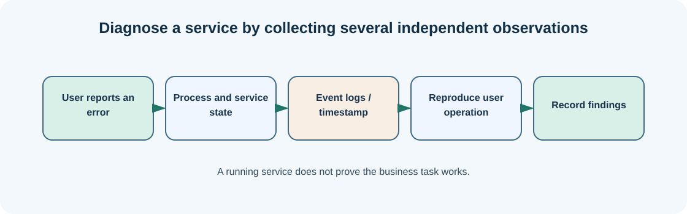

# Chapter 10 — Processes: what is running on your computer?

**Bits to Banking · System Administration: From Zero · Umicom Foundation**  
**Audience:** first-time users and returning learners; no prior system-administration knowledge required.  
**Code policy:** interactive PowerShell 7 and Bash commands; native C23/Assembly for Umicom executable development.  
**Estimated study time:** 25–50 minutes (longer when practising).

## What you will learn

List processes, read their resource use and avoid interrupting unknown work.

## Why this matters




A process is a running instance of a program. The same application may create several processes, and different processes can share a program name. A process has an identifier, memory and access to resources. When an application appears frozen, inspecting its process and resource use can help establish whether it exists, is consuming CPU, or has exited unexpectedly.

Process names are not proof of trust. An unfamiliar process should be investigated using location, digital signature where available and the associated application rather than terminated immediately. Some background processes are critical to system operation. `Stop-Process` can end a process, potentially losing unsaved work; it is outside this beginner exercise.

The Windows Task Manager provides a graphical view of processes. PowerShell `Get-Process` gives a more inspectable textual form. Learning both helps when supporting people who prefer either a graphical interface or a command line.

## New words, explained

| Term | Plain-English meaning |
|---|---|
| **Process** | Running instance of executable code. |
| **PID** | Process identifier assigned by the operating system. |
| **CPU** | Processor time used to execute work. |
| **Working set** | Approximate physical memory currently held by a Windows process. |
| **Task Manager** | Windows application for inspecting running processes and resources. |

## Windows practice — PowerShell 7

> **Before typing:** Run these commands in a normal, non-elevated PowerShell window. Where a file is used, complete the previous practice-folder chapters first. Do not paste the `PS C:\...>` prompt into the terminal.

**Start:** Use the Windows Start menu or Windows Terminal to open PowerShell. Check the prompt is ready. Commands beginning with `$` are still commands; type them exactly as shown.

### Step 1 — Show five processes

```powershell
Get-Process | Select-Object -First 5 Name, Id, CPU
```

**Expected observation:** A short list appears; CPU values may be blank for some processes.

**Check:** Read the output before continuing. If it does not match, stop and investigate the specific command; do not add `-Force` or run as Administrator automatically.

### Step 2 — Sort processes by physical memory use

```powershell
Get-Process | Sort-Object WorkingSet64 -Descending | Select-Object -First 5 Name, Id, WorkingSet64
```

**Expected observation:** Processes with the largest reported working sets appear first.

**Check:** Read the output before continuing. If it does not match, stop and investigate the specific command; do not add `-Force` or run as Administrator automatically.

### Step 3 — Open Task Manager using the user interface

```powershell
taskmgr
```

**Expected observation:** The Task Manager window opens; you may close it without changing anything.

**Check:** Read the output before continuing. If it does not match, stop and investigate the specific command; do not add `-Force` or run as Administrator automatically.

## Linux comparison — terminal/Bash

> Linux commands are alternatives on a Linux machine or authorised VM. Do not paste them into Windows PowerShell as though the shells have identical syntax.

### Linux step 1 — List processes from the terminal

```bash
ps -eo pid,comm,%cpu,%mem | head -n 10
```

**Expected observation:** A small process list appears.

### Linux step 2 — Show system load averages

```bash
uptime
```

**Expected observation:** Linux displays uptime and load averages, if the utility is installed.

## Worked support scenario

Umicom Studio reports a stalled build. You find that the compiler is still running and consuming CPU. That observation suggests ongoing compilation, not necessarily a crash. Next you inspect the build log and elapsed time. Terminating the compiler is a separate operational choice that should not be made simply because the UI looks idle.

## Common problems and how to respond

| Problem or assumption | Better response |
|---|---|
| Stopping the first process with a familiar name | Verify PID, executable and ownership before considering termination. |
| Assuming high CPU usage always means failure | Busy compilation and media encoding legitimately use CPU. |
| Treating the PID as permanent | PIDs can be reused after a process exits. |

## Exercise: demonstrate understanding

1. Write down the purpose of **two commands** from this chapter, in your own words.
2. Run a **read-only command** and record only the information needed to answer its question.
3. Explain which command would change the machine, if any, and why the chapter avoids it.
4. Explain the difference between an observation, a conclusion and an unverified assumption.

## Review questions

1. What is a process?
2. Does a process name uniquely identify a specific running instance?

<details><summary>Show the suggested answers</summary>

1. A running instance of a program.
2. No; multiple processes can have the same name.

</details>

## How this connects to Umicom

Umicom Framework process supervision should be used when applications need native build or execution lifecycle services. A training chapter may inspect processes without creating another application-owned process manager.

## Where to go next

Continue with [Chapter 11 — Windows services: background programs and startup](11-windows-services-and-startup.md).
