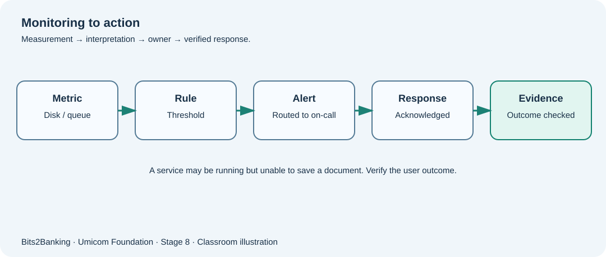

# Chapter 100 — Monitoring: from a measurement to an alert someone can act on

**Bits to Banking · System Administration From Zero · Stage 8**  
**Prerequisites:** Course Chapters 1–96 provide optional foundation; this lesson explains new terms before use.  
**Audience:** Beginners, returning professionals, and supervised young learners.  
**Safety:** Read-only observations on a computer you own or are permitted to use. Never copy real secrets into exercises.

## What we are going to learn

A metric is a measurement; a threshold is a rule; an alert is a request for attention. A service needs all three connected to the real business outcome.



## Understand the idea before typing

A Windows process appearing in Task Manager, or a Linux process in `ps`, only proves that the operating system currently has a process record. It does not prove that a Notes document can be saved or that a bank’s payment workflow has completed. Monitor **the job the software exists to perform**. Technical metrics provide clues; a small synthetic transaction or an independently checked processing outcome provides more meaningful readiness evidence.

An alert should contain a clear symptom, affected service, first observation time, severity, a runbook link and ownership. If alerts have no owner, their existence is merely noise. For a beginner, do not wire a real paging system; create a paper exercise using a fictional output. Metrics are not automatically comparable across platforms: PowerShell’s `CPU` process property is typically accumulated CPU time, not current utilisation percentage.

## New terms explained

| Term | Plain-English meaning |
|---|---|
| **Metric** | A numeric measurement such as free disk percentage. |
| **Log** | A recorded event with useful context. |
| **Threshold** | A value beyond which investigation may be required. |
| **Alert** | A notification routed to a responsible person or service. |
| **False positive** | An alert raised when no real incident exists. |
| **SLO** | A target for service behaviour agreed by the service owner. |


## Windows laboratory — PowerShell 7

Open **Windows Terminal → PowerShell** or search for **PowerShell**. The prompt looks like `PS C:\Users\...>`; do **not** type the prompt itself. On Windows PowerShell 5.1, read-only commands may still work, but the project teaches PowerShell 7. Type the commands one line at a time:

```powershell
Get-Process | Sort-Object CPU -Descending | Select-Object -First 5 Name, Id, CPU
Get-PSDrive -PSProvider FileSystem
Get-Date
```

**What to expect:** The `CPU` column is cumulative processor time in seconds and is not an instant CPU percentage. Note which machine and time supplied the measurement. Avoid publishing workstation usernames or private file paths in public screenshots. The exact names, counts and times on your computer will differ; no precise output is assumed.

## Linux laboratory — terminal

Open your Linux terminal (for example a disposable virtual machine). These commands are read-only. If a command is unavailable, note your distribution and ask the instructor before installing anything.

```bash
uptime
free -h
df -h
ps -eo pid,comm,etime --sort=pid | head -n 6
```

**What to expect:** `uptime` shows elapsed system runtime and load averages, not an SLA guarantee. `free -h` reports memory totals. `etime` shows how long a process has existed; not that it is healthy.

## Worked Umicom case study

The fictional Notes service is reachable but a student’s edits are not being saved. A CPU chart looks normal. A useful runbook checks the last successful save, the storage dependency and a fresh write operation in a **dedicated practice workspace**. If one component is unhealthy, the alert describes the failed user outcome and its dependencies. It does not declare success simply because `ping` or `Get-Process` succeeds.

## What if something goes wrong?

| Observation | Safe response |
|---|---|
| CPU is high for a moment | Look for sustained patterns and associated response degradation; a single sample is incomplete. |
| There are many alerts but nobody responds | Check routing, acknowledgement, on-call owner and escalation time. |
| Everything is green but users cannot save | Add a meaningful end-to-end service check and investigate stale/missing telemetry. |

## Guided learner exercise

1. Design a fictional “Notes save unavailable” alert with a symptom, owner, evidence and first safe check.
2. Explain why one process measurement cannot prove the health of a distributed service.
3. Choose a threshold that would require trend evidence rather than reacting to one brief spike.

## Self-check and suggested answers

**Answer 1:** A process can be alive while database, network, permission or workflow dependencies fail.

**Answer 2:** An alert is useful only when its routing and acknowledgement path have been tested.

## What this proves — and what it does not

These exercises teach how to collect observations and describe decisions. They are not a certification of any real Umicom deployment. A command completing successfully does not automatically mean that a business operation finished. In live work, only an authorised owner should change service configuration, scheduled jobs, firewall policy, backup retention or credentials, after impact assessment and recovery planning. New reusable monitoring or scheduling software belongs in **Umicom Framework**, preferably implemented in C23 or Assembly rather than new PowerShell/Python scripts.

**Further reading:** [Stage 8 overview](stage-8-index.md) · [Safe command reference](stage-8-safe-command-reference.md) · [Stage 8 glossary](stage-8-glossary.md).
