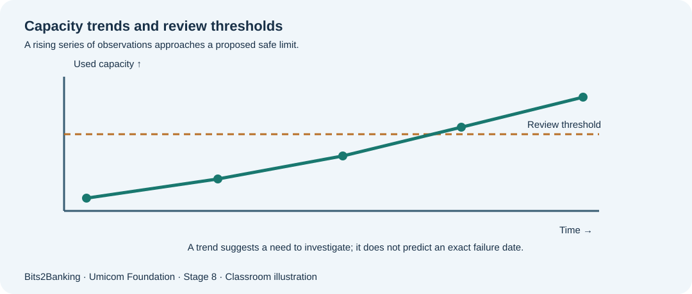

# Chapter 101 — Capacity planning: recognise trends before systems run out of resources

**Bits to Banking · System Administration From Zero · Stage 8**  
**Prerequisites:** Course Chapters 1–96 provide optional foundation; this lesson explains new terms before use.  
**Audience:** Beginners, returning professionals, and supervised young learners.  
**Safety:** Read-only observations on a computer you own or are permitted to use. Never copy real secrets into exercises.

## What we are going to learn

A good administrator observes disk, memory, processor and queues over time, separates brief peaks from sustained growth, and plans before customers are affected.



## Understand the idea before typing

Imagine a Notes training machine with 20 GB of usable space. It used 10 GB last month, 12 GB this month and 14 GB now. If growth stays similar, free space will keep shrinking. The administrator should not claim certainty from three points: growth may slow, backups may move elsewhere, or logs may surge. Instead, **record the trend, assumptions and a trigger for review**.

Disk space, memory pressure, CPU work and queue depth should be interpreted independently. A high queue can reflect a failed downstream service even when CPU is quiet. On Windows, file-system free space from `Get-PSDrive` and underlying volume capacity from `Get-Volume` are different views. On Linux, `df` shows filesystem availability and `du` shows sizes under directories the user may read. No learner should run recursive scans of private home folders owned by others.

## New terms explained

| Term | Plain-English meaning |
|---|---|
| **Capacity** | How much work or data a resource can support. |
| **Headroom** | Capacity still available before a safe operating limit. |
| **Trend** | How a measurement changes across multiple observations. |
| **Queue depth** | Work waiting to be processed. |
| **Saturation** | A resource is too busy to keep up with demand. |
| **Forecast** | An estimate based on assumptions; never an observed fact. |


## Windows laboratory — PowerShell 7

Open **Windows Terminal → PowerShell** or search for **PowerShell**. The prompt looks like `PS C:\Users\...>`; do **not** type the prompt itself. On Windows PowerShell 5.1, read-only commands may still work, but the project teaches PowerShell 7. Type the commands one line at a time:

```powershell
Get-PSDrive -PSProvider FileSystem
Get-Process | Sort-Object WorkingSet64 -Descending | Select-Object -First 5 Name, Id, WorkingSet64
Get-Date
```

**What to expect:** `WorkingSet64` is current resident memory measured in bytes, not the total memory a process could allocate. Sorting highlights large process working sets, but does not identify the cause of a capacity incident. The exact names, counts and times on your computer will differ; no precise output is assumed.

## Linux laboratory — terminal

Open your Linux terminal (for example a disposable virtual machine). These commands are read-only. If a command is unavailable, note your distribution and ask the instructor before installing anything.

```bash
df -h
free -h
uptime
```

**What to expect:** `df` reports mounted filesystem usage. Some pseudo-filesystems are not ordinary disks. `free` output includes reclaimable cache; avoid calling all cache “wasted memory”.

## Worked Umicom case study

The fictional Notes export queue had 2 jobs yesterday, 6 this morning and 14 after lunch. CPU load is low. The storage export adapter might be blocked; increasing server CPUs without diagnosis could waste money. The learner makes an observation table with time, queue depth, oldest job age, available disk and processing rate. The next action is to ask the responsible operator whether completed exports match the expected count. Forecast a range, not a promised capacity date.

## What if something goes wrong?

| Observation | Safe response |
|---|---|
| Disk free space is large, but saves fail | Check quota, permissions, inodes on Linux, specific mount and actual application path. |
| A process has a large working set | That may be normal cache/use; correlate with pressure and user symptoms. |
| Queue depth grows but CPU stays low | Investigate a blocked downstream dependency or unavailable worker. |

## Guided learner exercise

1. Create three fictional disk-use observations and calculate how much the used-space value changed between them.
2. Explain how one unusually large upload could invalidate a linear growth forecast.
3. List two business signals that would help determine whether a backlog is harmful.

## Self-check and suggested answers

**Answer 1:** A forecast is an estimate under assumptions, not guaranteed future behaviour.

**Answer 2:** Oldest-job age and number of successful exports are often more useful than queue count alone.

## What this proves — and what it does not

These exercises teach how to collect observations and describe decisions. They are not a certification of any real Umicom deployment. A command completing successfully does not automatically mean that a business operation finished. In live work, only an authorised owner should change service configuration, scheduled jobs, firewall policy, backup retention or credentials, after impact assessment and recovery planning. New reusable monitoring or scheduling software belongs in **Umicom Framework**, preferably implemented in C23 or Assembly rather than new PowerShell/Python scripts.

**Further reading:** [Stage 8 overview](stage-8-index.md) · [Safe command reference](stage-8-safe-command-reference.md) · [Stage 8 glossary](stage-8-glossary.md).
