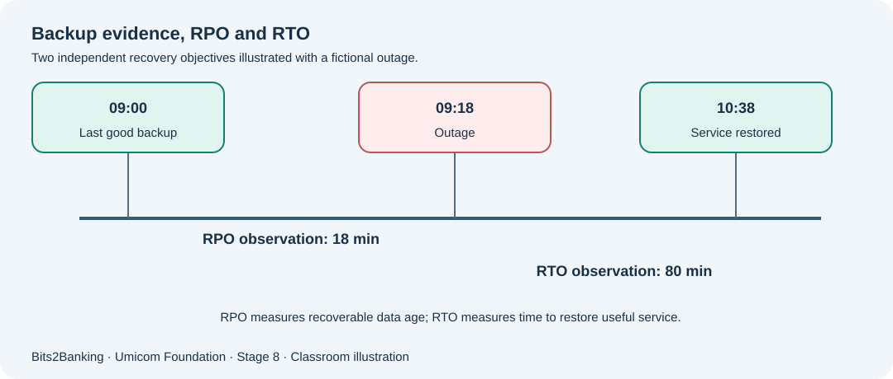

# Chapter 103 — Backups, retention, RPO and RTO without confusing the objectives

**Bits to Banking · System Administration From Zero · Stage 8**  
**Prerequisites:** Course Chapters 1–96 provide optional foundation; this lesson explains new terms before use.  
**Audience:** Beginners, returning professionals, and supervised young learners.  
**Safety:** Read-only observations on a computer you own or are permitted to use. Never copy real secrets into exercises.

## What we are going to learn

A backup is a copy, a restore is the recovery of usable information, and retention is a policy about which copies remain available. Learn what Recovery Point and Recovery Time Objectives measure.



## Understand the idea before typing

Suppose a classroom Notes service creates a backup at 09:00 and fails at 09:18. If the most recent recoverable copy is truly from 09:00, up to 18 minutes of changes may be missing. An RPO of 15 minutes would not be met, even if the restored copy opens perfectly. Now suppose the restore takes 80 minutes. If the RTO is 60 minutes, the recovery-time objective is missed independently of the data-loss objective. **RPO and RTO answer different questions.**

A retention plan should consider daily, weekly and monthly generations, storage separation, permissions, encryption, privacy and legally required holding periods. More copies are not automatically better if all copies share the same failing disk or account. A backup verification checksum proves two compared byte sequences match; it does not establish that the backup is complete or that an application can successfully open the restored data.

## New terms explained

| Term | Plain-English meaning |
|---|---|
| **Backup** | A stored copy intended to support recovery. |
| **Retention** | How long each class of backup is kept under an approved policy. |
| **RPO** | Recovery Point Objective: the maximum tolerated data loss, measured in time. |
| **RTO** | Recovery Time Objective: the planned maximum time to restore useful service. |
| **Restore test** | A controlled attempt to recover and use backup information. |
| **Immutable backup** | A backup protected against certain changes or deletion under its configured controls. |


## Windows laboratory — PowerShell 7

Open **Windows Terminal → PowerShell** or search for **PowerShell**. The prompt looks like `PS C:\Users\...>`; do **not** type the prompt itself. On Windows PowerShell 5.1, read-only commands may still work, but the project teaches PowerShell 7. Type the commands one line at a time:

```powershell
$Practice = Join-Path $HOME 'UmicomTraining\backup-practice'
New-Item -ItemType Directory -Path $Practice -Force | Out-Null
'Sample Notes training text' | Set-Content -LiteralPath (Join-Path $Practice 'notes.txt')
Copy-Item -LiteralPath (Join-Path $Practice 'notes.txt') -Destination (Join-Path $Practice 'notes-copy.txt')
Get-FileHash -LiteralPath (Join-Path $Practice 'notes.txt') -Algorithm SHA256
Get-FileHash -LiteralPath (Join-Path $Practice 'notes-copy.txt') -Algorithm SHA256
```

**What to expect:** You create only two files in your own practice folder. Matching SHA-256 hashes confirm the two current file byte sequences match. The exercise does **not** prove an application backup works or authorise deleting any older copies. The exact names, counts and times on your computer will differ; no precise output is assumed.

## Linux laboratory — terminal

Open your Linux terminal (for example a disposable virtual machine). These commands are read-only. If a command is unavailable, note your distribution and ask the instructor before installing anything.

```bash
mkdir -p "$HOME/UmicomTraining/backup-practice"
printf '%s\n' 'Sample Notes training text' > "$HOME/UmicomTraining/backup-practice/notes.txt"
cp "$HOME/UmicomTraining/backup-practice/notes.txt" "$HOME/UmicomTraining/backup-practice/notes-copy.txt"
sha256sum "$HOME/UmicomTraining/backup-practice/notes.txt" "$HOME/UmicomTraining/backup-practice/notes-copy.txt"
```

**What to expect:** The examples write only inside the learner’s own new training folder. `sha256sum` prints a checksum for each practice file. Never use these commands on a live database or a shared clinical record.

## Worked Umicom case study

The fictional Notes team keeps backups for seven days and schedules a restore exercise once per month. An outage happens at 14:00. The newest **verified** recoverable data is from 13:40, so the observed recovery point is 20 minutes old. Restoring application functionality finishes at 16:10, making the observed recovery time 130 minutes. Compare these with fictional objectives of 15 minutes (RPO) and two hours (RTO). Both objectives are missed. A truthful handover includes measured figures, sources, excluded data and lessons for the next practice drill; it must not mark recovery compliant just because the machine booted.

## What if something goes wrong?

| Observation | Safe response |
|---|---|
| Backup job says completed | Confirm the expected data exists and periodically complete an independent restore drill. |
| Two SHA-256 hashes match | Hashes compare selected bytes; they do not verify the scope, age, recoverability or key access of a complete backup. |
| No space remains for another backup | Escalate capacity risk; never delete protected retention copies without policy and owner approval. |

## Guided learner exercise

1. Using the fictional outage from the scenario, calculate whether the RPO and RTO objectives were met. State the arithmetic and what each result means.
2. Create a small retention matrix with Daily, Weekly and Monthly generations. Mark every duration as a **proposed training policy** rather than a universal rule.
3. Explain why restoring a file into a separate training folder is safer than overwriting its original.

## Self-check and suggested answers

**Answer 1:** The 20-minute recovery point exceeds the 15-minute RPO, and 130 minutes exceeds the 120-minute RTO. Both are misses.

**Answer 2:** A separate destination protects the original, enables side-by-side comparison and limits the effect of a mistaken restore.

## What this proves — and what it does not

These exercises teach how to collect observations and describe decisions. They are not a certification of any real Umicom deployment. A command completing successfully does not automatically mean that a business operation finished. In live work, only an authorised owner should change service configuration, scheduled jobs, firewall policy, backup retention or credentials, after impact assessment and recovery planning. New reusable monitoring or scheduling software belongs in **Umicom Framework**, preferably implemented in C23 or Assembly rather than new PowerShell/Python scripts.

**Further reading:** [Stage 8 overview](stage-8-index.md) · [Safe command reference](stage-8-safe-command-reference.md) · [Stage 8 glossary](stage-8-glossary.md).
