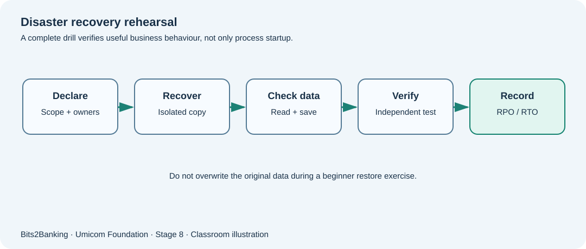

# Chapter 104 — Disaster recovery: read a runbook, rehearse and prove service recovery

**Bits to Banking · System Administration From Zero · Stage 8**  
**Prerequisites:** Course Chapters 1–96 provide optional foundation; this lesson explains new terms before use.  
**Audience:** Beginners, returning professionals, and supervised young learners.  
**Safety:** Read-only observations on a computer you own or are permitted to use. Never copy real secrets into exercises.

## What we are going to learn

Disaster recovery is more than restarting a computer. It restores the business process, data, access, connectivity and confidence that people can safely continue working.



## Understand the idea before typing

A fictional service may depend on its application process, storage, account permissions, DNS, time synchronisation and backup data. A runbook that says “restart Notes” is incomplete if the recovered process cannot read its records. A safe DR drill has a **declared boundary**: training environment, isolated files, operator roles, start and stop conditions, acceptable data loss, expected restoration time and independent verification.

The restore procedure must be rehearsed on harmless data before people rely on it. Keep the original workload undisturbed. If a step fails, record what was attempted, where it failed and what evidence remains. Do not keep retrying destructive operations hoping the outcome will improve. A DR plan should also define a communication point, because another team may be waiting for a storage, network or identity service before their work can resume.

## New terms explained

| Term | Plain-English meaning |
|---|---|
| **Disaster recovery (DR)** | Organised recovery after a severe interruption. |
| **Runbook** | Documented actions, prerequisites, owners and verification steps. |
| **Recovery site** | A separate location or environment used for recovery. |
| **Dependency** | Another component that the service requires. |
| **Failback** | Controlled return to the normal environment after recovery. |
| **Exercise boundary** | The approved machines, accounts and data that a drill may touch. |


## Windows laboratory — PowerShell 7

Open **Windows Terminal → PowerShell** or search for **PowerShell**. The prompt looks like `PS C:\Users\...>`; do **not** type the prompt itself. On Windows PowerShell 5.1, read-only commands may still work, but the project teaches PowerShell 7. Type the commands one line at a time:

```powershell
$Root = Join-Path $HOME 'UmicomTraining\drill'
New-Item -ItemType Directory -Path (Join-Path $Root 'source') -Force | Out-Null
New-Item -ItemType Directory -Path (Join-Path $Root 'restored') -Force | Out-Null
'Fictional Notes document' | Set-Content -LiteralPath (Join-Path $Root 'source\doc.txt')
Copy-Item -LiteralPath (Join-Path $Root 'source\doc.txt') -Destination (Join-Path $Root 'restored\doc.txt')
Compare-Object (Get-Content -LiteralPath (Join-Path $Root 'source\doc.txt')) (Get-Content -LiteralPath (Join-Path $Root 'restored\doc.txt'))
```

**What to expect:** An empty `Compare-Object` result indicates that the compared **text lines** match. For byte-level comparison use `Get-FileHash` as taught in Chapter 103. This is a practice copy, not a production restore validation. The exact names, counts and times on your computer will differ; no precise output is assumed.

## Linux laboratory — terminal

Open your Linux terminal (for example a disposable virtual machine). These commands are read-only. If a command is unavailable, note your distribution and ask the instructor before installing anything.

```bash
mkdir -p "$HOME/UmicomTraining/drill/source" "$HOME/UmicomTraining/drill/restored"
printf '%s\n' 'Fictional Notes document' > "$HOME/UmicomTraining/drill/source/doc.txt"
cp "$HOME/UmicomTraining/drill/source/doc.txt" "$HOME/UmicomTraining/drill/restored/doc.txt"
cmp "$HOME/UmicomTraining/drill/source/doc.txt" "$HOME/UmicomTraining/drill/restored/doc.txt"
```

**What to expect:** `cmp` exits successfully and prints nothing when these two files contain identical bytes. Keep both training directories to demonstrate the original was not overwritten.

## Worked Umicom case study

The course imagines that the primary Notes teaching machine stops accepting saves. The service owner declares a DR rehearsal, records a baseline hash for harmless data, deploys a previously tested practice image to a **separate** VM, restores a sample document and checks save/read behaviour. An independent reviewer observes the result and notes the achieved recovery time. Later, “failback” is treated as another change with its own plan, not as an automatic final step.

## What if something goes wrong?

| Observation | Safe response |
|---|---|
| The recovered process is running | Test a meaningful Notes open/save operation and data consistency, not process existence alone. |
| The restore works only with administrator credentials | Record dependency and review least privilege; do not distribute the credentials to students. |
| The test VM cannot reach DNS | Identify its isolated network policy and decide whether DNS is necessary within the approved drill boundary. |

## Guided learner exercise

1. Draw a five-box dependency chain from user → UI → application → data service → stored document. Mark the owner of each dependency.
2. Write the first five steps of a DR runbook, separating preparation, recovery and independent evidence.
3. Explain how failback could introduce a new risk even after recovery succeeds.

## Self-check and suggested answers

**Answer 1:** Running processes are only one part of service readiness; data and permissions must also be checked.

**Answer 2:** Failback may introduce diverged data, changed networking or configuration; it requires review and controlled verification.

## What this proves — and what it does not

These exercises teach how to collect observations and describe decisions. They are not a certification of any real Umicom deployment. A command completing successfully does not automatically mean that a business operation finished. In live work, only an authorised owner should change service configuration, scheduled jobs, firewall policy, backup retention or credentials, after impact assessment and recovery planning. New reusable monitoring or scheduling software belongs in **Umicom Framework**, preferably implemented in C23 or Assembly rather than new PowerShell/Python scripts.

**Further reading:** [Stage 8 overview](stage-8-index.md) · [Safe command reference](stage-8-safe-command-reference.md) · [Stage 8 glossary](stage-8-glossary.md).
