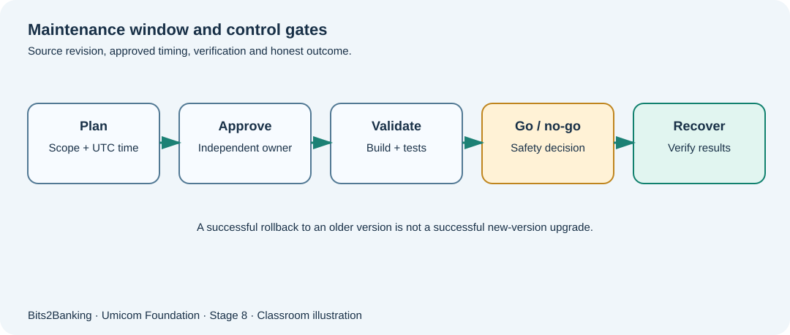

# Chapter 105 — Maintenance windows: plans, approvals, time zones and rollback decisions

**Bits to Banking · System Administration From Zero · Stage 8**  
**Prerequisites:** Course Chapters 1–96 provide optional foundation; this lesson explains new terms before use.  
**Audience:** Beginners, returning professionals, and supervised young learners.  
**Safety:** Read-only observations on a computer you own or are permitted to use. Never copy real secrets into exercises.

## What we are going to learn

A planned update is a controlled change. Learn to describe its scope, who approves it, when it can happen, what tests must pass and how to return to safety.



## Understand the idea before typing

A learner may think software installation is always one click. For a shared service, updates can affect data formats, ports, extensions and other applications. The correct unit of work is a **change plan** with a source revision, dependency check, tests, backup proof, owner, expected impact, window and rollback criteria.

Time zones matter: a window advertised as “02:00 on Sunday” might be ambiguous near daylight-saving transitions. Record the local timezone and a UTC reference when coordinating people in different places. A window is permission to attempt an approved action, not evidence that all checks passed. At each gate, the authorised operator decides whether to continue; a C23 training model may report missing checks but cannot grant operational permission.

## New terms explained

| Term | Plain-English meaning |
|---|---|
| **Change window** | An agreed period when a particular change may occur. |
| **Rollback** | Returning to a previous known working state when a change fails. |
| **Go/no-go gate** | A documented decision to continue or stop. |
| **Change freeze** | A policy restricting certain changes during sensitive periods. |
| **Maintenance ticket** | Record describing the request, approvals, evidence and result. |
| **UTC** | Coordinated Universal Time; useful for cross-region timelines. |


## Windows laboratory — PowerShell 7

Open **Windows Terminal → PowerShell** or search for **PowerShell**. The prompt looks like `PS C:\Users\...>`; do **not** type the prompt itself. On Windows PowerShell 5.1, read-only commands may still work, but the project teaches PowerShell 7. Type the commands one line at a time:

```powershell
Get-Date
Get-TimeZone
Get-Date -AsUTC
git --version
```

**What to expect:** PowerShell 7 supports `Get-Date -AsUTC`. The Git version command is a read-only example of identifying the tool that may be used during a change; it is not a test of an application release. The exact names, counts and times on your computer will differ; no precise output is assumed.

## Linux laboratory — terminal

Open your Linux terminal (for example a disposable virtual machine). These commands are read-only. If a command is unavailable, note your distribution and ask the instructor before installing anything.

```bash
date -Is
date -u -Is
timedatectl status
```

**What to expect:** `timedatectl` may be unavailable in containers or minimal guests; the first two commands still display local and UTC times. Do not change the system clock during this exercise.

## Worked Umicom case study

A fictional Notes workstation update is proposed for Saturday 10:00–11:00 UTC. The teaching team must first verify that the prior release artifact is available, the current Notes files have a tested backup and two owners agree to the plan. A CMake build passes but the new version cannot reopen existing sample documents. The decision is **stop**, preserve logs and return to the last known working image under an approved recovery procedure. Record that the *new update failed* even if restoration subsequently succeeds.

## What if something goes wrong?

| Observation | Safe response |
|---|---|
| Everyone agreed to “Sunday morning” | Convert to explicit date, UTC offset/timezone and affected location; confirm ambiguity around DST. |
| Build passes but acceptance test fails | Do not promote; keep evidence and follow the approved no-go/rollback decision. |
| A rollback ran | Verify data and user-facing service independently; do not call rollback successful merely because a command returned zero. |

## Guided learner exercise

1. Write a fictional maintenance ticket with source revision, window in UTC, owner, independent reviewer, tests, restore method and stop condition.
2. Distinguish a successful previous-version restoration from a successful installation of the proposed version.
3. Explain what evidence would be required to mark a change complete in a real organisation.

## Self-check and suggested answers

**Answer 1:** Restoration and new-release acceptance are separate outcomes; prior service recovery cannot change the result of a failed upgrade.

**Answer 2:** The owner needs verified business operation, revision identity, logs, approvals and successful required tests.

## What this proves — and what it does not

These exercises teach how to collect observations and describe decisions. They are not a certification of any real Umicom deployment. A command completing successfully does not automatically mean that a business operation finished. In live work, only an authorised owner should change service configuration, scheduled jobs, firewall policy, backup retention or credentials, after impact assessment and recovery planning. New reusable monitoring or scheduling software belongs in **Umicom Framework**, preferably implemented in C23 or Assembly rather than new PowerShell/Python scripts.

**Further reading:** [Stage 8 overview](stage-8-index.md) · [Safe command reference](stage-8-safe-command-reference.md) · [Stage 8 glossary](stage-8-glossary.md).
