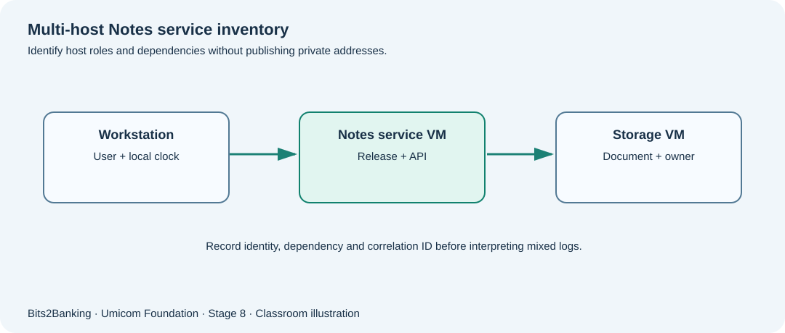

# Chapter 106 — Multi-machine administration: inventory, dependencies and accurate clocks

**Bits to Banking · System Administration From Zero · Stage 8**  
**Prerequisites:** Course Chapters 1–96 provide optional foundation; this lesson explains new terms before use.  
**Audience:** Beginners, returning professionals, and supervised young learners.  
**Safety:** Read-only observations on a computer you own or are permitted to use. Never copy real secrets into exercises.

## What we are going to learn

A service may run across several machines. Learn to identify which host does what, which revision it runs and why consistent timestamps are essential for diagnosis.



## Understand the idea before typing

A support note that says “the server was down” is often too vague. Which server? Which application revision? Was the reported problem on the user’s laptop, the data server or the network between them? A small inventory should record host role, owner, environment, expected dependencies and approved access path, without publishing sensitive addresses unnecessarily.

Across several machines, an event timestamp can appear to happen before its cause if clocks differ. Do not manually change system clocks as a quick fix. Record timezone offsets, clock source, and correlation identifiers before interpreting event order. A successful DNS lookup does not prove that a service is healthy; a successful TCP handshake does not prove that the right authenticated application answered.

## New terms explained

| Term | Plain-English meaning |
|---|---|
| **Inventory** | A list of machines, roles, operating systems and accountable owners. |
| **Host** | The computer running an operating system or workload. |
| **Endpoint** | The named address and port through which a service may be reached. |
| **Clock skew** | Difference between clocks that should agree sufficiently. |
| **Correlation identifier** | An identifier used to follow related operations across logs. |
| **Dependency map** | A diagram showing which services rely on others. |


## Windows laboratory — PowerShell 7

Open **Windows Terminal → PowerShell** or search for **PowerShell**. The prompt looks like `PS C:\Users\...>`; do **not** type the prompt itself. On Windows PowerShell 5.1, read-only commands may still work, but the project teaches PowerShell 7. Type the commands one line at a time:

```powershell
hostname
Get-ComputerInfo | Select-Object WindowsProductName, OsArchitecture
Get-Date -AsUTC
Get-NetIPAddress -AddressFamily IPv4 | Select-Object -First 5 InterfaceAlias, IPAddress
```

**What to expect:** These commands read information from the **current** Windows host only. IP addresses can be sensitive in screenshots; redact them before posting reports. Interface names vary widely. The exact names, counts and times on your computer will differ; no precise output is assumed.

## Linux laboratory — terminal

Open your Linux terminal (for example a disposable virtual machine). These commands are read-only. If a command is unavailable, note your distribution and ask the instructor before installing anything.

```bash
hostname
uname -m
date -u -Is
ip -brief address
```

**What to expect:** `ip -brief address` shows interface addresses on many Linux distributions. If `ip` is absent, ask the instructor about the installed networking tools; do not install as root just to complete the lesson.

## Worked Umicom case study

The fictional Notes topology has a student workstation, Notes service VM and storage VM. The workstation’s clock is five minutes ahead. The Notes service emits a “saved” event and the workstation logs “save requested” after it, confusing the student. The inventory reveals the three roles, separate clocks and the same fictional request ID. The operator notes clock skew and uses correlation data and independently observed request flow to reconstruct an honest incident timeline.

## What if something goes wrong?

| Observation | Safe response |
|---|---|
| Names like `server1` appear in logs | Cross-check with approved inventory and environment before attributing a fault. |
| Timestamps contradict message order | Record offsets and correlation IDs; identify clock skew before concluding an impossible sequence. |
| One port responds | Check authenticated application readiness and expected version rather than declaring the entire service healthy. |

## Guided learner exercise

1. Design a three-row inventory for a fictional Notes workstation, application host and storage VM. Do not include real IP addresses.
2. Draw arrows for two dependencies and state how you would verify them without privileged access.
3. Explain why UTC timestamps still require accurate clocks and recorded observation sources.

## Self-check and suggested answers

**Answer 1:** UTC normalises timezone representation, but cannot repair a machine clock that is incorrectly set.

**Answer 2:** Inventories reduce the risk of diagnosing or changing the wrong system.

## What this proves — and what it does not

These exercises teach how to collect observations and describe decisions. They are not a certification of any real Umicom deployment. A command completing successfully does not automatically mean that a business operation finished. In live work, only an authorised owner should change service configuration, scheduled jobs, firewall policy, backup retention or credentials, after impact assessment and recovery planning. New reusable monitoring or scheduling software belongs in **Umicom Framework**, preferably implemented in C23 or Assembly rather than new PowerShell/Python scripts.

**Further reading:** [Stage 8 overview](stage-8-index.md) · [Safe command reference](stage-8-safe-command-reference.md) · [Stage 8 glossary](stage-8-glossary.md).
