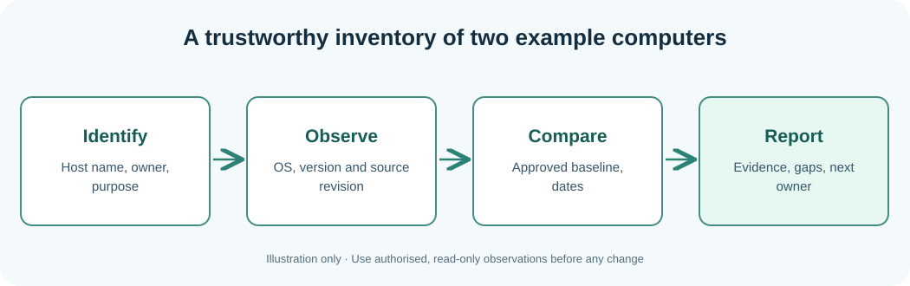

# Chapter 110 — Distinguish OS versions, patches and Umicom application releases

**Bits to Banking · System Administration From Zero · Stage 9**  
**Audience:** Absolute beginners, adults, returning professionals and supervised younger learners.  
**Safety:** Observe only your own computer or an explicitly authorised practice environment. Live changes are not required.

## Why this matters

A Windows or Linux operating-system release describes the system software; an application release describes a particular product. The compiler architecture is a third property. Updating the browser does not update Windows; checking the Windows build number does not tell you which version of Umicom Framework an application uses. A **patch history** helps explain which changes were installed and when, but available logs may be incomplete.

In incident work capture host identity, OS, architecture, running application build, source revision *if reliably known*, timestamp and evidence source. `git log` in a developer's checkout is not proof of what was deployed to a server. Avoid software installation or forced restarts during this read-only lesson.



## Learning objectives

After the lesson you should be able to explain the new terminology, run and understand a small read-only observation, distinguish observations from assumptions, and record the next safe action when a check is incomplete. A professional answer can be **not checked**, **not authorised** or **requires escalation**.

## Step-by-step Windows laboratory — PowerShell 7

Open Start, type **PowerShell**, and choose PowerShell 7 where available. Do not type the `PS C:\...>` prompt. Run each command one line at a time. PowerShell 5.1 may also run these read-only commands where the associated feature is installed.

```powershell
Get-ComputerInfo | Select-Object WindowsProductName, WindowsVersion, OsVersion, OsArchitecture
Get-HotFix | Select-Object -First 6 HotFixID, InstalledOn
Get-Command pwsh, git -ErrorAction SilentlyContinue | Select-Object Name, Source
```

**Interpret the result:** The output will describe *your* computer, not the fictional Umicom hosts. Names, dates and versions will differ. Record the time and the important fields. If the command cannot run or permission is denied, mark the observation incomplete rather than inventing a value. A command's exit status only reports the command's own work.

## Step-by-step Linux laboratory — Terminal

On Linux use an account you own or are permitted to use, preferably in a disposable VM. These are observational commands unless the lesson explicitly describes a practice file you create in your home directory; you do not need `sudo`.

```bash
cat /etc/os-release
uname -r
uname -m
dpkg-query -W git
```

**Interpret the result:** Not all distributions install the same management tools or use systemd. Preserve errors as troubleshooting evidence. Do not install random replacements, change unit files or edit firewall rules to make classroom output look identical to a screenshot.

### Which version does each command report?

Windows `OsVersion` is not the same as the output from `git --version`, and neither is the package identity of a deployed Umicom application. An update catalogue is not complete proof that every Windows component is patched. Linux `uname -r` reports the active kernel, while `/etc/os-release` identifies the distribution. If a package manager command is unavailable, write “Not Run — different distribution/tool unavailable” instead of interpreting it as a software fault.

## Worked Umicom example

`Get-HotFix` does not represent every Windows update channel. `dpkg-query` belongs to Debian-style systems; on Fedora the relevant command would be `rpm -qi git`. Record unavailable commands rather than inventing an installed version. When Umicom Notes reports revision A while a workspace is on B, do not automatically change the running application: first examine deployment and package evidence.

## Exercises

Create a five-row table that separates host OS, installed Notes version, Framework commit, evidence source and observed time. Which of those may differ between two otherwise similar machines?

## Suggested answer and review criteria

A complete answer names the host, exact observation, source, timestamp with a time-zone offset, and reviewer or next owner. It also states what the command **does not** prove. In particular, a process Running is not proof of a completed Notes save, and an old release restored after failure does not make the failed proposed release successful.

## Common questions

**What if my command gives an error?** Read the exact message and check where you are with `Get-Location` on Windows or `pwd` on Linux. If the tool is not installed, note that fact. If it requires permissions you do not have, stop and contact the owner.

**What if my output differs from the book?** Computers differ. Compare the *fields and meaning* rather than expecting the same host name, drive size or process list. Never fabricate a result.

**Can I apply these commands to another person's machine?** Only after permission has been given and the information has been classified appropriately. This course never grants system-administration authority.

**Further practice:** Review [Chapter 108](108-capstone-seven-day-operations-plan.md) for the seven-day plan, then complete the Stage 9 workbook and [Chapter 120](120-capstone-investigate-two-fictional-umicom-notes-hosts.md) for the two-host exercise.
