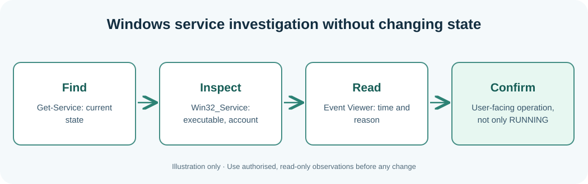

# Chapter 111 — Observe Windows services and diagnose failures safely

**Bits to Banking · System Administration From Zero · Stage 9**  
**Audience:** Absolute beginners, adults, returning professionals and supervised younger learners.  
**Safety:** Observe only your own computer or an explicitly authorised practice environment. Live changes are not required.

## Why this matters

A Windows **service** is a program managed by the Service Control Manager. `Get-Service` tells you whether Windows reports it Running or Stopped; `Win32_Service` also describes its launch configuration. An active process can still fail to save a Notes document or contact a dependency. **Liveness** (running) and **business correctness** (the required result) are different checks.

A service stopped deliberately is not automatically broken. A restart can erase useful timing evidence and should be treated as a change requiring approval. Only query services for which you have permission; service paths and accounts may reveal sensitive operational information.



## Learning objectives

After the lesson you should be able to explain the new terminology, run and understand a small read-only observation, distinguish observations from assumptions, and record the next safe action when a check is incomplete. A professional answer can be **not checked**, **not authorised** or **requires escalation**.

## Step-by-step Windows laboratory — PowerShell 7

Open Start, type **PowerShell**, and choose PowerShell 7 where available. Do not type the `PS C:\...>` prompt. Run each command one line at a time. PowerShell 5.1 may also run these read-only commands where the associated feature is installed.

```powershell
Get-Service | Select-Object -First 10 Name, Status, StartType
Get-CimInstance Win32_Service | Select-Object -First 10 Name, State, StartMode, StartName
Get-WinEvent -ListLog System | Select-Object -First 5 LogName, RecordCount
```

**Interpret the result:** The output will describe *your* computer, not the fictional Umicom hosts. Names, dates and versions will differ. Record the time and the important fields. If the command cannot run or permission is denied, mark the observation incomplete rather than inventing a value. A command's exit status only reports the command's own work.

## Step-by-step Linux laboratory — Terminal

On Linux use an account you own or are permitted to use, preferably in a disposable VM. These are observational commands unless the lesson explicitly describes a practice file you create in your home directory; you do not need `sudo`.

```bash
systemctl list-units --type=service --all --no-pager | head -n 10
systemctl is-system-running
```

**Interpret the result:** Not all distributions install the same management tools or use systemd. Preserve errors as troubleshooting evidence. Do not install random replacements, change unit files or edit firewall rules to make classroom output look identical to a screenshot.

### Read a service record

`Name` is the service's internal identifier. `Status` tells you what the service manager currently reports. `StartType` or `StartMode` describes whether it is configured to start automatically or manually. They describe different dimensions. `StartName` may reveal a sensitive account label, so redact it before publishing classroom screenshots. `Get-WinEvent -ListLog System` reports log information; it does **not** show a complete historical explanation of the selected service. Use approved log filters only after choosing a particular incident.

## Worked Umicom example

Fictional Notes synchronisation service reports Running, but a save operation fails. Record: host, observation time, service name, reported state, Notes save failure, dependency hypotheses and next owner. Do **not** record service Running as Notes healthy; ask the authorised operator to check document storage and relevant logs.

## Exercises

Explain the difference between startup configuration and current state. How could a Windows service be Running while its user-facing feature remains unavailable?

## Suggested answer and review criteria

A complete answer names the host, exact observation, source, timestamp with a time-zone offset, and reviewer or next owner. It also states what the command **does not** prove. In particular, a process Running is not proof of a completed Notes save, and an old release restored after failure does not make the failed proposed release successful.

## Common questions

**What if my command gives an error?** Read the exact message and check where you are with `Get-Location` on Windows or `pwd` on Linux. If the tool is not installed, note that fact. If it requires permissions you do not have, stop and contact the owner.

**What if my output differs from the book?** Computers differ. Compare the *fields and meaning* rather than expecting the same host name, drive size or process list. Never fabricate a result.

**Can I apply these commands to another person's machine?** Only after permission has been given and the information has been classified appropriately. This course never grants system-administration authority.

**Further practice:** Review [Chapter 108](108-capstone-seven-day-operations-plan.md) for the seven-day plan, then complete the Stage 9 workbook and [Chapter 120](120-capstone-investigate-two-fictional-umicom-notes-hosts.md) for the two-host exercise.
