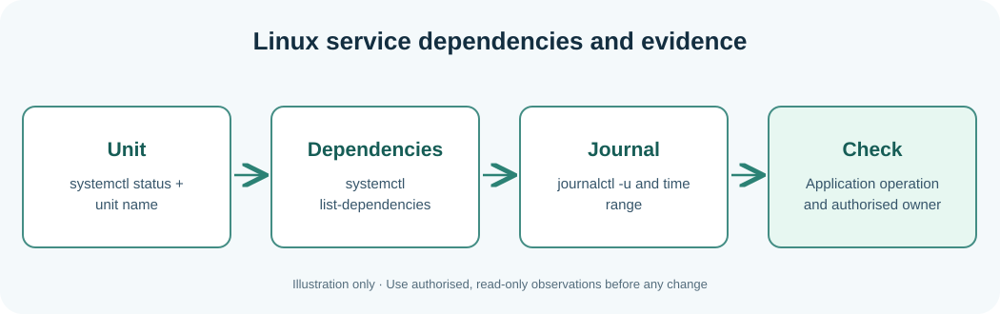

# Chapter 112 — Inspect Linux systemd units and journal evidence

**Bits to Banking · System Administration From Zero · Stage 9**  
**Audience:** Absolute beginners, adults, returning professionals and supervised younger learners.  
**Safety:** Observe only your own computer or an explicitly authorised practice environment. Live changes are not required.

## Why this matters

Many Linux machines use **systemd** to supervise services. A **unit** describes a service and often its dependencies; the journal collects messages. Linux machines without systemd have other service managers, so adapt only after identifying the actual system. The presence of a process is not sufficient evidence that an application is ready.

Distinguish `list-unit-files` (known unit declarations) from `list-units --all` (loaded unit states). A request might fail because a filesystem became read-only even though the application unit stayed active. Logs should be examined within a relevant time range, and clock offsets should be recorded when comparing hosts. This lesson does not restart, enable or edit units.



## Learning objectives

After the lesson you should be able to explain the new terminology, run and understand a small read-only observation, distinguish observations from assumptions, and record the next safe action when a check is incomplete. A professional answer can be **not checked**, **not authorised** or **requires escalation**.

## Step-by-step Windows laboratory — PowerShell 7

Open Start, type **PowerShell**, and choose PowerShell 7 where available. Do not type the `PS C:\...>` prompt. Run each command one line at a time. PowerShell 5.1 may also run these read-only commands where the associated feature is installed.

```powershell
Get-Service | Select-Object -First 8 Name, Status
# On Windows, services are not systemd units.
```

**Interpret the result:** The output will describe *your* computer, not the fictional Umicom hosts. Names, dates and versions will differ. Record the time and the important fields. If the command cannot run or permission is denied, mark the observation incomplete rather than inventing a value. A command's exit status only reports the command's own work.

## Step-by-step Linux laboratory — Terminal

On Linux use an account you own or are permitted to use, preferably in a disposable VM. These are observational commands unless the lesson explicitly describes a practice file you create in your home directory; you do not need `sudo`.

```bash
systemctl list-units --type=service --all --no-pager | head -n 12
systemctl list-dependencies --no-pager systemd-journald.service
systemctl status systemd-journald.service --no-pager
journalctl -u systemd-journald.service --since today --no-pager -n 20
```

**Interpret the result:** Not all distributions install the same management tools or use systemd. Preserve errors as troubleshooting evidence. Do not install random replacements, change unit files or edit firewall rules to make classroom output look identical to a screenshot.

### Read the systemd output

A unit name often ends with `.service`; a directory or device can be represented by other kinds of units. `loaded`, `active` and `sub` columns describe different levels of state. A unit may be loaded but inactive, or active while a dependency is unhealthy. A journal viewer can return fewer entries because of permissions or retention. Do not use `systemctl restart`, `enable` or `daemon-reload` during this lesson—they modify service state or configuration.

## Worked Umicom example

Imagine Notes frontend → Notes storage → mounted data directory. If the directory becomes read-only, restarting the frontend is unlikely to fix the root cause. On your disposable Linux machine inspect a unit's status and dependencies. If journal access is denied, record “journal unavailable to this account”; it is not proof that nothing happened.

## Exercises

What is the difference between a unit's state, its dependencies and the successful execution of a Notes save operation?

## Suggested answer and review criteria

A complete answer names the host, exact observation, source, timestamp with a time-zone offset, and reviewer or next owner. It also states what the command **does not** prove. In particular, a process Running is not proof of a completed Notes save, and an old release restored after failure does not make the failed proposed release successful.

## Common questions

**What if my command gives an error?** Read the exact message and check where you are with `Get-Location` on Windows or `pwd` on Linux. If the tool is not installed, note that fact. If it requires permissions you do not have, stop and contact the owner.

**What if my output differs from the book?** Computers differ. Compare the *fields and meaning* rather than expecting the same host name, drive size or process list. Never fabricate a result.

**Can I apply these commands to another person's machine?** Only after permission has been given and the information has been classified appropriately. This course never grants system-administration authority.

**Further practice:** Review [Chapter 108](108-capstone-seven-day-operations-plan.md) for the seven-day plan, then complete the Stage 9 workbook and [Chapter 120](120-capstone-investigate-two-fictional-umicom-notes-hosts.md) for the two-host exercise.
